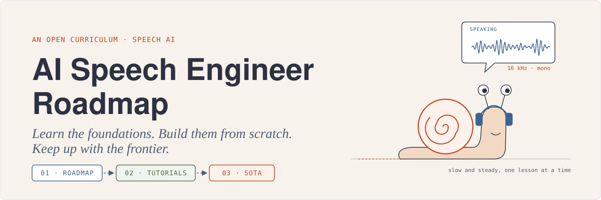
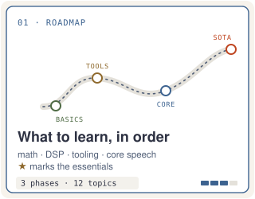
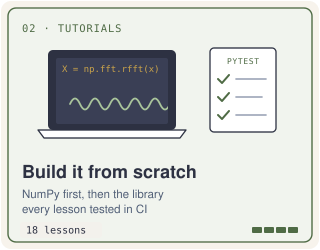
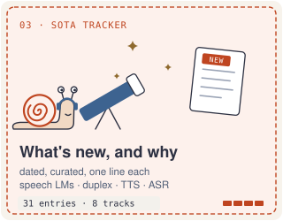
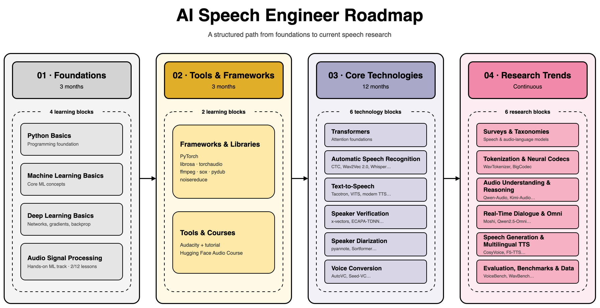

<div align="center">



[](https://github.com/leminhnguyen/ai-speech-engineer-roadmap/actions/workflows/ci.yml)
[](https://github.com/leminhnguyen/ai-speech-engineer-roadmap/stargazers)
[](LICENSE)

[Roadmap](roadmap/README.md) · [Tutorials](tutorials/README.md) · [SOTA Tracker](sota/README.md) · [Quick start](#-quick-start)

</div>

<table>
<tr>
<td width="33%" valign="top">
<a href="roadmap/README.md"></a>
</td>
<td width="33%" valign="top">
<a href="tutorials/README.md"></a>
</td>
<td width="33%" valign="top">
<a href="sota/README.md"></a>
</td>
</tr>
</table>

## 🧭 Where to Start

| You are… | Go to |
| --- | --- |
| 🌱 New to speech | [01 · Foundations](roadmap/01-foundations.md), with the [tutorials](tutorials/README.md) alongside |
| 🔬 Want to understand, not just call libraries | [Lesson 01 · Sound and Waveforms](tutorials/01-audio-signal-processing/01-sound-and-waveforms/docs/en.md) |
| 🚀 Already working in speech | [SOTA Tracker](sota/README.md), starting with the [surveys](sota/topics/surveys.md) |
| ☎️ Building a phone voice agent | [AI Contact Center with LiveKit](tutorials/04-ai-contact-center/README.md) |
| 🇻🇳 Building for Vietnamese | [Vietnamese Speech](roadmap/vietnamese-speech.md) |

## 🗺️ The Roadmap

[](roadmap/README.md)

<sub>Durations are guidelines. Move on when you can explain the idea, rebuild it small, and name its failure modes.</sub>

## 🛠️ Tutorials

Implement it in NumPy → prove it with tests → compare it with the production library.

| Module | Lessons | You will build |
| --- | :---: | --- |
| 🔊 [**Audio Signal Processing**](tutorials/README.md#-01--audio-signal-processing) |  | Waveforms → DFT/STFT → mel & MFCC → spectral features → pitch |
| ☎️ [**AI Contact Center with LiveKit**](tutorials/04-ai-contact-center/README.md) |  | SIP & G.711 → jitter, noise, echo → VAD, turn-taking, barge-in → latency |

<sub>Next up: Speech Recognition and Speech Synthesis.</sub>

## 🆕 What's New in Speech AI

<!-- BEGIN LATEST -->
| Date | Work | Track | Why it matters |
| :---: | --- | --- | --- |
| 2026-07 | **DuplexChat** | [Evaluation, Benchmarks & Data](sota/topics/evaluation.md) | Large-scale, speaker-separated dialogue speech for training full-duplex models. |
| 2026-04 | ⭐ **OmniVoice** | [Speech Generation & Multilingual TTS](sota/topics/generation.md) | Pushes zero-shot TTS toward omnilingual coverage with a diffusion language model. |
| 2026-04 | ⭐ **HumDial-FDBench** | [Evaluation, Benchmarks & Data](sota/topics/evaluation.md) | Benchmark for full-duplex interaction quality in spoken dialogue systems. |
| 2026-03 | ⭐ **Gipformer** 🇻🇳 | [Speech Recognition](sota/topics/asr.md) | 68M Zipformer RNN-T for Vietnamese call-center speech, MIT-licensed; v1.5 beats PhoWhisper-large on hard call-center test sets. |
| 2026-02 | **WavBench** | [Evaluation, Benchmarks & Data](sota/topics/evaluation.md) | Evaluates spoken models on reasoning, colloquial speech, and paralinguistic cues. |
<!-- END LATEST -->

<sub>⭐ = must-read · [All entries →](sota/README.md)</sub>

## 🚀 Quick Start

```bash
git clone https://github.com/leminhnguyen/ai-speech-engineer-roadmap.git && cd ai-speech-engineer-roadmap
python3 -m venv .venv && source .venv/bin/activate
pip install -r requirements.txt
make check   # audit lessons, run tests, verify the SOTA tracker
```

## 🤝 Contributing

Fix a resource, propose a SOTA entry, or write a lesson. [CONTRIBUTING.md](CONTRIBUTING.md) explains how each pillar accepts changes.

<details>
<summary><b>📝 Citation</b></summary>

```bibtex
@misc{nguyen2026aispeechroadmap,
  author = {Nguyen, Le Minh},
  title  = {AI Speech Engineer Roadmap},
  year   = {2026},
  url    = {https://github.com/leminhnguyen/ai-speech-engineer-roadmap}
}
```

</details>

<div align="center">
<br/>

<a href="https://star-history.com/#leminhnguyen/ai-speech-engineer-roadmap&Date">
  
</a>

**If this helps you, give it a ⭐ so others can find it.**

<sub>MIT License · Inspired by [Audio Signal Processing for ML](https://github.com/musikalkemist/AudioSignalProcessingForML) and [AI Engineering From Scratch](https://github.com/patchwork-ai/ai-engineering-from-scratch) · [Acknowledgments](ACKNOWLEDGMENTS.md)</sub>

</div>
