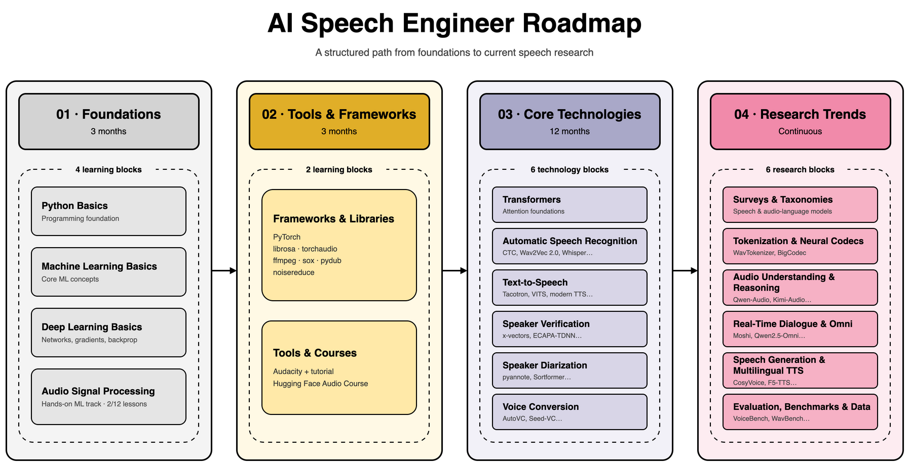

<div align="center">

# 🐌 AI Speech Engineer Roadmap

**Learn the foundations. Build them from scratch. Keep up with the frontier.**

A practical, end-to-end resource for becoming an AI Speech Engineer: from signal processing to ASR, TTS, speaker technologies, voice conversion, and today's audio-language models.

[](https://github.com/leminhnguyen/ai-speech-engineer-roadmap/actions/workflows/ci.yml)
[](https://github.com/leminhnguyen/ai-speech-engineer-roadmap/stargazers)
[](https://github.com/leminhnguyen/ai-speech-engineer-roadmap/commits/master)
[](https://www.python.org/)
[](LICENSE)
[](CONTRIBUTING.md)

[🗺️ Roadmap](roadmap/README.md) ·
[🛠️ Tutorials](tutorials/README.md) ·
[📡 SOTA Tracker](sota/README.md) ·
[🚀 Getting Started](#-getting-started) ·
[🤝 Contributing](CONTRIBUTING.md)

</div>

---

## 🧩 Three Pillars

Speech AI sits at the intersection of signal processing, deep learning, and linguistics, and the good material is scattered across courses, papers, and library docs. This repository organizes it into three parts, each with its own pace of change:

<table>
<tr>
<td width="33%" valign="top">

### 🗺️ [Roadmap](roadmap/README.md)

**What to learn, and in what order.**

A curated path through the knowledge that stays useful for years: math and ML, audio signal processing, the standard toolkit, and the core speech technologies.

⭐ marks the essentials.

*Changes: rarely*

</td>
<td width="33%" valign="top">

### 🛠️ [Tutorials](tutorials/README.md)

**Build it to understand it.**

Hands-on lessons that implement each concept with NumPy, prove it with tests, then compare it with production libraries.

Every lesson runs in CI.

*Changes: as lessons are added*

</td>
<td width="33%" valign="top">

### 📡 [SOTA Tracker](sota/README.md)

**What is new, and why it matters.**

A dated, curated timeline of new models, codecs, benchmarks, and surveys, grouped by track: speech LMs, full-duplex dialogue, TTS, ASR, and more.

*Changes: continuously*

</td>
</tr>
</table>

## 🧭 Choose Your Path

| If you are… | Start here | Then |
| --- | --- | --- |
| 🌱 **New to speech** | [Roadmap · 01 Foundations](roadmap/01-foundations.md) | Work through the [tutorials](tutorials/README.md) alongside it |
| 🔬 **Want to understand deeply** | [Lesson 01 · Sound and Waveforms](tutorials/01-audio-signal-processing/01-sound-and-waveforms/docs/en.md) | Continue to [Core Speech Technologies](roadmap/03-core-speech-technologies.md) |
| 🚀 **Already working in speech** | [SOTA Tracker](sota/README.md) | Start with the [surveys](sota/topics/surveys.md), then your track |
| 🇻🇳 **Building for Vietnamese** | [Vietnamese Speech](roadmap/vietnamese-speech.md) | VLSP reports, phonemizers, theses, and Vietnamese models |

## 🗺️ The Roadmap at a Glance

[](roadmap/README.md)

| Phase | Duration | What you will learn |
| --- | :---: | --- |
| 🧠 [**01 · Foundations**](roadmap/01-foundations.md) | 3 months | Python, machine learning, deep learning, and audio signal processing |
| 💼 [**02 · Tools & Frameworks**](roadmap/02-tools-and-frameworks.md) | 3 months | PyTorch, librosa, torchaudio, audio utilities, and the Hugging Face Audio course |
| 🌱 [**03 · Core Speech Technologies**](roadmap/03-core-speech-technologies.md) | 12 months | Transformers, ASR, TTS, speaker verification, speaker diarization, and voice conversion |
| 📡 [**SOTA Tracker**](sota/README.md) | Continuous | Speech tokenization, audio-language models, real-time dialogue, generation, and evaluation |

Durations are guidelines, not deadlines. Move on when you can explain the core idea, reproduce a small implementation, and describe its failure modes.

## 🛠️ Tutorial Progress

| Module | Progress | |
| --- | --- | --- |
| 🔊 **01 · Audio Signal Processing** |  | Waveforms → sampling → DFT/STFT → mel & MFCC → spectral features → pitch |
| 🎙️ **02 · Speech Recognition** |  | |
| 🗣️ **03 · Speech Synthesis** |  | |

**[→ See all lessons](tutorials/README.md)**

## 🆕 What's New in Speech AI

The five most recent entries in the [SOTA tracker](sota/README.md). ⭐ = must-read.

<!-- BEGIN LATEST -->
| Date | Work | Track | Why it matters |
| :---: | --- | --- | --- |
| 2026-07 | **DuplexChat** | [Evaluation, Benchmarks & Data](sota/topics/evaluation.md) | Large-scale, speaker-separated dialogue speech for training full-duplex models. |
| 2026-04 | ⭐ **OmniVoice** | [Speech Generation & Multilingual TTS](sota/topics/generation.md) | Pushes zero-shot TTS toward omnilingual coverage with a diffusion language model. |
| 2026-04 | ⭐ **HumDial-FDBench** | [Evaluation, Benchmarks & Data](sota/topics/evaluation.md) | Benchmark for full-duplex interaction quality in spoken dialogue systems. |
| 2026-02 | **WavBench** | [Evaluation, Benchmarks & Data](sota/topics/evaluation.md) | Evaluates spoken models on reasoning, colloquial speech, and paralinguistic cues. |
| 2026-01 | **Qwen3-TTS** | [Speech Generation & Multilingual TTS](sota/topics/generation.md) | Multilingual TTS from the Qwen3 family. |
<!-- END LATEST -->

## 🚀 Getting Started

**Prerequisites:** Python 3.11+, `make`, and Git.

```bash
git clone https://github.com/leminhnguyen/ai-speech-engineer-roadmap.git
cd ai-speech-engineer-roadmap

python3 -m venv .venv
source .venv/bin/activate          # Windows: .venv\Scripts\Activate.ps1
python -m pip install --upgrade pip
python -m pip install -r requirements.txt

make check                         # audit lessons, run tests, verify the SOTA tracker
```

<details>
<summary><b>All commands</b></summary>
<br/>

| Command | What it does |
| --- | --- |
| `make audit` | Verify every lesson has the required files |
| `make test` | Run the unit tests of every lesson |
| `make figures` | Regenerate lesson plots |
| `make notebooks` | Execute every notebook from a clean state |
| `make sota` | Rebuild the SOTA tracker pages from `sota/data/entries.yaml` |
| `make sota-check` | Fail if the SOTA pages are out of date (used in CI) |
| `make check` | `audit` + `test` + `sota-check` |

</details>

## 📂 Repository Structure

```text
.
├── roadmap/                    # 🗺️ Pillar 1: what to learn, in order
│   ├── README.md               #    Overview, diagram, and phases
│   ├── 01-foundations.md
│   ├── 02-tools-and-frameworks.md
│   ├── 03-core-speech-technologies.md
│   └── vietnamese-speech.md
├── tutorials/                  # 🛠️ Pillar 2: build it from scratch
│   ├── README.md               #    Module and lesson index
│   ├── LESSON_TEMPLATE.md
│   └── 01-audio-signal-processing/
├── sota/                       # 📡 Pillar 3: what is new
│   ├── README.md               #    Big picture, tracks, latest additions
│   ├── data/entries.yaml       #    Single source of truth
│   └── topics/                 #    Generated, one page per track
├── materials/                  # Theses and VLSP reports
├── assets/                     # Shared images
├── scripts/                    # Lesson audit and SOTA page builder
└── Makefile
```

## 🤝 Contributing

Fix a resource, propose a SOTA entry, or write a lesson. See [CONTRIBUTING.md](CONTRIBUTING.md) for how each pillar accepts changes.

## ⭐ Star History

<a href="https://star-history.com/#leminhnguyen/ai-speech-engineer-roadmap&Date">
  
</a>

## 📝 Citation

```bibtex
@misc{nguyen2026aispeechroadmap,
  author = {Nguyen, Le Minh},
  title  = {AI Speech Engineer Roadmap},
  year   = {2026},
  url    = {https://github.com/leminhnguyen/ai-speech-engineer-roadmap}
}
```

## 🙏 Acknowledgments

The tutorial sequence was informed by [Audio Signal Processing for Machine Learning](https://github.com/musikalkemist/AudioSignalProcessingForML) and the lesson-first layout by [AI Engineering From Scratch](https://github.com/patchwork-ai/ai-engineering-from-scratch). See [ACKNOWLEDGMENTS.md](ACKNOWLEDGMENTS.md).

## 📄 License

Distributed under the [MIT License](LICENSE).

<div align="center">
<br/>

**If this helps you, give it a ⭐ so others can find it.**

[⬆ Back to top](#-ai-speech-engineer-roadmap)

</div>
