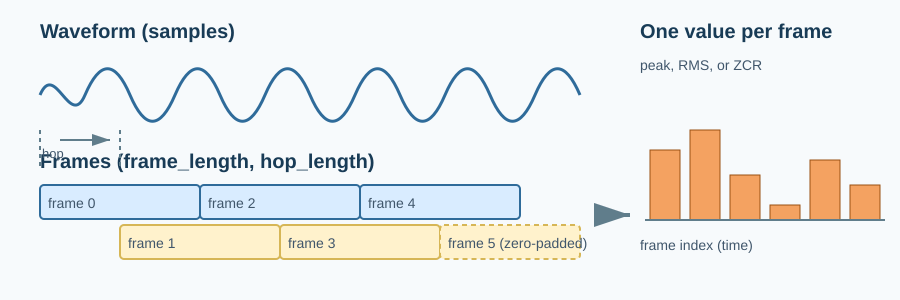
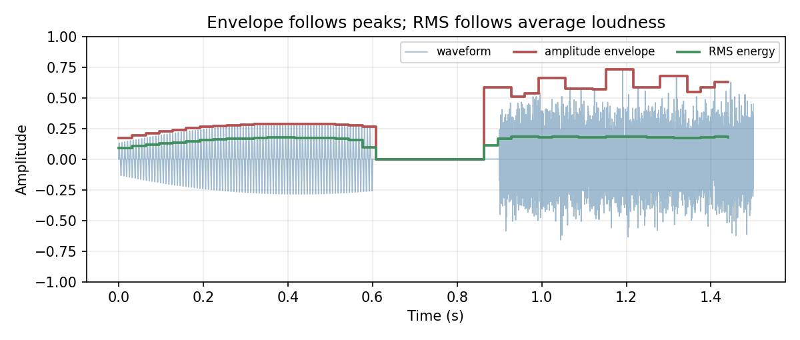
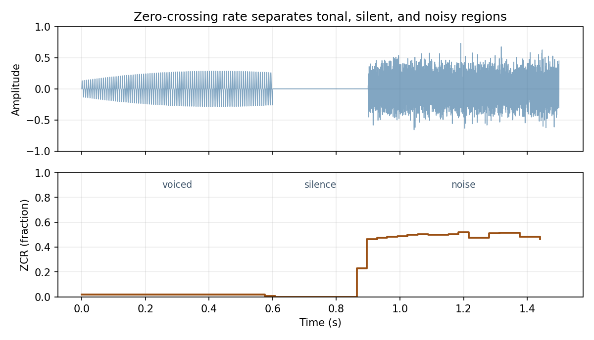

# Time-Domain Features: Envelope, RMS Energy, and Zero-Crossing Rate

> A model rarely reads raw samples one by one; it reads short frames and asks each one a simple question.

**Type:** Learn + Build  
**Language:** Python  
**Prerequisites:** [Digital Audio](../../02-digital-audio/docs/en.md)  
**Time:** ~50 minutes

## Learning Objectives

- Split a signal into overlapping frames with a frame length and hop length.
- Compute the amplitude envelope, RMS energy, and zero-crossing rate per frame.
- Predict the RMS of a sine wave and the zero-crossing rate of a pure tone.
- Convert a frame index back to time in seconds.
- Reproduce `librosa.feature.rms` and `librosa.feature.zero_crossing_rate` and explain where they differ.

## The Problem

One second of 16 kHz audio is 16,000 numbers. Loudness, silence, and noisiness are all visible in a waveform plot, but no single sample carries any of them. A sample is just one pressure reading. These properties only exist across a *stretch* of samples.



Feature extraction therefore begins with **framing**: cut the signal into short windows of `frame_length` samples, start a new window every `hop_length` samples, and compute one number per window. The result is a much shorter sequence that describes how the signal evolves over time. Every spectrogram, mel feature, and MFCC in later lessons starts from exactly this step.

## The Mental Model

Typical values for speech are a frame of 20 to 32 ms and a hop of half that, so 1024 and 512 samples at 16 kHz. Frames overlap so that an event landing on a frame boundary is still seen whole by a neighbouring frame.

Three classic time-domain features answer three questions about a frame $x$ of length $L$:

**Amplitude envelope: how big is the biggest swing?**

$$AE_t = \max_{n \in \text{frame } t} |x[n]|$$

**RMS energy: how loud is it on average?**

$$RMS_t = \sqrt{\frac{1}{L}\sum_{n \in \text{frame } t} x[n]^2}$$

RMS is a better loudness proxy than the envelope because it is insensitive to a single spike. For a sine wave of amplitude $A$, the RMS is exactly $A/\sqrt{2}$. RMS is often reported in decibels, $20\log_{10}(RMS)$, because perceived loudness is closer to logarithmic than linear.



**Zero-crossing rate: how often does the sign flip?**

$$ZCR_t = \frac{1}{L-1}\sum_{n} \mathbf{1}\big[\operatorname{sign}(x[n]) \neq \operatorname{sign}(x[n+1])\big]$$

A pure tone at $f$ Hz crosses zero $2f$ times per second, so its ZCR is about $2f / sr$. Voiced speech, dominated by low harmonics, has a low ZCR. Fricatives such as /s/ and broadband noise flip sign almost every other sample and have a high ZCR. This makes ZCR a cheap voiced/unvoiced and speech/noise cue.



## Build It with NumPy

`code/main.py` implements framing once and derives all three features from it. Framing builds an index matrix so the whole operation is vectorized:

```python
def frame_signal(samples, frame_length, hop_length):
    num_frames = 1 + int(np.ceil(max(len(samples) - frame_length, 0) / hop_length))
    padded_length = (num_frames - 1) * hop_length + frame_length
    padded = np.pad(samples, (0, padded_length - len(samples)))
    starts = np.arange(num_frames) * hop_length
    indices = starts[:, None] + np.arange(frame_length)[None, :]
    return padded[indices]  # shape: (num_frames, frame_length)
```

With frames in hand, each feature is one line:

```python
envelope = np.max(np.abs(frames), axis=1)
rms = np.sqrt(np.mean(frames ** 2, axis=1))
zcr = np.mean(np.abs(np.diff(np.sign(frames), axis=1)) > 0, axis=1)
```

Run it from this lesson directory:

```bash
python3 code/main.py
python3 code/generate_figures.py --output-dir assets/generated
```

The script concatenates a soft 200 Hz tone with a loud 2 kHz tone and prints the three features for each half.

## Validate the Idea

The unit tests check facts you can derive by hand: a 1024-sample frame with hop 512 over 10 samples yields the expected frame starts, the RMS of a 0.8-amplitude sine is $0.8/\sqrt{2}$, silence has zero RMS and zero ZCR, an alternating ±1 sequence has ZCR of exactly 1, and a 400 Hz tone at 8 kHz has ZCR of $2 \cdot 400 / 8000 = 0.1$.

## Use It in Practice

`librosa` implements the same features. Pass `center=False` to frame the signal from sample 0 the way `frame_signal` does:

```python
import librosa

rms = librosa.feature.rms(y=signal, frame_length=1024, hop_length=512, center=False)[0]
zcr = librosa.feature.zero_crossing_rate(signal, frame_length=1024, hop_length=512, center=False)[0]
times = librosa.frames_to_time(range(len(rms)), sr=16_000, hop_length=512)
```

RMS matches the NumPy version to floating-point precision. Two details differ. First, librosa drops a trailing partial frame, while this lesson zero-pads it, so the NumPy result may be one frame longer. Second, librosa's ZCR counts crossings slightly differently at frame edges and divides by `frame_length` rather than `frame_length - 1`, giving differences around 0.001. Neither matters for a model, but you should know why two "identical" feature extractors disagree by one frame.

In modern speech models these hand-crafted features are rarely the input. RMS still drives voice-activity detection, silence trimming, and loudness normalization, and ZCR remains a fast heuristic on embedded devices. More importantly, the framing machinery here is the first half of the short-time Fourier transform.

## Pitfalls

- Frame length trades time resolution for stability. Very short frames make RMS and ZCR jumpy; very long frames blur onsets.
- Hop length sets the feature rate. A 512-sample hop at 16 kHz yields 31.25 feature vectors per second, regardless of frame length.
- `center=True`, the librosa default, pads half a frame on each side so frame `t` is centred on sample `t * hop_length`. Mixing centred and uncentred features misaligns them by half a frame.
- Exact zeros have no sign. Decide how to treat them before computing ZCR, or digital silence produces spurious crossings.
- RMS in linear units compresses quiet passages. Convert to dB with a floor before plotting or thresholding.

## Exercises

1. Compute RMS for hop lengths of 128, 512, and 2048 on the same signal and compare how sharply each tracks the boundary at 0.5 s.
2. Generate white noise with `np.random.default_rng(0).normal(size=16_000)`. Predict its ZCR, then measure it.
3. Build a two-line voice-activity detector: mark a frame active when RMS in dB exceeds a threshold. Test it on a tone with silence gaps and explain a case where ZCR helps and RMS alone fails.

## Key Terms

| Term | Meaning |
| --- | --- |
| Frame | A short, fixed-length window of consecutive samples. |
| Hop length | Number of samples between the starts of consecutive frames. |
| Amplitude envelope | Maximum absolute sample value in each frame. |
| RMS energy | Root of the mean squared sample value; a loudness proxy. |
| Zero-crossing rate | Fraction of adjacent sample pairs whose sign differs. |
| Decibel (dB) | Logarithmic ratio to a reference; $20\log_{10}$ for amplitudes. |

## Further Reading

- [Audio Signal Processing for ML: Time-domain audio features](https://www.youtube.com/watch?v=SRrQ_v-OOSg)
- [librosa `feature.rms`](https://librosa.org/doc/latest/generated/librosa.feature.rms.html)
- [librosa `feature.zero_crossing_rate`](https://librosa.org/doc/latest/generated/librosa.feature.zero_crossing_rate.html)
- [The Scientist and Engineer's Guide to DSP: Statistics, Probability and Noise](https://www.dspguide.com/ch2.htm)
