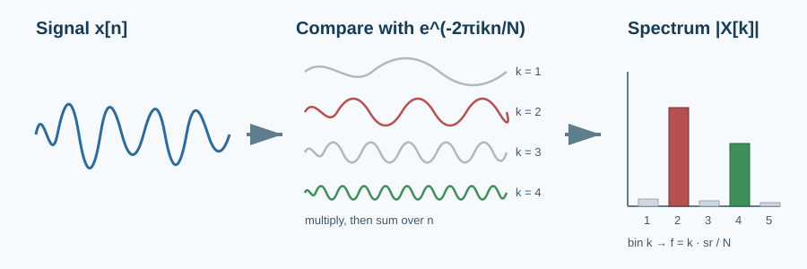
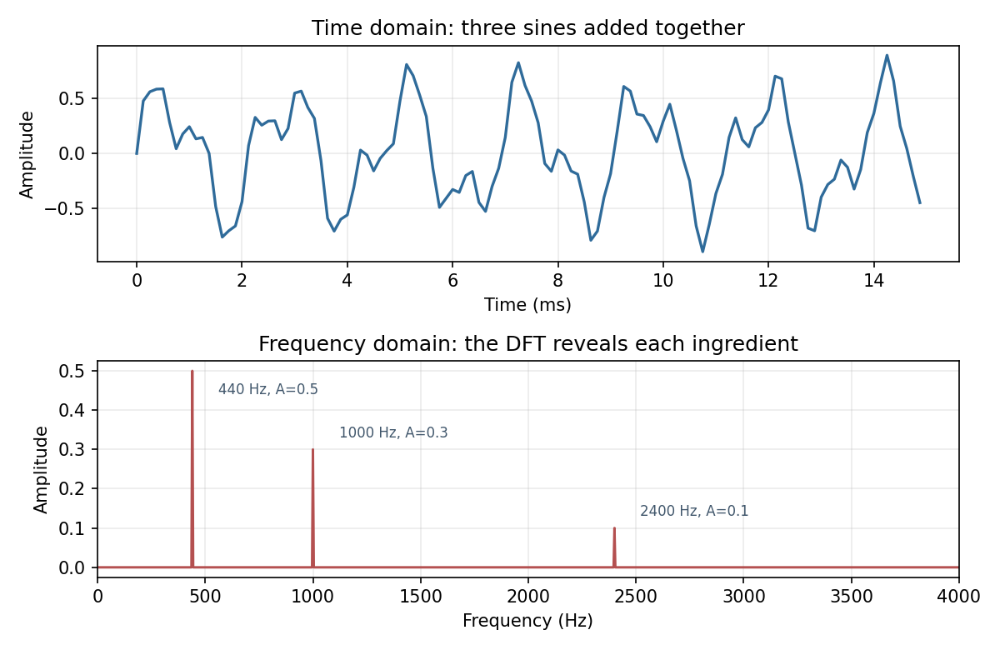
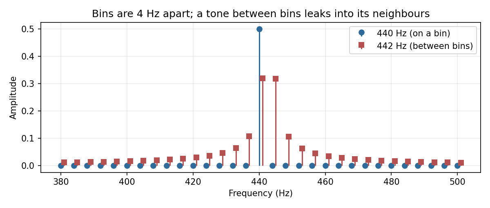

# The Discrete Fourier Transform

> Every signal is a sum of sinusoids. The DFT asks, one frequency at a time, how much of each is present.

**Type:** Learn + Build  
**Language:** Python  
**Prerequisites:** [Time-Domain Features](../../03-time-domain-features/docs/en.md), complex numbers at the level of $e^{i\theta} = \cos\theta + i\sin\theta$  
**Time:** ~60 minutes

## Learning Objectives

- State the DFT and its inverse and explain what each term does.
- Implement the DFT from its definition and verify it against `np.fft.fft`.
- Map a bin index to a frequency in hertz and compute the frequency resolution.
- Read a one-sided magnitude spectrum and recover the amplitude of each component.
- Recognise spectral leakage and explain why a longer signal sharpens the spectrum.

## The Problem

The previous two lessons used `np.fft.rfft` as a black box to check that a tone had the frequency we intended. That is fine for a test, but a speech engineer needs to know what the numbers mean. Which bin is 300 Hz? Why does a 442 Hz tone smear across several bins? Why are half the outputs redundant? Why is the magnitude scaled by the signal length?



A waveform hides its ingredients. Two tones added together look like a wobbly line. The Fourier transform changes the coordinate system so that each ingredient becomes a single spike. Spectrograms, mel features, and MFCCs are all built on top of this one operation.

## The Mental Model

Take $N$ samples $x[0], \dots, x[N-1]$. For each candidate frequency index $k$, multiply the signal by a reference sinusoid that completes exactly $k$ cycles over the $N$ samples, then sum:

$$X[k] = \sum_{n=0}^{N-1} x[n]\, e^{-2\pi i k n / N}, \qquad k = 0, \dots, N-1$$

The complex exponential is a rotating point on the unit circle. If the signal contains a component that rotates at the same rate, the products line up and the sum is large. If not, the products point in every direction and cancel. $X[k]$ is therefore a *correlation* between the signal and frequency $k$. Its magnitude $|X[k]|$ is how much of that frequency is present; its angle is the phase.

Three consequences follow directly from the formula.

**Bin $k$ corresponds to $f_k = k \cdot sr / N$ hertz.** Adjacent bins are $sr / N$ apart, so more samples give finer frequency resolution. A quarter second at 8 kHz has 2,000 samples and 4 Hz bins.

**Real signals produce a mirror-image spectrum.** $X[N-k] = \overline{X[k]}$, so bins above $N/2$ repeat the information below. That is why `np.fft.rfft` returns only $N/2 + 1$ values and why the highest useful frequency is the Nyquist frequency from Lesson 02.

**The inverse is the same sum with the opposite sign and a $1/N$ factor.**

$$x[n] = \frac{1}{N}\sum_{k=0}^{N-1} X[k]\, e^{+2\pi i k n / N}$$

Nothing is lost. The DFT is a change of basis, not a compression.



## Build It with NumPy

`code/main.py` writes the definition out as an $N \times N$ matrix of complex exponentials and multiplies it by the signal. It is $O(N^2)$ and deliberately so: you can read it line by line against the formula.

```python
def dft(samples):
    n = len(samples)
    index = np.arange(n)
    twiddle = np.exp(-2j * np.pi * np.outer(index, index) / n)
    return np.einsum("kn,n->k", twiddle, samples)
```

The one-sided magnitude spectrum divides by $N$ and doubles the interior bins so that a sine of amplitude $A$ appears as a spike of height $A$:

```python
def magnitude_spectrum(samples):
    n = len(samples)
    full = np.abs(np.fft.fft(samples)) / n
    half = full[: n // 2 + 1].copy()
    half[1 : (n + 1) // 2] *= 2.0
    return half
```

Run it from this lesson directory:

```bash
python3 code/main.py
python3 code/generate_figures.py --output-dir assets/generated
```

The script confirms that the definition and `np.fft.fft` agree to about $10^{-10}$, that the inverse restores the signal, and that the three tones appear at the right bins with the right amplitudes.

## Validate the Idea

The unit tests pin down the facts you should be able to derive on paper: $X[0]$ is the sum of the samples, the spectrum of a real signal is conjugate-symmetric, bin $k$ of an 8-sample transform at 8 kHz is $k$ kHz, and a 0.6-amplitude sine that lands exactly on a bin produces a single spike of height 0.6 with nothing elsewhere.

### Spectral leakage

The DFT assumes the $N$ samples repeat forever. A 440 Hz tone over 0.25 s completes exactly 110 cycles, so it repeats seamlessly and lands on bin 110. A 442 Hz tone completes 110.5 cycles. Its imaginary repetition has a jump at the seam, and that jump costs energy in every bin.



The peak drops from 0.5 to about 0.32 and spreads across the neighbours. Nothing is wrong with the transform; the signal simply does not fit the analysis length. Real audio never does, which is why the next lesson multiplies each frame by a window before transforming it.

## Use It in Practice

Never ship the $O(N^2)$ version. Use the FFT, which produces identical numbers in $O(N \log N)$:

```python
import numpy as np

spectrum = np.fft.rfft(frame)                       # one-sided, N//2 + 1 complex bins
frequencies = np.fft.rfftfreq(len(frame), d=1 / sr)  # hertz for each bin
magnitude = np.abs(spectrum)
power_db = 20 * np.log10(np.maximum(magnitude, 1e-12))
```

In `librosa`, `librosa.stft` applies this per frame, and `librosa.fft_frequencies(sr=sr, n_fft=n_fft)` gives the same bin frequencies. Speech pipelines typically use `n_fft` of 512 or 1024 at 16 kHz, giving 257 or 513 bins with resolution of about 31 or 16 Hz. That is coarse compared with the 4 Hz here, but a 20 to 30 ms frame is what keeps time resolution good enough to follow phonemes.

Speech models almost always discard the phase and keep the magnitude or power. Phase matters for reconstruction, which is why neural vocoders and TTS systems have to recover it.

## Pitfalls

- Frequency resolution is $sr / N$, not $sr$. Doubling the sample rate with the same duration doubles $N$ and leaves resolution unchanged.
- `np.fft.fft` does not normalise. Divide by $N$ to read amplitudes, and double the interior bins if you keep only one side.
- Bin $N/2$ exists only for even $N$, and it must not be doubled. The `(n + 1) // 2` slice handles both parities.
- Zero-padding a frame adds bins between the existing ones. It interpolates the spectrum; it does not add real resolution.
- Leakage is not noise. It is the signature of a frequency that does not complete a whole number of cycles in the frame.

## Exercises

1. Compute the DFT of `[1, 0, -1, 0]` by hand, then check with `dft`. Which bin is non-zero and why?
2. Generate a 1 kHz tone at 8 kHz for 0.1 s, 0.25 s, and 1 s. Report the bin spacing and the width of the peak in each case.
3. Multiply the 442 Hz tone by `np.hanning(len(signal))` before computing the spectrum. Describe how the leakage changes and what happens to the peak height.

## Key Terms

| Term | Meaning |
| --- | --- |
| DFT | The discrete Fourier transform; correlates a finite signal with $N$ reference frequencies. |
| Bin | One output index $k$ of the DFT, representing frequency $k \cdot sr / N$. |
| Frequency resolution | Spacing between adjacent bins, $sr / N$ hertz. |
| Magnitude spectrum | $|X[k]|$, the strength of each frequency component. |
| Conjugate symmetry | For real input, $X[N-k] = \overline{X[k]}$; half the bins are redundant. |
| Spectral leakage | Energy spreading across bins when a component does not complete whole cycles in the frame. |
| FFT | A fast algorithm for the DFT with identical output in $O(N \log N)$ time. |

## Further Reading

- [Audio Signal Processing for ML: Demystifying the Fourier Transform](https://www.youtube.com/watch?v=XQ45IgG6rJ4)
- [Audio Signal Processing for ML: Discrete Fourier Transform](https://www.youtube.com/watch?v=ZUi_jdOyxIQ)
- [The Scientist and Engineer's Guide to DSP: The Discrete Fourier Transform](https://www.dspguide.com/ch8.htm)
- [NumPy `numpy.fft` reference](https://numpy.org/doc/stable/reference/routines.fft.html)
- [Cooley and Tukey (1965), An algorithm for the machine calculation of complex Fourier series](https://www.ams.org/journals/mcom/1965-19-090/S0025-5718-1965-0178586-1/)
