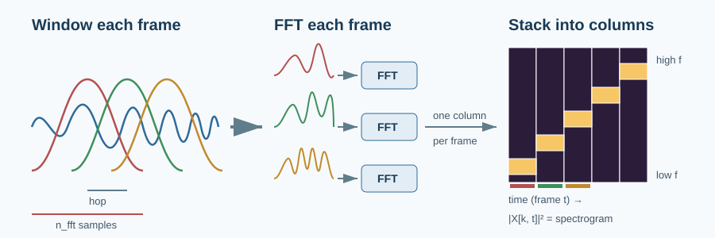
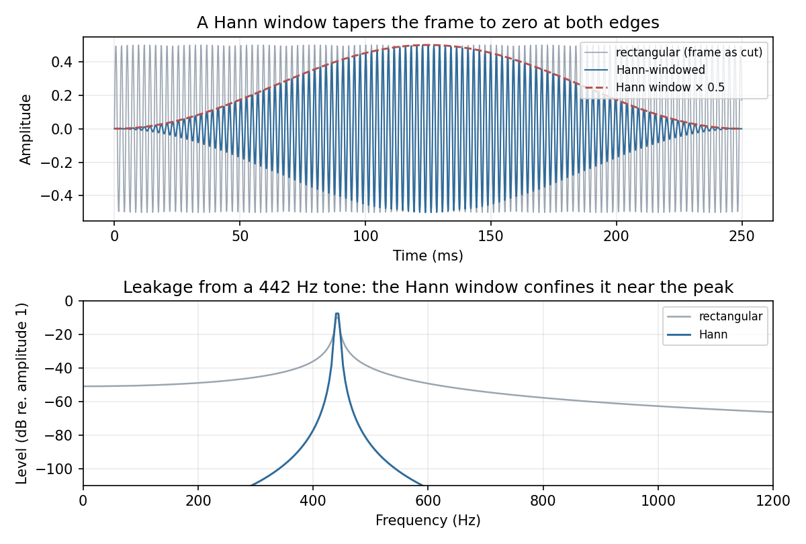
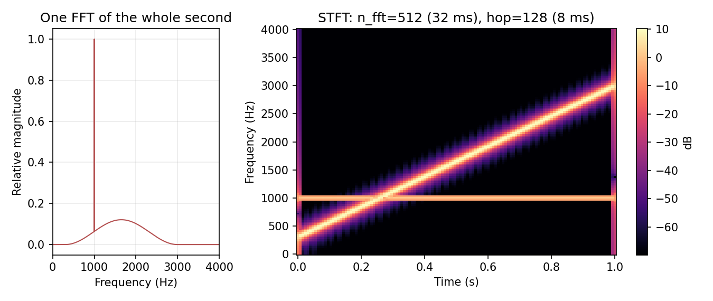
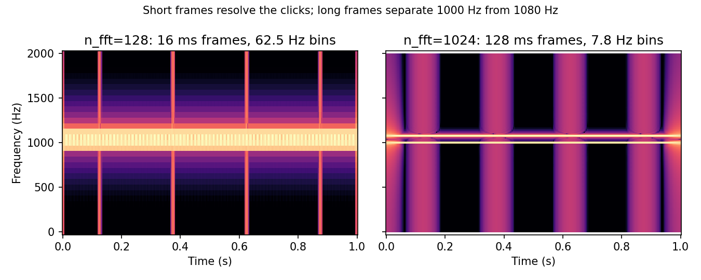

# The Short-Time Fourier Transform: Windows and Spectrograms

> One FFT tells you which frequencies are in a signal. The STFT tells you when.

**Type:** Learn + Build  
**Language:** Python  
**Prerequisites:** [Time-Domain Features](../../03-time-domain-features/docs/en.md), [The Discrete Fourier Transform](../../04-discrete-fourier-transform/docs/en.md)  
**Time:** ~60 minutes

## Learning Objectives

- Explain why a window reduces spectral leakage and implement the periodic Hann window.
- Build the STFT from framing, windowing, and the FFT, and match `librosa.stft` to floating-point precision.
- Convert `n_fft`, `hop_length`, and the sample rate into window duration, hop duration, and bin spacing.
- Describe the time-frequency trade-off and choose frame sizes for speech.
- Invert an STFT with weighted overlap-add and state when a window/hop pair reconstructs exactly.

## The Problem

Speech changes constantly. A single word moves through several vowels and consonants in a few hundred milliseconds, and each one has a different spectrum. Lesson 04 transformed the whole signal at once. That tells you which frequencies occurred somewhere in the recording, but not when.



The fix combines the two previous lessons. Lesson 03 cut a signal into short overlapping frames. Lesson 04 turned a block of samples into a spectrum. The **short-time Fourier transform** does both: frame the signal, then take the DFT of every frame. Stack the spectra side by side and you get a **spectrogram**, a picture with time on the x-axis, frequency on the y-axis, and energy as colour. It is the input to almost every speech model you will meet.

There is one catch. Lesson 04 ended with spectral leakage: a tone that does not complete a whole number of cycles in the frame smears across many bins. In real audio that happens in every frame. The STFT therefore needs one extra ingredient, the window.

## The Mental Model

### Windows: fade in, fade out

Cutting a frame out of a signal is the same as multiplying it by a *rectangular window*: 1 inside the frame, 0 outside. The sharp edges create a jump where the DFT's imagined repetition meets itself, and that jump is what leaks into every bin.

A smooth window fades the frame in and out so the edges meet at zero. The standard choice for speech is the **Hann window**:

$$w[n] = 0.5 - 0.5\cos\!\left(\frac{2\pi n}{N}\right), \qquad n = 0, \dots, N-1$$



The window is not free. Its main lobe is about twice as wide as the rectangular one, so two tones must be slightly further apart to be told apart. The side lobes are far lower, and they fall away quickly. For the 442 Hz tone from Lesson 04, about 5.8% of the energy lands more than three bins from the peak with a rectangular window, and less than 0.01% with Hann. Speech analysis almost always takes that trade.

### The STFT

With a window $w$ of length $N$ (`n_fft`) and hop $H$ (`hop_length`), the STFT is the DFT of each windowed frame:

$$X[k, t] = \sum_{n=0}^{N-1} x[n + tH]\, w[n]\, e^{-2\pi i k n / N}$$

Row $k$ is frequency $k \cdot sr / N$, exactly as in Lesson 04. Column $t$ is the frame that starts at sample $tH$. The **power spectrogram** is $|X[k, t]|^2$, and it is almost always shown in decibels because speech energy spans more than 60 dB.



The single FFT on the left knows that energy existed between 300 and 3000 Hz. The spectrogram on the right shows that it swept upward over one second, while a quiet 1 kHz tone stayed put.

### The time-frequency trade-off

Three numbers describe any STFT configuration:

| Quantity | Formula | 16 kHz, `n_fft=400`, `hop=160` |
| --- | --- | --- |
| Window duration | $N / sr$ | 25 ms |
| Hop duration | $H / sr$ | 10 ms (100 frames per second) |
| Bin spacing | $sr / N$ | 40 Hz |

A longer window gives finer frequency bins but blurs anything that changes inside it. A shorter window follows fast events but lumps nearby frequencies together. You cannot improve both at once with the same window.



Speech sits in the middle. A 20 to 30 ms window is short enough that the vocal tract is roughly steady within it, and long enough to resolve the harmonics of a typical voice. A 10 ms hop is the near-universal feature rate for ASR and TTS.

### Putting it back together

The STFT is invertible when every sample is covered by frames whose windows add up to something non-zero. The inverse transforms each column back to a frame, multiplies it by the window again, adds the frames at their original positions, and divides by the running sum of $w^2$. This is **weighted overlap-add**. A Hann window with 50% or 75% overlap also satisfies the stronger *constant overlap-add* property: the shifted windows sum to a flat line (1 and 2 respectively), so no sample is weighted more than another.

## Build It with NumPy

`code/main.py` builds the STFT from three pieces you already know. The window is one line:

```python
def hann_window(length, periodic=True):
    denominator = length if periodic else length - 1
    return 0.5 - 0.5 * np.cos(2.0 * np.pi * np.arange(length) / denominator)
```

The STFT pads, frames, windows, and transforms:

```python
def stft(samples, n_fft, hop_length, window=None, center=True):
    if window is None:
        window = hann_window(n_fft)
    if center:
        samples = np.pad(samples, n_fft // 2)
    frames = frame_signal(samples, n_fft, hop_length) * window
    return np.fft.rfft(frames, axis=1).T  # shape: (n_fft // 2 + 1, num_frames)
```

With `center=True` the signal is padded by half a window on each side so that column $t$ is centred on sample $tH$, and the number of frames is $1 + \lfloor L / H \rfloor$. The transpose puts frequency on the first axis, the same layout as librosa.

Run it from this lesson directory:

```bash
python3 code/main.py
python3 code/generate_figures.py --output-dir assets/generated
```

The script compares rectangular and Hann leakage, tracks the peak of a chirp through time, round-trips the chirp through `istft`, and checks that Hann windows at 75% overlap sum to a constant.

## Validate the Idea

The unit tests check facts you can derive by hand: an 8-point periodic Hann window is `[0, 0.146, 0.5, 0.854, 1, 0.854, 0.5, 0.146]`, Hann windows sum to exactly 1 at 50% overlap and 2 at 75%, one second at 16 kHz with hop 128 gives 126 centred frames, every STFT column equals `np.fft.rfft` of the matching windowed frame, `istft(stft(x))` returns `x`, the Hann window cuts leakage by more than an order of magnitude, the peak of a rising chirp never moves down, and a 400/160 configuration at 16 kHz is 25 ms, 10 ms, and 40 Hz.

## Use It in Practice

`librosa` uses the same defaults as `code/main.py`: a periodic Hann window, `center=True`, and zero padding. The two implementations agree to about $10^{-14}$:

```python
import librosa
import numpy as np

spectrum = librosa.stft(y, n_fft=512, hop_length=128)          # complex, (257, frames)
power_db = librosa.power_to_db(np.abs(spectrum) ** 2, ref=np.max)
restored = librosa.istft(spectrum, hop_length=128, length=len(y))
```

`torch.stft` computes the same transform on a GPU but has different defaults. Pass `window=torch.hann_window(n_fft)` explicitly, otherwise it uses a rectangular window, and pass `return_complex=True`. Its `center=True` pads with reflection rather than zeros, so the edge frames differ slightly from librosa.

Common speech configurations at 16 kHz are `n_fft=400, hop_length=160` (Whisper and many ASR front ends) and `n_fft=1024, hop_length=256` at 22.05 or 24 kHz for TTS vocoders. Most models then discard the phase, compress the magnitude with a mel filterbank, and take a logarithm. That is [the next lesson](../../06-mel-spectrograms-and-mfccs/docs/en.md).

## Pitfalls

- `np.hanning(N)` is the symmetric window, which ends in zeros at both sides. Spectral analysis uses the periodic form. The difference is small, but it breaks exact overlap-add and makes results disagree with librosa and PyTorch.
- A window scales the spectrum. A Hann-windowed sine of amplitude $A$ peaks at $A \sum w / 2$, not $A N / 2$. Divide by the window sum if you need calibrated amplitudes.
- `center=True` adds frames that overhang the signal. The bright vertical stripes at 0 s and 1 s in the chirp spectrogram come from the abrupt start and end of the signal meeting the zero padding.
- Hop length sets the frame rate and the cost, not the resolution. Halving the hop doubles the number of columns without making any column sharper.
- Frame counts differ between libraries because of centring and padding rules. Align features by time in seconds, not by frame index, when you mix tools.
- A spectrogram without a dB scale looks almost empty. Plot `power_to_db` with a sensible `top_db` such as 80.

## Exercises

1. Compute the spectrogram of the chirp with `n_fft` of 128, 512, and 2048 at a fixed hop of 128. For each, report the window duration, the bin spacing, and how thick the chirp line looks.
2. Replace the Hann window with `np.ones(n_fft)` in `stft`. Plot the spectrogram in dB and describe what the rectangular window does to the region around the chirp.
3. Use `overlap_add_window` to test Hann with hops of `n_fft / 2`, `n_fft / 4`, and `3 * n_fft / 8`. Which ones are constant, and does `istft` still reconstruct the signal for the one that is not? Why?
4. Record or download a short speech clip, resample it to 16 kHz, and plot a 25 ms / 10 ms spectrogram. Point out a vowel's harmonics and a fricative such as /s/.

## Key Terms

| Term | Meaning |
| --- | --- |
| Window | A taper multiplied into each frame so its edges fade to zero. |
| Hann window | $0.5 - 0.5\cos(2\pi n / N)$; the default analysis window for speech. |
| STFT | The DFT of each windowed frame; a 2-D array indexed by frequency bin and frame. |
| Spectrogram | The magnitude or power of the STFT, usually shown in decibels. |
| `n_fft` | Frame and FFT length in samples; sets bin spacing $sr / N$. |
| Hop length | Samples between consecutive frames; sets the frame rate. |
| Time-frequency trade-off | Longer windows sharpen frequency and blur time, and vice versa. |
| Overlap-add | Reconstructing a signal by summing inverse-transformed frames at their positions. |
| COLA | Constant overlap-add: shifted windows sum to a constant, so every sample gets equal weight. |

## Further Reading

- [Audio Signal Processing for ML: Short-Time Fourier Transform explained easily](https://www.youtube.com/watch?v=-Yxj3yfvY-4)
- [Audio Signal Processing for ML: How to extract spectrograms from audio with Python](https://www.youtube.com/watch?v=3gzI4Z2OFgY)
- [Harris (1978), On the use of windows for harmonic analysis with the discrete Fourier transform](https://doi.org/10.1109/PROC.1978.10837)
- [Griffin and Lim (1984), Signal estimation from modified short-time Fourier transform](https://doi.org/10.1109/TASSP.1984.1164317)
- [librosa `stft`](https://librosa.org/doc/0.11.0/generated/librosa.stft.html)
- [PyTorch `torch.stft`](https://pytorch.org/docs/stable/generated/torch.stft.html)
