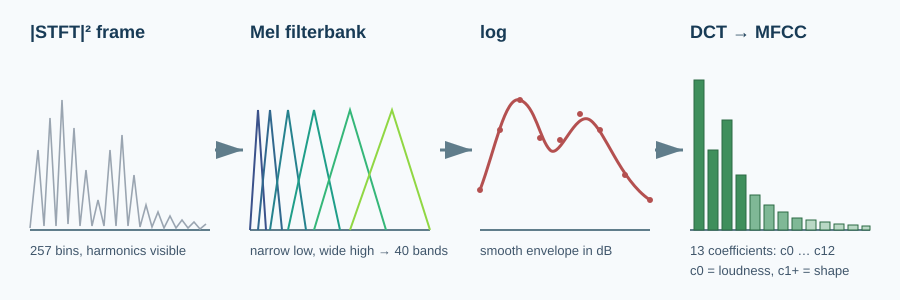
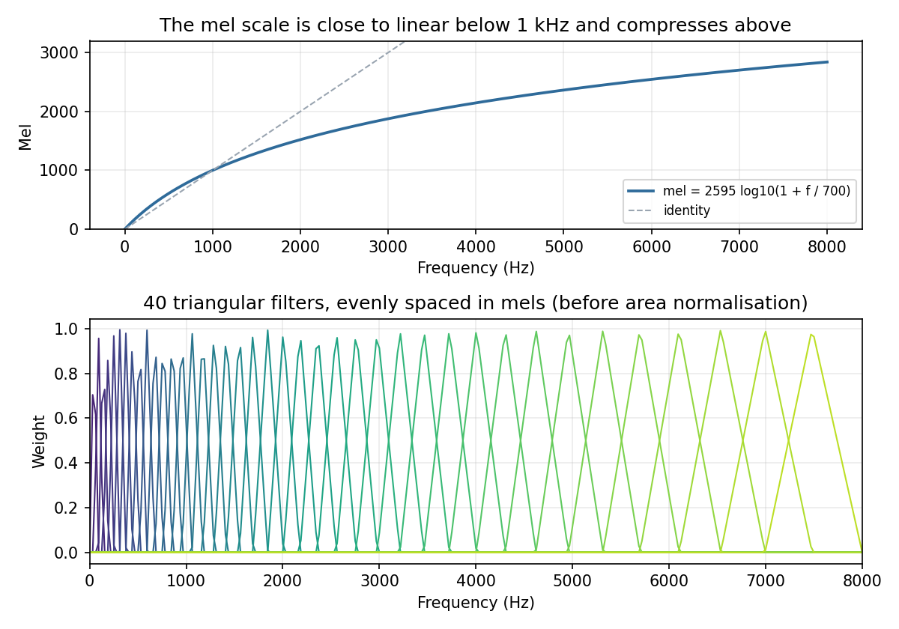
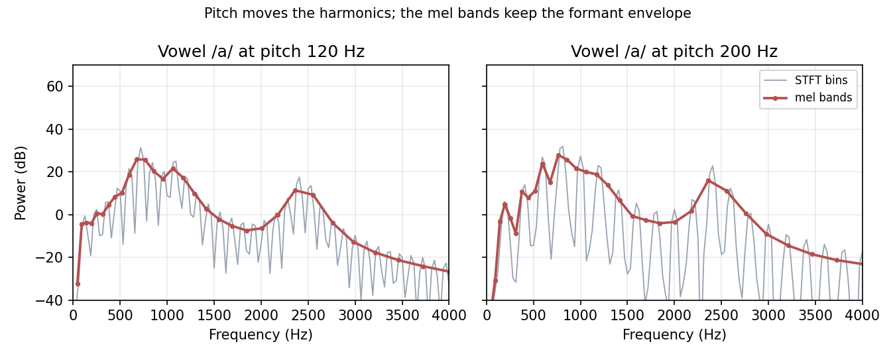
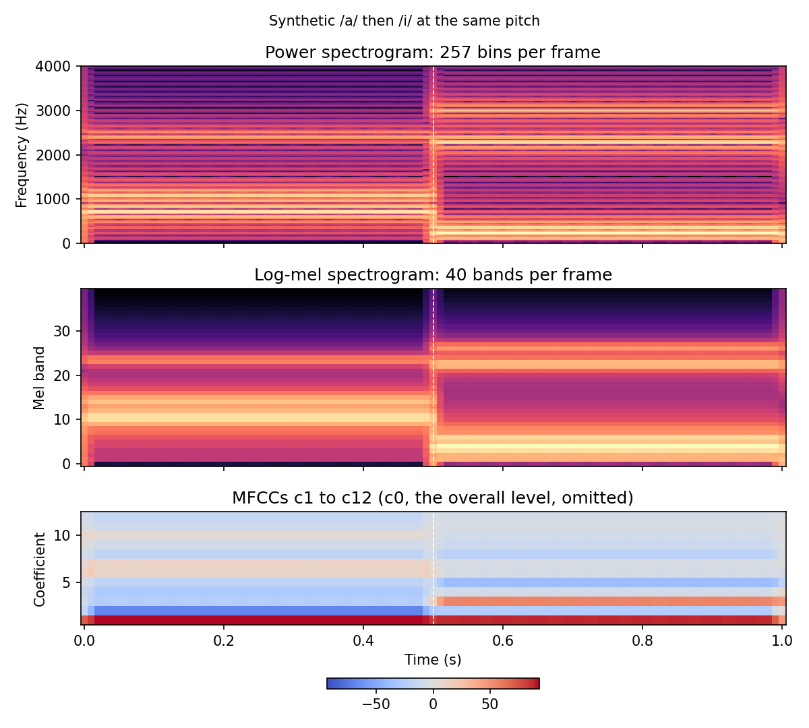

# Mel Spectrograms and MFCCs

> A spectrogram shows everything in the signal. A mel spectrogram keeps what a listener, or a speech model, actually needs.

**Type:** Learn + Build  
**Language:** Python  
**Prerequisites:** [The Short-Time Fourier Transform](../../05-short-time-fourier-transform/docs/en.md), logarithms and decibels from [Time-Domain Features](../../03-time-domain-features/docs/en.md)  
**Time:** ~70 minutes

## Learning Objectives

- Convert between hertz and mels and explain why the scale compresses high frequencies.
- Build a triangular mel filterbank from its definition and match `librosa.filters.mel` exactly.
- Turn a power spectrogram into a log-mel spectrogram, the input to most modern ASR and TTS models.
- Compute MFCCs with an orthonormal DCT and explain what c0 and the higher coefficients encode.
- Show that MFCCs track the vowel (spectral envelope) rather than the pitch, and remove a fixed channel gain with cepstral mean normalisation.

## The Problem

A 25 ms frame at 16 kHz with `n_fft=512` gives 257 frequency bins, 100 times per second. Most of that detail does not help a speech model. The fine comb of harmonics in a vowel is set by the speaker's pitch, and the pitch changes from speaker to speaker and from sentence to sentence without changing the word. What identifies the vowel is the smooth outline of the spectrum, the **formants** where the vocal tract resonates.



Hearing handles this in a particular way. We easily tell 200 Hz from 300 Hz, but 7,200 Hz and 7,300 Hz sound almost the same. The cochlea resolves low frequencies finely and high frequencies coarsely. This lesson builds features that do the same thing in three steps: pool STFT bins into perceptually spaced bands (the **mel spectrogram**), take the logarithm, and optionally compress the result with a cosine transform (the **MFCCs**).

## The Mental Model

### The mel scale

The mel scale maps frequency to perceived pitch. The HTK formula used throughout this lesson is:

$$m = 2595 \log_{10}\!\left(1 + \frac{f}{700}\right), \qquad f = 700\left(10^{m / 2595} - 1\right)$$

By construction, 1000 Hz is about 1000 mel. Below that the curve is close to linear. Above it, the curve is logarithmic: 4 kHz is only 2146 mel, and the whole 4 to 8 kHz octave takes up fewer mels than the range from 0 to 1 kHz.



### The filterbank

Pick `n_mels + 2` edge frequencies evenly spaced in mels between `fmin` and `fmax`. Filter $m$ is a triangle that rises from edge $m$ to a peak at edge $m+1$ and falls to zero at edge $m+2$:

$$H_m(f) = \max\!\left(0,\ \min\!\left(\frac{f - f_{m}}{f_{m+1} - f_{m}},\ \frac{f_{m+2} - f}{f_{m+2} - f_{m+1}}\right)\right)$$

Neighbouring triangles overlap by half, so between the first and last centres they sum to exactly 1. Evenly spaced in mels means the triangles widen in hertz: with 40 filters up to 8 kHz, the first spans 92 Hz and the last spans about 1 kHz. Most libraries then scale each triangle to unit area, called Slaney normalisation, so that a wide filter does not report more energy just because it covers more bins.

Written as a matrix $M$ of shape `(n_mels, n_fft // 2 + 1)`, the mel spectrogram is a single matrix product with the power spectrogram $P$ from Lesson 05:

$$S_{\text{mel}} = M P$$

### The logarithm

Mel energies span many orders of magnitude, so they go through a log, usually in decibels: $10 \log_{10}(S_{\text{mel}})$. The log does more than compress the range. Speech is often modelled as a source (the glottal pulses that set the pitch) passing through a filter (the vocal tract that sets the vowel). In the spectrum those two multiply; after a log they add. A fixed microphone or channel response is also a multiplication, so it becomes a constant offset per band.



The grey STFT bins change completely when the pitch moves from 120 to 200 Hz. The red mel bands barely change above 700 Hz, because each band is wider than the harmonic spacing and averages over several harmonics. Below 700 Hz the bands are narrower than 200 Hz, so they start to pick out individual harmonics. That is one reason pitch never disappears from mel features entirely.

### The cosine transform: MFCCs

Adjacent log-mel bands are strongly correlated because their filters overlap and the envelope is smooth. The **discrete cosine transform** (DCT-II) re-expresses each log-mel column as a sum of cosines of increasing ripple rate:

$$c_k = \sqrt{\tfrac{2}{M}}\,\alpha_k \sum_{m=0}^{M-1} \log S_{\text{mel}}[m]\,\cos\!\left(\frac{\pi k (2m + 1)}{2M}\right), \qquad \alpha_0 = \tfrac{1}{\sqrt{2}},\ \alpha_{k>0} = 1$$

These are the **mel-frequency cepstral coefficients**. Keeping the first 13 keeps the slow ripples, which describe the envelope and therefore the vowel. It discards the fast ripples, which carry fine detail such as leftover harmonics. The name "cepstrum" is a play on "spectrum": it is a spectrum of a log spectrum.

Two coefficients have a direct reading. $c_0$ is $\sqrt{M}$ times the average log energy, so it measures overall loudness. Multiplying the signal by 0.1 lowers every band by 20 dB and moves $c_0$ by $-20\sqrt{40} \approx -126.5$, while $c_1$ to $c_{12}$ do not move at all. $c_1$ contrasts low bands against high bands and measures the overall spectral tilt.



## Build It with NumPy

`code/main.py` builds the pipeline stage by stage. The filterbank is a broadcast of the triangle formula over all bins and filters at once:

```python
def mel_filterbank(sample_rate, n_fft, n_mels, fmin=0.0, fmax=None, normalize=True):
    fmax = sample_rate / 2.0 if fmax is None else fmax
    bins_hz = np.arange(n_fft // 2 + 1) * sample_rate / n_fft
    edges = mel_frequencies(n_mels + 2, fmin, fmax)
    lower, center, upper = edges[:-2, None], edges[1:-1, None], edges[2:, None]
    rising = (bins_hz[None, :] - lower) / (center - lower)
    falling = (upper - bins_hz[None, :]) / (upper - center)
    weights = np.maximum(0.0, np.minimum(rising, falling))
    if normalize:
        weights *= 2.0 / (upper - lower)  # unit area per triangle
    return weights
```

The DCT is a fixed matrix with a constant first row:

```python
def dct_matrix(n_out, n_in):
    k = np.arange(n_out)[:, None]
    n = np.arange(n_in)[None, :]
    basis = np.sqrt(2.0 / n_in) * np.cos(np.pi * k * (2 * n + 1) / (2 * n_in))
    basis[0] /= np.sqrt(2.0)
    return basis
```

The full chain is four lines: power spectrogram, filterbank, decibels, DCT. `synthetic_vowel` builds test signals by placing harmonics of a chosen pitch under resonant peaks at chosen formants, so pitch and vowel can be changed independently. The formants for /a/ (730, 1090, 2440 Hz) and /i/ (270, 2290, 3010 Hz) are the classic averages for adult male speakers.

Run it from this lesson directory:

```bash
python3 code/main.py
python3 code/generate_figures.py --output-dir assets/generated
```

The script prints the shapes through the pipeline, `(257, 51) -> (40, 51) -> (13, 51)` for half a second of audio. It shows that /a/ at two pitches lies about four times closer in MFCC space than /a/ and /i/ at the same pitch, and that a gain change moves only $c_0$.

## Validate the Idea

The unit tests check facts you can derive by hand: 1000 Hz is 1000 mel and `mel_to_hz` inverts `hz_to_mel`, the filter edges are evenly spaced in mels and widen in hertz, unnormalised triangles peak at 1 and sum to exactly 1 between the first and last centres, normalised triangles have unit area, a 1 kHz tone lands in the band centred nearest 1 kHz, the DCT matrix is orthonormal, a flat log-mel column produces only $c_0 = -20\sqrt{40}$, scaling the signal moves only $c_0$, MFCCs separate vowels far more than pitches, and cepstral mean normalisation leaves every coefficient with zero mean.

## Use It in Practice

With `htk=True`, librosa uses the same mel formula as `code/main.py` and matches it to within the float32 precision of its filterbank:

```python
import librosa

mel = librosa.feature.melspectrogram(y=y, sr=16_000, n_fft=512, hop_length=160, n_mels=40, htk=True)
log_mel = librosa.power_to_db(mel)
mfcc = librosa.feature.mfcc(S=log_mel, n_mfcc=13)
deltas = librosa.feature.delta(mfcc)             # frame-to-frame change, often stacked to 39 features
```

Front ends differ in small ways that change the numbers, so match the one your model was trained with:

| Front end | Mel scale | Filter normalisation | Log | Typical setup at 16 kHz |
| --- | --- | --- | --- | --- |
| `librosa` default | Slaney (linear below 1 kHz) | unit area | none until `power_to_db` | set by caller |
| `torchaudio.transforms.MelSpectrogram` | HTK | none | none; add `AmplitudeToDB` | set by caller |
| Whisper | Slaney, via librosa | unit area | $\log_{10}$, clipped to 8 below the peak, then $(x + 4) / 4$ | 80 or 128 mels, `n_fft=400`, hop 160 |
| Kaldi `compute-fbank-feats` | HTK-like | none | natural log | 23 bins by default; 80 is common for neural ASR |

Modern neural ASR and TTS models almost always take **log-mel spectrograms** directly, with 80 or 128 bands. The DCT's decorrelation mattered for Gaussian mixture models with diagonal covariances, but a convolutional or Transformer encoder can learn its own combination of bands. MFCCs are still common for speaker verification baselines, keyword spotting on small devices, and classical pipelines, and they are a compact feature for quick experiments.

## Pitfalls

- Too many mel bands for a small `n_fft` leaves the lowest filters narrower than one bin, and some end up empty. librosa warns about empty filters; check that `sr / n_fft` is well below the width of your narrowest band, or lower `n_mels`.
- Slaney and HTK mel scales place the bands differently. Mixing a model trained on one with features from the other silently hurts accuracy.
- Power versus magnitude matters. `power_to_db` expects $|X|^2$ and uses $10\log_{10}$; `amplitude_to_db` expects $|X|$ and uses $20\log_{10}$. Using the wrong one doubles or halves every value.
- Always floor before the log. A silent frame has zero energy, and $\log 0$ is $-\infty$. Use an `amin` such as $10^{-10}$ and a `top_db` clip.
- `fmax` should not exceed the Nyquist frequency, and `fmin` above 0 (for example 20 to 80 Hz) keeps DC offset and rumble out of the lowest band.
- $c_0$ is loudness. Many recipes drop it or replace it with log energy. Otherwise a model can learn the recording volume rather than the content.
- Per-utterance cepstral mean normalisation removes a fixed channel colouring, but it also removes information in very short clips. Use running or global statistics for streaming.

## Exercises

1. Compute `mel_filterbank(16_000, 512, n_mels)` for `n_mels` of 40, 80, and 128. For each, count how many filters cover fewer than two bins, and relate the answer to `sr / n_fft`.
2. Change `normalize=False` and recompute the log-mel spectrogram of the /a/–/i/ signal. Which bands change the most, and why?
3. Replace `hz_to_mel` with the Slaney formula (linear $f / (200/3)$ below 1 kHz, logarithmic above) and compare your filterbank with `librosa.filters.mel(sr=16_000, n_fft=512, n_mels=40)`.
4. Pass a vowel through a fixed filter, for example `np.convolve(vowel, [1.0, -0.9])[: len(vowel)]`, which is the pre-emphasis used by many ASR recipes. Show that the MFCCs change by a roughly constant offset per coefficient and that `cepstral_mean_normalization` removes most of it.
5. Build a nearest-centroid vowel classifier: compute the mean MFCC profile of /a/, /i/, and /u/ (formants 300, 870, 2240 Hz) at 120 Hz, then classify each vowel at pitches from 90 Hz upward in 20 Hz steps. Which vowel is misclassified first, near what pitch, and why does a high voice leave too few harmonics to trace the lowest formant?

## Key Terms

| Term | Meaning |
| --- | --- |
| Mel scale | A perceptual frequency scale, close to linear below 1 kHz and logarithmic above. |
| Mel filterbank | Triangular filters evenly spaced in mels that pool STFT bins into bands. |
| Mel spectrogram | The power spectrogram multiplied by the filterbank; shape `(n_mels, frames)`. |
| Log-mel spectrogram | The mel spectrogram in decibels or log units; the standard input to neural speech models. |
| Formant | A resonance of the vocal tract; a broad peak in the spectral envelope that identifies a vowel. |
| DCT-II | A cosine transform that decorrelates log-mel bands; orthonormal when scaled as in this lesson. |
| MFCC | Mel-frequency cepstral coefficient; the first coefficients of the DCT of the log-mel spectrum. |
| $c_0$ | The first MFCC, proportional to the average log energy of the frame. |
| Cepstral mean normalisation | Subtracting each coefficient's time average to remove a fixed channel response. |
| Delta features | Frame-to-frame differences of MFCCs that capture how the spectrum is changing. |

## Further Reading

- [Audio Signal Processing for ML: Mel Spectrograms Explained Easily](https://www.youtube.com/watch?v=9GHCiiDLHQ4)
- [Audio Signal Processing for ML: Mel-Frequency Cepstral Coefficients Explained Easily](https://www.youtube.com/watch?v=4_SH2nfbQZ8)
- [Davis and Mermelstein (1980), Comparison of parametric representations for monosyllabic word recognition in continuously spoken sentences](https://doi.org/10.1109/TASSP.1980.1163420)
- [Stevens, Volkmann, and Newman (1937), A scale for the measurement of the psychological magnitude pitch](https://doi.org/10.1121/1.1915893)
- [librosa `filters.mel`](https://librosa.org/doc/0.11.0/generated/librosa.filters.mel.html) and [`feature.mfcc`](https://librosa.org/doc/0.11.0/generated/librosa.feature.mfcc.html)
- [torchaudio `transforms.MelSpectrogram`](https://pytorch.org/audio/stable/generated/torchaudio.transforms.MelSpectrogram.html)
- [Whisper's log-mel front end (`whisper/audio.py`)](https://github.com/openai/whisper/blob/main/whisper/audio.py)
