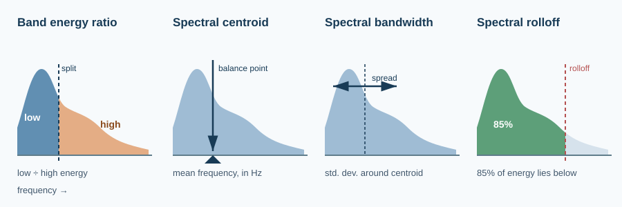
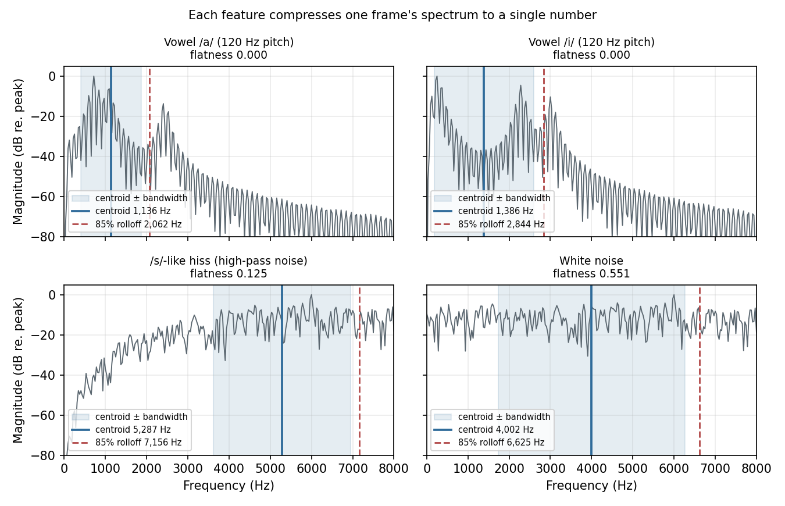

# Frequency-Domain Features: Band Energy, Centroid, Bandwidth, Rolloff, and Flatness

> A spectrogram column has 257 numbers. Sometimes one number is enough to tell a vowel from a hiss.

**Type:** Learn + Build  
**Language:** Python  
**Prerequisites:** [The Short-Time Fourier Transform](../../05-short-time-fourier-transform/docs/en.md), [Mel Spectrograms and MFCCs](../../06-mel-spectrograms-and-mfccs/docs/en.md)  
**Time:** ~60 minutes

## Learning Objectives

- Compute band energy ratio, spectral centroid, bandwidth, rolloff, and flatness from a magnitude spectrogram, and match librosa exactly.
- Read each feature as a statistic of the spectrum treated as a distribution over frequency.
- Predict feature values for tones, vowels, fricatives, and white noise before computing them.
- Combine RMS energy and spectral centroid into a frame-level rule that separates silence, voiced speech, and fricatives.
- Recognise when a feature reflects the recording (gain, floor, sample rate) rather than the sound.

## The Problem

Lesson 03 summarised each frame with time-domain numbers such as RMS energy and zero-crossing rate. Lesson 06 kept a whole vector per frame, 40 mel bands or 13 MFCCs. In between sit the **frequency-domain features**: single numbers per frame, computed from the spectrum, that each answer one question about its shape.



They are cheap, interpretable, and still useful in speech systems. Voice activity detectors, fricative detectors, audio-quality checks, and data-filtering scripts for training sets use them. A centroid that jumps above 4 kHz, a flatness that rises toward 0.5, or a band energy ratio that falls below 0 dB tells you something about a frame without training a model.

## The Mental Model

Treat a frame's magnitude spectrum $|X_k|$ as a pile of mass spread along the frequency axis, with bin $k$ at frequency $f_k = k \cdot f_s / N$. Normalise it so the masses add to one:

$$w_k = \frac{|X_k|}{\sum_j |X_j|}$$

Now $w_k$ is a probability distribution over frequency, and most features are its familiar statistics.

### Band energy ratio

Pick a split frequency $f_{\text{split}}$ and compare the power on either side:

$$\text{BER} = \frac{\sum_{f_k < f_{\text{split}}} |X_k|^2}{\sum_{f_k \ge f_{\text{split}}} |X_k|^2}$$

Voiced speech has a falling spectrum, so its BER at 2 kHz is well above 1 (positive in dB). A fricative like /s/ puts its energy above 4 kHz, so its BER is far below 1. For white noise the answer follows from the bandwidths alone: 2 kHz below the split against 6 kHz above it is $1/3$, or $-4.8$ dB.

### Spectral centroid

The mean of the distribution, its balance point:

$$\text{centroid} = \sum_k f_k\, w_k$$

It correlates with perceived **brightness**. For a single tone it is the tone's frequency. For two on-bin tones with amplitudes $a$ and $b$ it is $(a f_1 + b f_2)/(a + b)$, because the Hann window spreads each tone symmetrically. Vowels sit near 1 to 1.5 kHz in this lesson; the /s/-like hiss sits above 5 kHz.

### Spectral bandwidth

The spread around the centroid, a weighted standard deviation when $p = 2$:

$$\text{bandwidth} = \left(\sum_k w_k\, |f_k - \text{centroid}|^p\right)^{1/p}$$

A periodic Hann window spreads an on-bin tone over three bins weighted $\tfrac14, \tfrac12, \tfrac14$, so even a pure tone has a bandwidth of $\Delta f / \sqrt{2}$, about 22 Hz for `n_fft=512` at 16 kHz. Bandwidth is never exactly zero.

### Spectral rolloff

The frequency below which a fixed fraction, usually 85%, of the magnitude lies. It is a percentile of the distribution, so it ignores how the top 15% is shaped and moves less than the centroid when a few strong high bins appear.

### Spectral flatness

The ratio of the geometric to the arithmetic mean of the power spectrum:

$$\text{flatness} = \frac{\exp\!\left(\frac{1}{K}\sum_k \ln P_k\right)}{\frac{1}{K}\sum_k P_k}, \qquad P_k = |X_k|^2$$

The two means agree only when every bin holds the same power, so flatness is 1 for a perfectly flat spectrum and close to 0 when a few peaks hold everything. Measured white noise does not reach 1. Each periodogram bin of white noise is exponentially distributed, and for that distribution the ratio converges to $e^{-\gamma} \approx 0.561$, where $\gamma$ is the Euler–Mascheroni constant. Flatness is often called **Wiener entropy** or **tonality**.



## Build It with NumPy

`code/main.py` computes a centred, Hann-windowed magnitude spectrogram as in Lesson 05, then reduces each column. The weighted statistics need only the bin frequencies and one normalisation:

```python
def spectral_centroid(magnitude, sample_rate, n_fft):
    return np.einsum("k,kt->t", bin_frequencies(sample_rate, n_fft), _weights(magnitude))


def spectral_bandwidth(magnitude, sample_rate, n_fft, p=2.0):
    frequencies = bin_frequencies(sample_rate, n_fft)
    deviation = np.abs(frequencies[:, None] - spectral_centroid(magnitude, sample_rate, n_fft)[None, :])
    return np.sum(_weights(magnitude) * deviation ** p, axis=0) ** (1.0 / p)
```

Rolloff is a cumulative sum and a threshold, and flatness is a log-mean:

```python
def spectral_rolloff(magnitude, sample_rate, n_fft, roll_percent=0.85):
    cumulative = np.cumsum(magnitude, axis=0)
    first = np.argmax(cumulative >= roll_percent * cumulative[-1:], axis=0)
    return bin_frequencies(sample_rate, n_fft)[first]


def spectral_flatness(magnitude, amin=1e-10):
    power = np.maximum(magnitude ** 2, amin)
    return np.exp(np.mean(np.log(power), axis=0)) / np.mean(power, axis=0)
```

To get test material with known properties, `highpass_noise` shapes seeded Gaussian noise with a Butterworth-style gain $1/\sqrt{1 + (f_c/f)^{2n}}$. With $f_c = 4$ kHz it behaves like /s/: no harmonics, most energy high up, and a gentle slope below the cutoff rather than an empty band. `asa_utterance` strings silence, /a/, the hiss, /a/, and silence into a synthetic "asa" with known segment boundaries.

Run it from this lesson directory:

```bash
python3 code/main.py
python3 code/generate_figures.py --output-dir assets/generated
```

The script prints a table of median feature values per sound:

```text
sound          BER@2k (dB)  centroid  bandwidth  rolloff85  flatness
1 kHz tone           142.0    1000Hz       22Hz     1031Hz     0.000
vowel /a/             13.9    1137Hz      734Hz     2094Hz     0.000
vowel /i/              4.4    1383Hz     1205Hz     2844Hz     0.001
/s/-like hiss        -21.8    5347Hz     1733Hz     7312Hz     0.133
white noise           -4.7    4016Hz     2329Hz     6812Hz     0.561
```

Read the columns against the mental model. The tone's BER is enormous because only window leakage reaches above 2 kHz. /i/ has a lower BER and higher centroid than /a/ because its second formant sits at 2290 Hz, not 1090 Hz. White noise lands on the two predictions, $-4.8$ dB and $0.561$.

### A frame classifier from two numbers

`label_frames` labels a frame silence when its RMS is below 0.01, fricative when its centroid is above 2.5 kHz, and voiced otherwise. RMS comes from the same spectrogram through Parseval's theorem, so no second pass over the waveform is needed. On the synthetic "asa" it labels 99% of the frames away from segment boundaries correctly.


Look at the flatness track at the start and end of the hiss. It spikes to almost 0.5 for one frame. Those frames contain an abrupt switch between two signals, and a sharp edge in time spreads energy across all frequencies. Real recordings have the same spikes at clicks, plosive bursts, and clipping.

## Validate the Idea

The unit tests check values you can derive by hand: an on-bin tone has its exact frequency as centroid and $\Delta f/\sqrt{2}$ as bandwidth; two tones give the amplitude-weighted mean; centroid, bandwidth, and rolloff do not change with gain; white noise has a BER of $1/3$ at 2 kHz and a flatness of $e^{-\gamma}$; a tone is far less flat than noise; rolloff of a flat spectrum at 50% is half the Nyquist frequency; the spectral RMS equals the RMS of the windowed frame; vowels and hiss fall on opposite sides of each threshold; and the frame labels recover every "asa" segment at its midpoint.

## Use It in Practice

librosa implements the same definitions. Pass a magnitude spectrogram and the outputs match `code/main.py` to floating-point precision:

```python
import librosa
import numpy as np

S = np.abs(librosa.stft(y, n_fft=512, hop_length=160))
centroid = librosa.feature.spectral_centroid(S=S, sr=16_000, n_fft=512)
bandwidth = librosa.feature.spectral_bandwidth(S=S, sr=16_000, n_fft=512)
rolloff = librosa.feature.spectral_rolloff(S=S, sr=16_000, n_fft=512, roll_percent=0.85)
flatness = librosa.feature.spectral_flatness(S=S)          # squares S internally (power=2.0)
rms = librosa.feature.rms(S=S, frame_length=512)
```

librosa has no band energy ratio function; it is a two-line sum over `librosa.fft_frequencies(sr=16_000, n_fft=512)`. Other places these features show up:

| Where | What it uses | Why |
| --- | --- | --- |
| Voice activity detection | Energy, flatness, and band energy | Speech is louder and less flat than steady background noise. |
| Fricative and sibilance detection | Centroid, BER, high-band energy | /s/ and /ʃ/ concentrate energy above 3 to 4 kHz. |
| De-essers in TTS post-processing | High-band energy relative to the rest | Turn down harsh /s/ sounds only when they dominate. |
| Training-data filtering | Rolloff and bandwidth | Detect up-sampled audio: an 8 kHz phone recording re-saved at 16 kHz has nothing above 4 kHz. |
| Music and audio tagging | Centroid, bandwidth, flatness, contrast | Classic timbre features before learned embeddings. |

Neural ASR and TTS models do not need these features as input, because a log-mel spectrogram contains the same information. They remain useful for **diagnostics, filtering, and lightweight rules** where you want a number you can explain.

## Pitfalls

- Magnitude or power changes the answer. librosa's centroid, bandwidth, and rolloff weight by magnitude $|X|$; flatness squares it to power. Weighting the centroid by power pulls it toward the strongest peaks.
- Silence has no meaningful centroid. With all-zero bins the normalisation divides by a floor and returns 0 Hz or noise-driven values. Gate spectral features with an energy threshold, as `label_frames` does.
- Flatness depends on the `amin` floor. Bins below $10^{-10}$ are raised to it, and the gaps between a vowel's harmonics or the empty low band of filtered noise reach it. Then scaling the signal changes the flatness. Check gain invariance on your own data before relying on a threshold.
- Features depend on the sample rate. The same /s/ has a lower centroid and rolloff at 8 kHz than at 16 kHz, because the hiss above 4 kHz is gone. Never compare thresholds across sample rates.
- `n_fft` sets the resolution. With `n_fft=512` at 16 kHz, rolloff moves in 31.25 Hz steps and a pure tone still has a 22 Hz bandwidth.
- A DC offset or low-frequency rumble pulls the centroid down and the BER up. Remove DC, or start the sums above 50 to 80 Hz.
- Transients spike flatness and bandwidth for a frame or two. Smooth the tracks with a short median filter before thresholding.

## Exercises

1. Without running code, predict the centroid and 85% rolloff of white noise sampled at 16 kHz. Compute them, and explain why the rolloff is not exactly $0.85 \times 8000$ Hz.
2. Change the split frequency of `band_energy_ratio` from 2 kHz to 1 kHz and 4 kHz. At which split are /a/ and /i/ furthest apart, and which formant explains it?
3. Weight the centroid by power instead of magnitude. Recompute the table and explain which sounds move most.
4. Resample the hiss to 8 kHz with `librosa.resample` and recompute its features with the same `n_fft`. Which threshold in `label_frames` would you have to change?
5. Add white noise at 20 dB below the speech to the "asa" utterance. Which feature degrades first? Design a rule using flatness that still detects the silent segments.
6. Implement **spectral contrast** for one band: the difference in dB between the mean of the top 20% and the bottom 20% of bins between 2 and 4 kHz. Compare a vowel with the hiss, then check `librosa.feature.spectral_contrast`.

## Key Terms

| Term | Meaning |
| --- | --- |
| Band energy ratio | Power below a split frequency divided by power above it. |
| Spectral centroid | Magnitude-weighted mean frequency of a frame; tracks perceived brightness. |
| Spectral bandwidth | Magnitude-weighted spread around the centroid; a standard deviation when $p=2$. |
| Spectral rolloff | The frequency below which a set fraction, usually 85%, of the magnitude lies. |
| Spectral flatness | Geometric over arithmetic mean of the power spectrum; near 0 for tones, about 0.56 for measured white noise. |
| Fricative | A consonant made by turbulent airflow, such as /s/, /f/, or /ʃ/; noisy and high-frequency. |
| Parseval's theorem | The energy of a frame equals the energy of its DFT up to a scale factor. |
| Euler–Mascheroni constant | $\gamma \approx 0.5772$; sets the expected flatness of exponentially distributed power values. |

## Further Reading

- [Audio Signal Processing for ML: Frequency-Domain Audio Features](https://www.youtube.com/watch?v=3-bjAoAxQ9o)
- [Peeters (2004), A large set of audio features for sound description in the CUIDADO project](http://recherche.ircam.fr/anasyn/peeters/ARTICLES/Peeters_2003_cuidadoaudiofeatures.pdf)
- [Johnston (1988), Transform coding of audio signals using perceptual noise criteria](https://doi.org/10.1109/49.608), the origin of the spectral flatness measure in audio coding
- [librosa spectral features](https://librosa.org/doc/0.11.0/feature.html#spectral-features)
