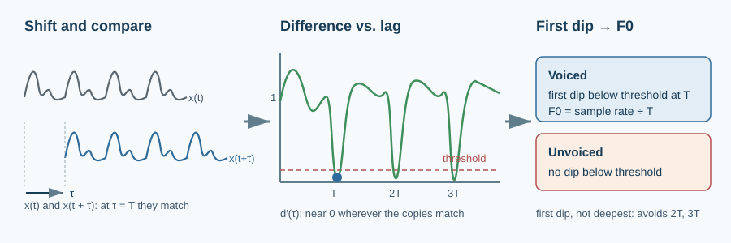
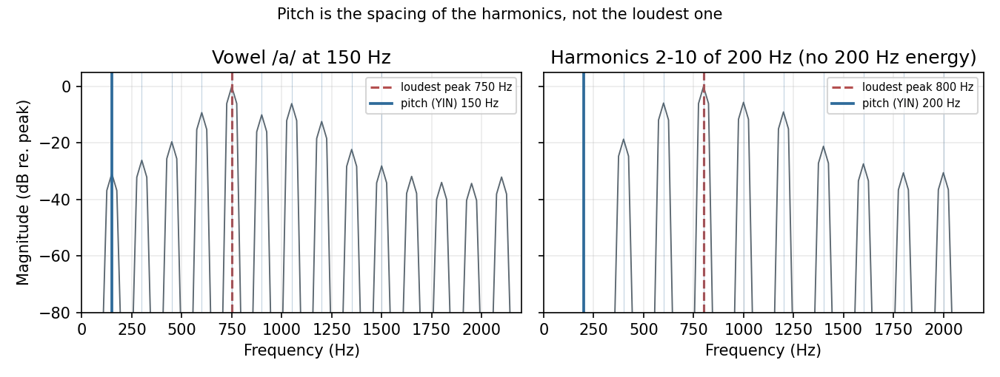
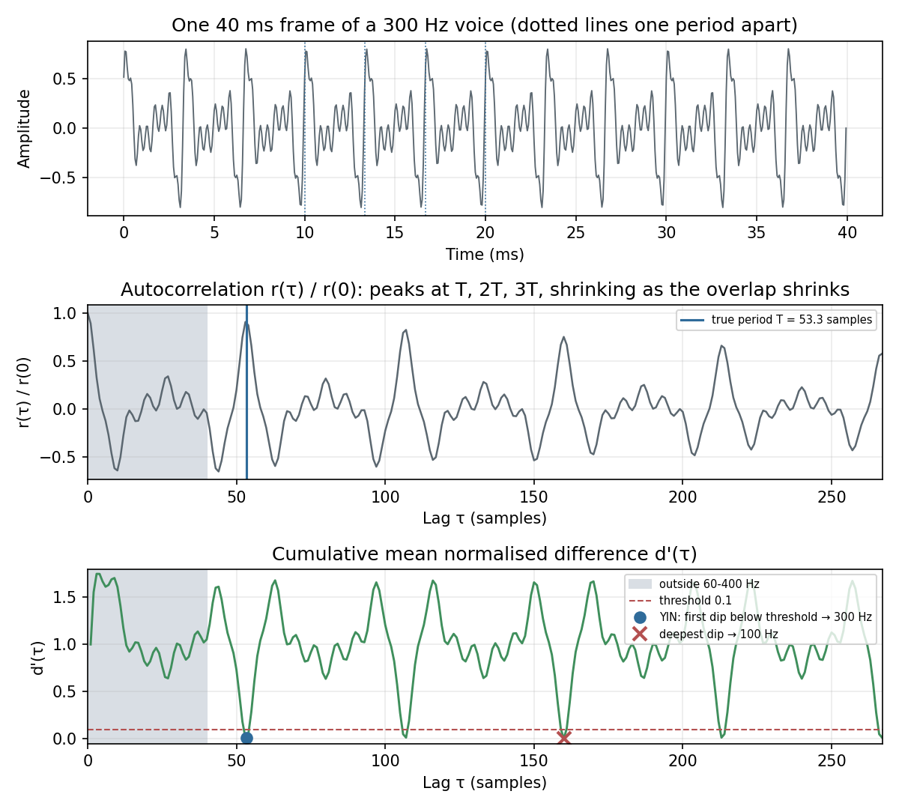
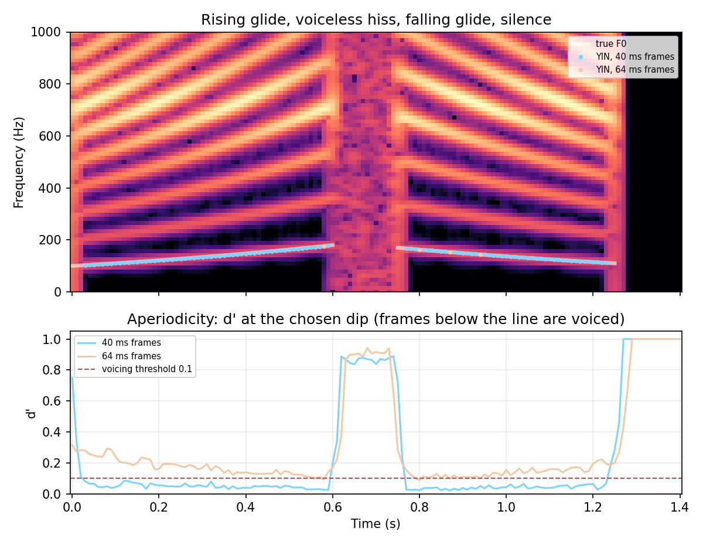

# Pitch Estimation: Autocorrelation and YIN

> Mel features deliberately blur the pitch away. Prosody, singing, and expressive TTS need it back.

**Type:** Learn + Build  
**Language:** Python  
**Prerequisites:** [The Discrete Fourier Transform](../../04-discrete-fourier-transform/docs/en.md), [Mel Spectrograms and MFCCs](../../06-mel-spectrograms-and-mfccs/docs/en.md)  
**Time:** ~70 minutes

## Learning Objectives

- Explain why the fundamental frequency (F0) is the spacing of the harmonics and not the loudest spectral peak.
- Compute a frame's autocorrelation with the FFT and read the period from its peaks.
- Implement YIN step by step: difference function, cumulative mean normalisation, absolute threshold, and parabolic interpolation.
- Make voiced/unvoiced decisions from aperiodicity and evaluate a pitch track with gross pitch error and cents.
- Choose frame length and threshold for moving speech pitch, and compare with `librosa.yin` and `librosa.pyin`.

## The Problem

Lesson 06 showed that MFCCs track the vowel and ignore the pitch. That is what a speech recogniser wants. Many other speech systems need the pitch itself. In Vietnamese, Mandarin, and Thai the pitch contour changes the meaning of a word. TTS models such as FastSpeech 2 predict an F0 contour explicitly. Voice conversion and singing synthesis transpose it. Emotion and speaker analysis use its range and movement.



Pitch is a perception; the measurable quantity behind it is the **fundamental frequency** $F_0$, the repetition rate of the glottal pulses. A voiced frame is close to periodic: it repeats every $T = f_s / F_0$ samples. Estimating pitch therefore means finding the period, and deciding whether there is one at all.

## The Mental Model

### Look for the spacing, not the loudest peak

A voiced sound is a comb of harmonics at $F_0, 2F_0, 3F_0, \dots$, shaped by the formant envelope. The strongest harmonic is whichever one sits nearest a formant, not the fundamental. For /a/ at 150 Hz the loudest bin is 750 Hz, the fifth harmonic under the first formant. With harmonics 2 to 10 of 200 Hz and nothing at 200 Hz, listeners still hear 200 Hz. This is the **missing fundamental**, and telephone speech, which cuts everything below 300 Hz, depends on it.



What the harmonics share is their spacing, and in the time domain that spacing is a repetition: shift the waveform by one period and it lines up with itself.

### Autocorrelation

The autocorrelation measures how well a frame matches a shifted copy of itself:

$$r(\tau) = \sum_{n=0}^{N-1-\tau} x[n]\, x[n+\tau]$$

It peaks at $\tau = 0$ and again at $T, 2T, 3T, \dots$. The pitch estimate is the lag of the highest peak inside the allowed range, $[f_s/f_{\max},\ f_s/f_{\min}]$. By the Wiener–Khinchin theorem, $r$ is the inverse FFT of the power spectrum. Zero-pad the frame to at least twice its length first, so the circular correlation of the FFT becomes a linear one.

Autocorrelation has two weaknesses. Fewer samples overlap as $\tau$ grows, so the peaks shrink with lag: a perfectly periodic 150 Hz vowel only reaches $r(T)/r(0) \approx 0.83$ in a 40 ms frame. Its height also depends on the signal, so there is no natural threshold for "periodic enough".

### YIN

YIN (de Cheveigné and Kawahara, 2002) replaces the product with a squared difference over a fixed window of $W$ samples:

$$d(\tau) = \sum_{j=0}^{W-1} \bigl(x[j] - x[j+\tau]\bigr)^2$$

A perfect period gives $d(T) = 0$. Then it normalises each value by the running mean of all smaller lags:

$$d'(0) = 1, \qquad d'(\tau) = \frac{d(\tau)}{\frac{1}{\tau}\sum_{j=1}^{\tau} d(j)}$$

This **cumulative mean normalised difference** starts at 1, stays near 1 for noise, and drops toward 0 at each multiple of the period. Every frame is on the same scale, so a fixed threshold now means something.

The third step is the important one. $d'$ dips at $T$, $2T$, and $3T$, and the later dips can be just as deep. YIN takes the **first** lag where $d'$ falls below a threshold (0.1 here), then slides to the bottom of that dip. If no dip crosses the threshold, the frame is **unvoiced**. Finally, a parabola through the minimum and its two neighbours refines $T$ to a fraction of a sample, because one sample at 16 kHz and 300 Hz is a 0.6% error.



The value of $d'$ at the chosen dip is the frame's **aperiodicity**. It is near 0 for clean voicing and near 1 for noise, and it is the voicing measure most pitch trackers expose.

### Measuring errors in cents

Pitch is perceived on a log scale, so errors are measured in **cents**: $1200 \log_2(\hat f / f)$. 100 cents is a semitone and 1200 is an octave. Two standard scores for a pitch track:

- **Gross pitch error (GPE):** the fraction of frames voiced in both estimate and reference that are off by more than 20%. Octave errors land here.
- **Fine error:** the typical error, in cents, of the frames that are not gross errors.

## Build It with NumPy

`code/main.py` follows the YIN paper's steps. The difference function expands the square into two energies and a cross term, so all lags come from one FFT per frame:

```python
def difference_function(frames, max_lag):
    window = frames.shape[1] - max_lag
    n_fft = 1 << int(np.ceil(np.log2(frames.shape[1] + window)))
    cross = np.fft.irfft(
        np.conj(np.fft.rfft(frames[:, :window], n=n_fft, axis=1)) * np.fft.rfft(frames, n=n_fft, axis=1),
        n=n_fft, axis=1,
    )[:, : max_lag + 1]
    cumulative = np.concatenate([np.zeros((frames.shape[0], 1)), np.cumsum(frames ** 2, axis=1)], axis=1)
    lags = np.arange(max_lag + 1)
    shifted_energy = cumulative[:, lags + window] - cumulative[:, lags]
    return np.maximum(cumulative[:, window : window + 1] + shifted_energy - 2.0 * cross, 0.0)
```

The threshold search is a few lines per frame:

```python
below = np.flatnonzero(search < threshold)       # search = d'[tau_min : tau_max + 1]
if below.size == 0:
    continue                                     # unvoiced
tau = tau_min + below[0]                         # first dip, not the deepest
while tau + 1 <= tau_max and curve[tau + 1] < curve[tau]:
    tau += 1                                     # slide to the bottom of the dip
f0[t] = sample_rate / (tau + parabolic_offset(curve, tau))
```

`harmonic_signal` synthesises test voices with a pitch contour that can move. Each harmonic's phase is the running sum of its instantaneous frequency, so a glide stays smooth. `intonation_utterance` joins a rising glide from 100 to 180 Hz, a voiceless hiss, a falling glide from 170 to 110 Hz, and silence, with the true F0 known for every sample.

Run it from this lesson directory:

```bash
python3 code/main.py
python3 code/generate_figures.py --output-dir assets/generated
```

The script prints each failure mode next to the fix. The loudest spectral peak of /a/ at 150 Hz is 750 Hz, while autocorrelation and YIN give 150 Hz. At a steady 300 Hz the deepest dip of $d'$ gives 100 Hz, and YIN's first dip gives 300 Hz. YIN finds the missing 200 Hz fundamental. On the intonation utterance it compares three settings:

```text
    frame threshold voicing ok    GPE  median error
     64ms       0.1      19.2%   0.0%      6.9 cents
     40ms       0.1      97.7%   0.0%      7.7 cents
     40ms       0.3      98.5%   1.0%      7.7 cents
```



The first row is the lesson's most practical result. The glides move 15 to 17 semitones per second. In a 64 ms frame the period drifts by about a semitone, so the frame never quite repeats, $d'$ bottoms out between 0.1 and 0.3, and most voiced frames are rejected. A 40 ms frame keeps the drift small enough. Raising the threshold to 0.3 recovers a little voicing, but it lets an early, shallow dip at half the period win in a few frames, and those are octave errors.

## Validate the Idea

The unit tests check the building blocks against their definitions and the behaviour against known answers: the FFT autocorrelation and difference function equal their direct sums; $d'$ starts at 1, reaches 0 at one and two periods, and exceeds 1 at half a period; parabolic interpolation recovers a vertex between samples; YIN is within 2 cents on steady pitches from 65 to 390 Hz; the loudest harmonic of /a/ is 750 Hz while both estimators say 150 Hz; the missing fundamental is found; the deepest dip gives 100 Hz for a 300 Hz voice while YIN gives 300 Hz; noise and silence are unvoiced; cents and GPE match hand calculations; and 40 ms frames track the intonation utterance with no gross errors while 64 ms frames do not.

## Use It in Practice

librosa offers both the plain algorithm and its probabilistic successor:

```python
import librosa

f0 = librosa.yin(y, fmin=60, fmax=400, sr=16_000, frame_length=640, hop_length=160)
f0, voiced_flag, voiced_prob = librosa.pyin(y, fmin=60, fmax=400, sr=16_000, frame_length=640, hop_length=160)
```

On the intonation utterance, with the same frame and hop:

| Estimator | Voicing correct | GPE | Median error | Notes |
| --- | :---: | :---: | :---: | --- |
| `code/main.py` YIN | 97.7% | 0% | 7.7 cents | Paper's fixed-window difference; see the timing pitfall below. |
| `librosa.yin` | 80.3% | 0% | 1.1 cents | Returns a pitch for every frame, including the hiss; no voicing output. |
| `librosa.pyin` | 100% | 0% | 2.6 cents | Many thresholds plus an HMM over time; about 35 times slower than `librosa.yin` here. |

**pYIN** (Mauch and Dixon, 2014) runs YIN with a distribution of thresholds, turns the dips into pitch candidates with probabilities, and decodes the most likely voiced and unvoiced path with a hidden Markov model. The temporal smoothing removes isolated octave jumps and voicing flicker, and it is the usual default for offline analysis. Other tools you will meet:

| Tool | Method | Typical use |
| --- | --- | --- |
| Praat | Autocorrelation with careful normalisation (Boersma, 1993) | Phonetics research, manual inspection. |
| WORLD (`pyworld`: DIO/Harvest) | Event-based F0 for a vocoder | Classical parametric TTS and voice conversion. |
| CREPE, FCPE, RMVPE | Neural networks on raw audio or spectrograms | Noisy, singing, or polyphonic audio; SVC and RVC pipelines. |

For FastSpeech-style TTS, F0 is usually extracted at the same hop as the mel spectrogram, interpolated through unvoiced frames, converted to log-hertz or semitones, and normalised per speaker.

## Pitfalls

- **Frame length must cover two periods, and no more than needed.** The lag search needs $f_s / f_{\min}$ samples plus an integration window. A longer frame helps low voices but blurs moving pitch, as the 64 ms row shows. Set `fmin` to the speaker's real range, not 30 Hz just in case.
- **Octave errors go both ways.** Too strict a search, such as the deepest dip, picks $2T$ and reports half the pitch. Too lax a threshold accepts a dip near $T/2$ and reports double. Look at the pitch track; a median hides them.
- **Know where in time an estimate belongs.** The paper's difference function compares samples $[0, W)$ with $[\tau, \tau + W)$, a span that ends $(\tau_{\max} - \tau)/2$ samples before the frame centre. On the glides this offset of 3.5 to 5.5 ms causes the whole 7.7-cent median error. Measured at the centre of the compared span, the error is under 1 cent, and on steady pitch it is about 0.1 cents. `librosa.yin` uses the full overlap of the frame, which is centred. Align F0 to mel frames with the same convention you train with.
- **Unvoiced is not zero.** Store unvoiced frames as NaN or with a separate voicing flag. Averaging zeros into an F0 statistic, or interpolating through them carelessly, drags the mean down.
- **Creaky voice, breathy voice, and noise** break the threshold assumption. Real speech has frames with aperiodicity of 0.2 to 0.4 that listeners still hear as voiced. pYIN's probabilistic voicing or a neural tracker handles these better.
- **Report error in cents, not hertz.** 5 Hz is a semitone at 85 Hz and a sixth of one at 500 Hz.

## Exercises

1. Plot `cumulative_mean_normalized_difference` and the plain `difference_function` for the 300 Hz frame on the same axes. Why does $d(\tau)$ alone give no threshold you could reuse for a 100 Hz voice?
2. Build a voicing decision for `autocorrelation_pitch`: call a frame voiced when its normalised peak $r(T)/r(0)$ exceeds a threshold. Find the threshold that maximises voicing accuracy on the intonation utterance, then check whether the same threshold still works with 64 ms frames. Compare with how YIN's 0.1 behaves.
3. Add white noise to the intonation utterance at 20, 10, and 0 dB SNR. Plot voicing accuracy and GPE against SNR for YIN and `librosa.pyin`.
4. Fix the timing pitfall: assign each estimate to the centre of its compared span, $(W + \tau)/2$ samples after the frame start, and re-evaluate. Then switch `difference_function` to the full-overlap form $\sum_{j=0}^{N-1-\tau}(x_j - x_{j+\tau})^2$ and compare.
5. Synthesise a Vietnamese-like tone pattern: a level tone at 180 Hz, a falling tone from 200 to 120 Hz, and a dipping tone that falls and rises. Choose the longest frame that keeps voicing accuracy above 95% for all three.
6. Convert a YIN track to semitones relative to the speaker's median F0, interpolate linearly through unvoiced frames, and plot it. This is the F0 feature many TTS models predict.

## Key Terms

| Term | Meaning |
| --- | --- |
| Fundamental frequency (F0) | The repetition rate of a periodic signal; the physical basis of perceived pitch. |
| Period $T$ | The repetition interval in samples, $f_s / F_0$. |
| Harmonic | A component at an integer multiple of $F_0$. |
| Missing fundamental | Perceiving $F_0$ from its harmonics when no energy is present at $F_0$ itself. |
| Autocorrelation | Sum of a signal times its shifted copy, as a function of the shift. |
| Difference function | Sum of squared differences between a signal and its shifted copy; zero at the period. |
| Cumulative mean normalised difference | YIN's $d'(\tau)$: the difference divided by its running mean, starting at 1. |
| Aperiodicity | $d'$ at the chosen dip; near 0 for clean voicing and near 1 for noise. |
| Voicing decision | Whether a frame has a pitch at all. |
| Octave error | An estimate off by a factor of 2 (or 3) in either direction. |
| Cent | One hundredth of a semitone; $1200 \log_2$ of a frequency ratio. |
| Gross pitch error | Fraction of voiced frames whose estimate is off by more than 20%. |

## Further Reading

- [de Cheveigné and Kawahara (2002), YIN, a fundamental frequency estimator for speech and music](https://doi.org/10.1121/1.1458024)
- [Mauch and Dixon (2014), pYIN: A fundamental frequency estimator using probabilistic threshold distributions](https://doi.org/10.1109/ICASSP.2014.6853678)
- [Rabiner (1977), On the use of autocorrelation analysis for pitch detection](https://doi.org/10.1109/TASSP.1977.1162905)
- [Kim, Salamon, Li, and Bello (2018), CREPE: A convolutional representation for pitch estimation](https://arxiv.org/abs/1802.06182)
- [librosa `yin`](https://librosa.org/doc/0.11.0/generated/librosa.yin.html) and [`pyin`](https://librosa.org/doc/0.11.0/generated/librosa.pyin.html)
