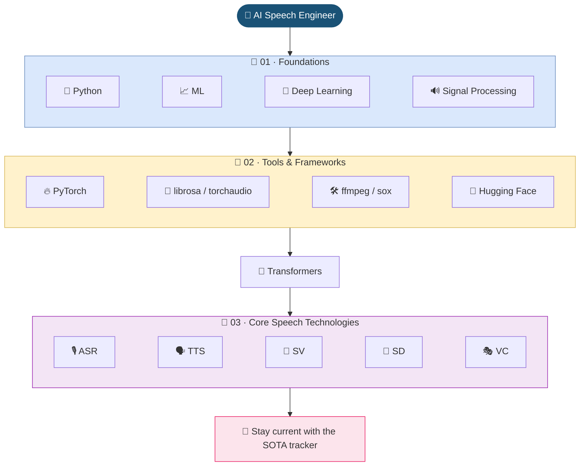

# 🗺️ Roadmap: AI Speech Engineer

> The foundation every speech engineer needs, in the order that makes it stick. Curated from six years of building speech systems.

[← Back to home](../README.md) · [🛠️ Tutorials](../tutorials/README.md) · [📡 SOTA Tracker](../sota/README.md)

This roadmap covers knowledge that stays useful for years: math and machine learning, audio signal processing, the standard toolkit, and the core speech technologies. Fast-moving research lives in the [SOTA tracker](../sota/README.md) instead, so this page stays stable.

## 🧭 The Path

| Phase | Duration | Focus | Practice it |
| --- | :---: | --- | --- |
| 🧠 [**01 · Foundations**](01-foundations.md) | 3 months | Python, machine learning, deep learning, audio signal processing | [Tutorial module 01](../tutorials/01-audio-signal-processing/) |
| 💼 [**02 · Tools & Frameworks**](02-tools-and-frameworks.md) | 3 months | PyTorch, librosa, torchaudio, audio utilities, Hugging Face Audio | — |
| 🌱 [**03 · Core Speech Technologies**](03-core-speech-technologies.md) | 12 months | Transformers, ASR, TTS, speaker verification, diarization, voice conversion | Planned |
| 🇻🇳 [**Vietnamese Speech**](vietnamese-speech.md) | Alongside 03 | Phonemizers, VLSP reports, theses, Vietnamese models | — |
| 📡 [**SOTA Tracker**](../sota/README.md) | Continuous | Speech LMs, codecs, full-duplex dialogue, modern TTS and benchmarks | — |

Durations are guidelines, not deadlines. Move on when you can **explain** the core idea, **reproduce** a small implementation, and **describe** its failure modes.

## 🔖 Legend

| Mark | Meaning |
| :---: | --- |
| ⭐ | Essential. If you only have time for a few resources, read these. |
| 📺 | Video or course |
| 📃 | Course or written material |
| 🇻🇳 | Vietnamese-specific resource |
| 📡 | Link to the newest work in the SOTA tracker |
