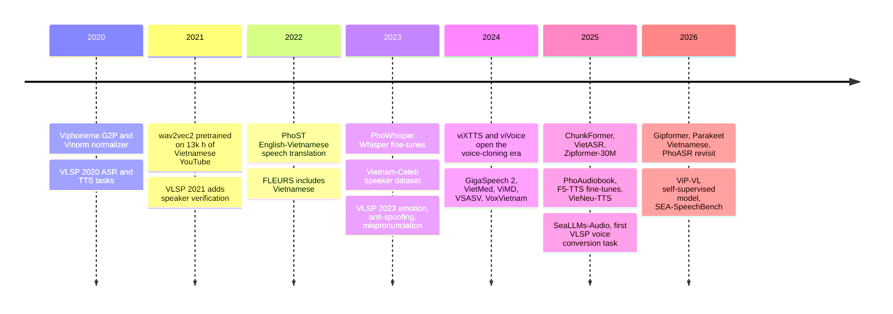

# 🇻🇳 Vietnamese Speech

> A survey of Vietnamese speech models, datasets, and benchmarks from 2020 to today. Vietnamese is tonal, has strong regional dialects, mixes freely with English, and has far less labeled data than English or Chinese. Every item below addresses one of those problems.

[← Roadmap](README.md) · [Core Speech Technologies](03-core-speech-technologies.md) · [📡 SOTA Tracker](../sota/README.md)

**Last reviewed:** November 2026 · ⭐ = start here · Dates are first public release (arXiv v1 or model release) · Numbers are as reported by the authors

**Sections:** [Timeline](#-timeline) · [Where to Start](#-where-to-start) · [ASR](#%EF%B8%8F-speech-recognition-asr) · [TTS](#%EF%B8%8F-speech-synthesis--voice-cloning) · [VC](#-voice-conversion) · [Speaker](#-speaker-recognition--anti-spoofing) · [Emotion, SLU, Translation](#-emotion-understanding--translation) · [SSL & Audio LLMs](#-self-supervised-models--audio-llms) · [Datasets](#%EF%B8%8F-datasets) · [Benchmarks](#-benchmarks) · [Text Processing](#-text-processing) · [VLSP](#%EF%B8%8F-vlsp-evaluation-campaigns) · [Our Work](#-our-work)

## 📈 Timeline

The field has shifted from **wav2vec2 fine-tuning on a few hundred hours** (2021) to **Zipformer and FastConformer models trained on thousands of hours** and deployable on CPU (2025–2026). TTS moved from **single-speaker Tacotron and VITS** to **zero-shot voice cloning** from a few seconds of audio. The open frontier is code-switching, dialects, call-center audio, and Vietnamese-native audio LLMs.

## 🧭 Where to Start

| Goal | Start with | Why |
| --- | --- | --- |
| Accurate open ASR | [PhoWhisper](https://github.com/VinAIResearch/PhoWhisper) | Well-documented Whisper fine-tunes in five sizes |
| Fast ASR on CPU or edge | [sherpa-onnx Vietnamese Zipformers](https://k2-fsa.github.io/sherpa/onnx/pretrained_models/offline-transducer/zipformer-transducer-models.html) | ONNX and INT8 builds of VietASR and Zipformer-30M |
| ASR with a commercial-friendly license | [Parakeet-CTC-0.6B-Vietnamese](https://huggingface.co/nvidia/parakeet-ctc-0.6b-Vietnamese) or [Gipformer](https://github.com/ggroup-ai-lab/gipformer) | NVIDIA Open Model License; MIT |
| Voice cloning | [VieNeu-TTS](https://github.com/pnnbao97/VieNeu-TTS) or [viXTTS](https://huggingface.co/capleaf/viXTTS) | On-device Apache-2.0; XTTS extended to Vietnamese |
| Speaker verification | [Vietnam-Celeb](https://github.com/thanhpv2102/Vietnam-Celeb.Interspeech) | Standard Vietnamese SV benchmark |
| Understand the research | [VietASR](https://arxiv.org/abs/2505.21527) and [PhoAudiobook](https://arxiv.org/abs/2506.01322) | How to scale with limited labels; how zero-shot TTS behaves on Vietnamese |

> ⚖️ **Check licenses.** Many Vietnamese models and datasets are non-commercial (CC BY-NC) or gated to institutional emails. The tables note the license where it is stated.

## 🎙️ Speech Recognition (ASR)

| Date | Work | Org | Highlights | License | Links |
| :---: | --- | --- | --- | :---: | --- |
| 2021-09 | ⭐ **wav2vec2-base-vi-250h** | — | wav2vec2-base pretrained on ~13k h of Vietnamese YouTube, fine-tuned on 250 h; 6.15% WER on VIVOS with a 4-gram LM | CC BY-NC 4.0 | [model](https://huggingface.co/nguyenvulebinh/wav2vec2-base-vietnamese-250h) · [code](https://github.com/vietai/ASR) |
| 2023-12 | ⭐ **PhoWhisper** | VinAI Research | Whisper fine-tunes (39M–1.55B) on 844 h of accented Vietnamese; large: 4.67% WER on VIVOS, 8.14% on Common Voice (ICLR 2024 Tiny Papers) | — | [paper](https://arxiv.org/abs/2406.02555) · [code](https://github.com/VinAIResearch/PhoWhisper) |
| 2025-02 | ⭐ **ChunkFormer** | — | Masked-chunking Conformer for long-form audio (up to 16 h per GPU); Vietnamese CTC-large (~110M, ~3,000 h): 4.18% WER on VIVOS (ICASSP 2025) | CC BY-NC 4.0 | [paper](https://arxiv.org/abs/2502.14673) · [code](https://github.com/khanld/chunkformer) |
| 2025-05 | ⭐ **VietASR** | SJTU, Tencent | Zipformer with ASR-biased SSL on 70k h of unlabeled speech plus only 50 h of labels; 68M model beats Whisper-large-v3 (Interspeech 2025) | — | [paper](https://arxiv.org/abs/2505.21527) · [code](https://github.com/zzasdf/VietASR) |
| 2025-10 | ⭐ **Zipformer-30M-RNNT-6000h** | — | 30M Zipformer RNN-T on ~6,000 h; 7.97% WER on VLSP 2025 public; first-place VLSP 2025 ASR system per its card | CC BY-NC-ND 4.0 | [model](https://huggingface.co/hynt/Zipformer-30M-RNNT-6000h) · [paper](https://aclanthology.org/2025.vlsp-1.4/) |
| 2026-01 | **Parakeet-CTC-0.6B-Vietnamese** | NVIDIA | 600M FastConformer-CTC on ~2,000 h from 10 public sets, with punctuation; 9.30% average WER on blind tests | NVIDIA Open Model | [model](https://huggingface.co/nvidia/parakeet-ctc-0.6b-Vietnamese) |
| 2026-01 | **Qwen3-ASR** | Alibaba Qwen | LLM-based ASR (0.6B, 1.7B) for 52 languages including Vietnamese; strong on read speech, weaker on hard call-center audio | Apache-2.0 | [paper](https://arxiv.org/abs/2601.21337) · [model](https://huggingface.co/Qwen/Qwen3-ASR-1.7B) |
| 2026-03 | **Gipformer** | G-Group AI Lab | 68M Zipformer RNN-T for call-center speech; v1.5: 7.00% WER on ViMD, beats PhoWhisper-large on hard call-center sets | MIT | [code](https://github.com/ggroup-ai-lab/gipformer) · [model](https://huggingface.co/g-group-ai-lab/gipformer1.5-68M-rnnt) |
| 2026-03 | **PhoASR** | Qualcomm AI Research | Revisits Vietnamese ASR data: a cleaning pipeline yielding a unified 500 h high-quality set with word timestamps (EACL 2026 Findings) | BSD-3-Clear | [paper](https://arxiv.org/abs/2603.14779) · [code](https://github.com/qualcomm-ai-research/PhoASR) |

**Deploy:** [sherpa-onnx](https://github.com/k2-fsa/sherpa-onnx) packages VietASR (`sherpa-onnx-zipformer-vi-2025-04-20`) and Zipformer-30M (`sherpa-onnx-zipformer-vi-30M-int8-2026-02-09`) for CPU and on-device inference.

## 🗣️ Speech Synthesis & Voice Cloning

### Vietnamese-first models

| Date | Work | Org | Highlights | License | Links |
| :---: | --- | --- | --- | :---: | --- |
| 2020 | ⭐ **Tacotron2 + Viphoneme + Vinorm** | — | End-to-end Vietnamese TTS with text normalization; released the `viphoneme` G2P package (NICS 2020) | — | [paper](https://ieeexplore.ieee.org/document/9335905/) · [code](https://github.com/v-nhandt21/Viphoneme) |
| 2024-04 | ⭐ **viXTTS** | capleaf | XTTS-v2 with a Vietnamese tokenizer, fine-tuned on viVoice; clones from ~6 s of reference audio | Coqui Public | [model](https://huggingface.co/capleaf/viXTTS) · [demo](https://github.com/thinhlpg/vixtts-demo) |
| 2025-03 | **F5-TTS-Vietnamese** | — | Recipe to extend F5-TTS vocab and embeddings and fine-tune on Vietnamese | MIT (code) | [code](https://github.com/nguyenthienhy/F5-TTS-Vietnamese) |
| 2025-03 | **zalopay/vietnamese-tts** | Zalopay | F5-TTS fine-tune on 200+ h; one of few permissively licensed Vietnamese cloning checkpoints | CC BY 4.0 | [model](https://huggingface.co/zalopay/vietnamese-tts) |
| 2025-04 | **EraX-Smile F5** | EraX | F5-TTS fine-tuned on 2.7M+ Vietnamese samples for zero-shot cloning | CC BY-NC 4.0 | [model](https://huggingface.co/erax-ai/EraX-Smile-UnixSex-F5) |
| 2025-06 | ⭐ **PhoAudiobook** | VinAI Research | 941 h audiobook TTS corpus; benchmarks VALL-E, VoiceCraft, and XTTS-v2 for zero-shot Vietnamese TTS (ACL 2025) | Research only | [paper](https://arxiv.org/abs/2506.01322) · [data](https://huggingface.co/datasets/thivux/phoaudiobook) |
| 2025-10 | ⭐ **VieNeu-TTS** | — | On-device TTS with instant voice cloning; v3 Turbo outputs 48 kHz Vietnamese and English | Apache-2.0 | [model](https://huggingface.co/pnnbao-ump/VieNeu-TTS) · [code](https://github.com/pnnbao97/VieNeu-TTS) |

### Multilingual models that support Vietnamese

| Date | Work | Org | Highlights | License | Links |
| :---: | --- | --- | --- | :---: | --- |
| 2023-05 | **MMS-TTS (vie)** | Meta | Lightweight single-speaker VITS baseline (~36M) that runs in `transformers` | CC BY-NC 4.0 | [paper](https://arxiv.org/abs/2305.13516) · [model](https://huggingface.co/facebook/mms-tts-vie) |
| 2025-12 | **Magpie TTS Multilingual** | NVIDIA | 357M open-weights model, 12 languages including Vietnamese | NVIDIA Open Model | [model](https://huggingface.co/nvidia/magpie_tts_multilingual_357m) |
| 2026-04 | **VoxCPM2** | OpenBMB | 2B tokenizer-free TTS, 30 languages, 48 kHz, short-clip cloning | Apache-2.0 | [paper](https://arxiv.org/abs/2509.24650) · [model](https://huggingface.co/openbmb/VoxCPM2) |
| 2026-04 | **OmniVoice** | k2-fsa | Zero-shot TTS for 600+ languages, trained on 581k h of open data | Apache-2.0 | [paper](https://arxiv.org/abs/2604.00688) · [code](https://github.com/k2-fsa/OmniVoice) |
| 2026-05 | **MOSS-TTS v1.5** | OpenMOSS | Adds Vietnamese among 31 languages via continued multilingual training | Apache-2.0 | [card](https://github.com/OpenMOSS/MOSS-TTS/blob/main/docs/moss_tts_model_card.md) · [model](https://huggingface.co/OpenMOSS-Team/MOSS-TTS-v1.5) |

### Challenge papers

| Date | Work | Highlights | Links |
| :---: | --- | --- | --- |
| 2022-06 | **VLSP 2021 TTS overview** | First VLSP task on spontaneous speech: 7.5 h single-speaker data, 8 evaluated submissions | [paper](https://jcsce.vnu.edu.vn/index.php/jcsce/article/view/358) |
| 2023-11 | **VNPT-IT, VLSP 2022** | Emotion transplantation for expressive TTS with limited target-speaker data | [paper](https://vjs.ac.vn/jcc/article/view/18236) |

## 🎭 Voice Conversion

| Date | Work | Highlights | Links |
| :---: | --- | --- | --- |
| 2024-05 | **Vietnamese Voice Conversion using Deep Learning Technique** | Master thesis, HUST | [pdf](../materials/Master_thesis___Le_Minh_Nguyen.pdf) |
| 2025-10 | ⭐ **VLSP 2025 VC overview** | First Vietnamese voice conversion shared task | [paper](https://aclanthology.org/2025.vlsp-1.13) |
| 2025-10 | **Twinkle-VC** | Robust zero-shot VC system for VLSP 2025 | [paper](https://aclanthology.org/2025.vlsp-1.15) · [pdf](../materials/vc_vlsp_2025_twinkle_team.pdf) |
| 2025-10 | **ViettelRoar** | Another VLSP 2025 VC system | [paper](https://aclanthology.org/2025.vlsp-1.14) |

## 🔐 Speaker Recognition & Anti-Spoofing

| Date | Work | Org | Highlights | Links |
| :---: | --- | --- | --- | --- |
| 2022-06 | **VLSP 2021 SV** | VLSP | First Vietnamese SV challenge: ~50 h of noisy speech, 1,300+ speakers; best EER 1.755% | [paper](https://jcsce.vnu.edu.vn/index.php/jcsce/article/view/333) |
| 2023 | ⭐ **Vietnam-Celeb** | — | First large-scale Vietnamese SV dataset: 1,000 speakers, 87k+ utterances, 3 dialects (Interspeech 2023) | [paper](https://www.isca-archive.org/interspeech_2023/pham23b_interspeech.html) · [data](https://github.com/thanhpv2102/Vietnam-Celeb.Interspeech) |
| 2024 | ⭐ **VSASV** | HuSTeP Lab | Spoofing-aware SV: 164k+ genuine and 174k+ spoofed utterances, 1,382 speakers (Interspeech 2024) | [paper](https://www.isca-archive.org/interspeech_2024/hoang24b_interspeech.html) · [data](https://huggingface.co/datasets/hustep-lab/VSASV-Dataset) |
| 2024-12 | **VoxVietnam** | HuSTeP Lab | Multi-genre SV: 187k+ utterances, 1,406 speakers (ICASSP 2025) | [paper](https://arxiv.org/abs/2501.00328) · [data](https://huggingface.co/datasets/hustep-lab/VoxVietnam-Dataset) |
| 2025-10 | **VLSP 2025 SASV** | VLSP | Summary of the second spoofing-aware SV challenge | [paper](https://aclanthology.org/2025.vlsp-1.10/) |
| 2026-06 | **VieSpeaker** | — | ~902 h from 4,715 speakers; 5.45% EER on Vietnam-Celeb-E | [paper](https://arxiv.org/abs/2606.24066) |

## 💬 Emotion, Understanding & Translation

| Date | Work | Task | Highlights | Links |
| :---: | --- | :---: | --- | --- |
| 2022-08 | ⭐ **PhoST** | Translation | 508 h English→Vietnamese speech translation corpus; cascaded beats end-to-end (Interspeech 2022) | [paper](https://arxiv.org/abs/2208.04243) · [code](https://github.com/VinAIResearch/PhoST) |
| 2023 | **VLSP 2023 ASR-SER** | Emotion | Joint ASR and emotion recognition on ~305 h; repeated in 2025 | [task](https://vlsp.org.vn/vlsp2023/eval/asr) · [2025 overview](https://aclanthology.org/2025.vlsp-1.1/) |
| 2026-01 | **ViSQA** | Spoken QA | First Vietnamese spoken QA benchmark: 13k+ QA pairs, clean and noisy test sets (PLOS ONE) | [paper](https://journals.plos.org/plosone/article?id=10.1371%2Fjournal.pone.0340771) · [data](https://figshare.com/articles/dataset/ViSQA_v1_0_0/29493149) |
| 2026-04 | **Human-guided LLM reasoning for SER** | Emotion | Routes uncertain samples to LLM reasoning; up to 86.59% accuracy on calm/angry/panic | [paper](https://arxiv.org/abs/2604.01711) |
| 2026-06 | **PiDA** | Translation | Phonetically-informed augmentation for robust Vietnamese→English ST; +2.04 BLEU on noisy ASR (Interspeech 2026) | [paper](https://arxiv.org/abs/2606.12911) |

## 🧠 Self-Supervised Models & Audio LLMs

| Date | Work | Org | Highlights | Links |
| :---: | --- | --- | --- | --- |
| 2025-05 | **VietASR** | SJTU, Tencent | ASR-biased SSL on 70k h of unlabeled Vietnamese speech | [paper](https://arxiv.org/abs/2505.21527) |
| 2025-11 | ⭐ **SeaLLMs-Audio** | Alibaba DAMO | Open 7B audio LLM for Vietnamese, Indonesian, Thai, English, and Chinese; ships SeaBench-Audio | [paper](https://arxiv.org/abs/2511.01670) · [code](https://github.com/DAMO-NLP-SG/SeaLLMs-Audio) |
| 2026-06 | ⭐ **ViP-VL** | — | BEST-RQ-style SSL on 17k h; evaluated on ASR, emotion, dialect ID, and SV (Interspeech 2026) | [paper](https://arxiv.org/abs/2606.10360) · [code](https://github.com/khanld/chunkformer) |

> 🔭 **Open gap:** As of this review there is no published Vietnamese-native full-duplex spoken dialogue model. SeaLLMs-Audio is the closest open model with verified Vietnamese support.

## 🗄️ Datasets

| Date | Dataset | Task | Size | License | Links |
| :---: | --- | :---: | --- | :---: | --- |
| 2022-05 | **FLEURS (vi_vn)** | ASR, LID, ST | ~12 h per language, 102 languages | CC BY 4.0 | [paper](https://arxiv.org/abs/2205.12446) · [data](https://huggingface.co/datasets/google/fleurs) |
| 2024 | **Bud500** | ASR | ~500 h, North, Central, South | Conflicting tags | [data](https://huggingface.co/datasets/linhtran92/viet_bud500) · [code](https://github.com/quocanh34/Bud500) |
| 2024-04 | **VietMed** | Medical ASR | 16 h labeled + 2,200 h unlabeled | — | [paper](https://arxiv.org/abs/2404.05659) |
| 2024-04 | **viVoice** | TTS | ~1,017 h, 24 kHz, 186 channels | CC BY-NC-SA 4.0 | [data](https://huggingface.co/datasets/capleaf/viVoice) |
| 2024-06 | ⭐ **GigaSpeech 2** | ASR | ~30k h across Thai, Indonesian, Vietnamese | — | [paper](https://arxiv.org/abs/2406.11546) |
| 2024-09 | **MultiMed** | Medical ASR | ~150 h, 5 languages | — | [paper](https://arxiv.org/abs/2409.14074) · [data](https://huggingface.co/leduckhai/MultiMed) |
| 2024-10 | ⭐ **ViMD** | Dialect ID, ASR | 102.56 h, 63 provincial dialects (EMNLP 2024) | CC BY-NC-ND 4.0 | [paper](https://arxiv.org/abs/2410.03458) · [data](https://huggingface.co/datasets/nguyendv02/ViMD_Dataset) |
| 2025-06 | **PhoAudiobook** | TTS | ~941 h audiobooks | Research only | [data](https://huggingface.co/datasets/thivux/phoaudiobook) |
| 2025-11 | **VieNeu-TTS-1000h** | TTS | ~1,000 h, ~150 speakers, phonemized | CC BY-NC 4.0 | [data](https://huggingface.co/datasets/pnnbao-ump/VieNeu-TTS-1000h) |
| 2026-02 | **ViMedCSS** | Code-switching ASR | 34 h medical Vietnamese with English terms (LREC 2026) | — | [paper](https://arxiv.org/abs/2602.12911) |
| 2026-03 | **VietSuperSpeech** | Conversational ASR | 267 h, pseudo-labeled (not human-verified) | — | [paper](https://arxiv.org/abs/2603.01894) · [data](https://huggingface.co/datasets/thanhnew2001/VietSuperSpeech) |
| 2026-09 | **VietPrism** | ASR, deepfake | 993 h real (5 dialects, ~half code-switched) + 3.1k h spoofed; preprint | — | [paper](https://arxiv.org/abs/2609.30005) |

Speaker datasets (Vietnam-Celeb, VSASV, VoxVietnam, VieSpeaker) are listed under [Speaker Recognition](#-speaker-recognition--anti-spoofing).

## 📏 Benchmarks

Common Vietnamese ASR test sets: **VIVOS**, **Common Voice vi**, **VLSP 2020 T1/T2**, **VLSP 2023/2025 public**, **FLEURS vi_vn**, **GigaSpeech 2 vi**, and **ViMD** for dialect robustness.

| Date | Benchmark | Highlights | Links |
| :---: | --- | --- | --- |
| 2025-11 | **SeaBench-Audio** | Released with SeaLLMs-Audio for Southeast Asian audio LLMs | [paper](https://arxiv.org/abs/2511.01670) |
| 2026-09 | **SEA-SpeechBench** | 11 Southeast Asian languages including Vietnamese, 9 tasks, 97k samples, 597 h | [paper](https://arxiv.org/abs/2609.09672) · [code](https://github.com/SEA-SpeechBench/SEA-SpeechBench) |

## 🔤 Text Processing

- ⭐ [Viphoneme](https://github.com/v-nhandt21/Viphoneme) - Vietnamese grapheme-to-IPA (`pip install viphoneme`), built on vPhon
- [Text2PhonemeSequence](https://github.com/thelinhbkhn2014/Text2PhonemeSequence) - Text-to-phoneme sequence conversion
- [VietNormalizer (2026)](https://arxiv.org/abs/2603.04145) - Dependency-free rule-based normalizer for numbers, dates, currency, acronyms, and foreign terms ([code](https://github.com/nghimestudio/vietnormalizer), MIT)

## 🏛️ VLSP Evaluation Campaigns

[VLSP](https://vlsp.org.vn/) runs the main Vietnamese speech shared tasks. Their data and overview papers are often the best starting point for a task.

| Year | Speech tracks |
| :---: | --- |
| [2020](https://vlsp.org.vn/vlsp2020/eval) | ASR · TTS |
| [2021](https://vlsp.org.vn/vlsp2021/eval) | ASR · TTS (spontaneous) · Speaker verification |
| [2022](https://vlsp.org.vn/vlsp2022/eval) | ASR · TTS (expressive) · Multilingual speaker verification |
| [2023](https://vlsp.org.vn/vlsp2023/eval) | ASR + emotion recognition · Emotional TTS · Spoofing-aware SV · Mispronunciation detection |
| 2024 | No edition |
| [2025](https://vlsp.org.vn/vlsp2025/eval) | Speech quality assessment · ASR + emotion recognition · Spoofing-aware SV · Voice conversion ([proceedings](https://aclanthology.org/2025.vlsp-1/)) |
| [2026](https://vlsp.org.vn/vlsp2026/eval) | Speaker recognition on edge devices · Non-verbal conversational TTS · Speech quality assessment |

## 🎓 Our Work

- [HMM-based Vietnamese TTS (2016)](https://theses.hal.science/tel-01260884/document) - Background reading on pre-neural Vietnamese TTS
- [Graduation thesis: High-quality Vietnamese speech synthesis and caching model (2021)](../materials/graduation-thesis.pdf) (in Vietnamese)
- [VLSP 2021 TTS - Navi Team (2021)](../materials/vlsp_tts_2021_navi_team.pdf)
- [Master thesis: Vietnamese Voice Conversion using Deep Learning Technique (2024)](../materials/Master_thesis___Le_Minh_Nguyen.pdf)
- [VLSP 2025 ASR - Twinkle Team (2025)](../materials/asr_vlsp_2025_twinkle_team.pdf)
- [VLSP 2025 Voice Conversion - Twinkle Team (2025)](../materials/vc_vlsp_2025_twinkle_team.pdf)
