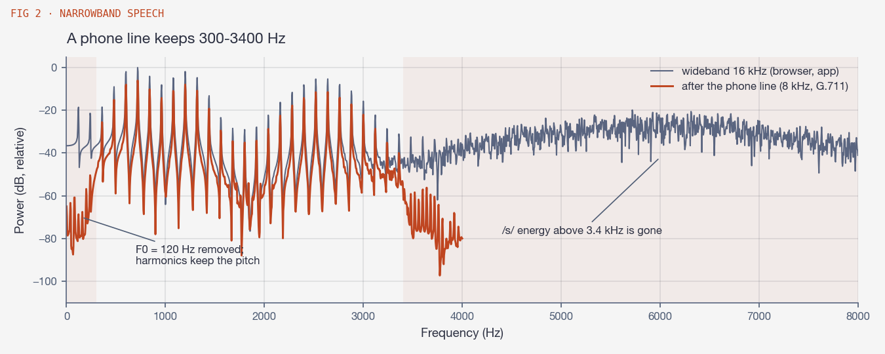
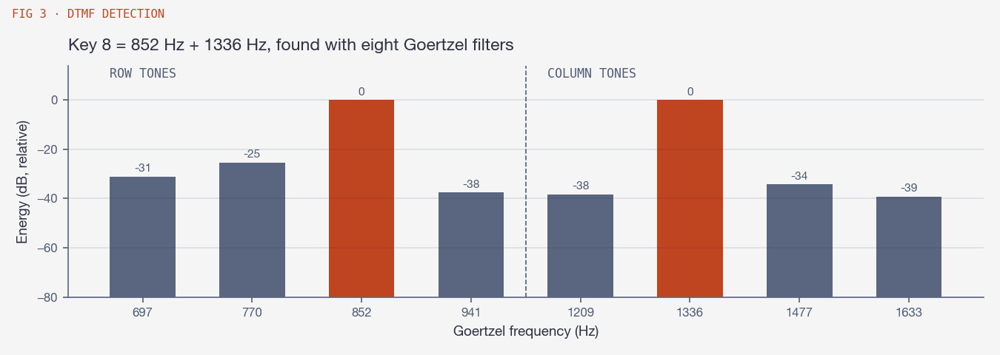

# Telephony and SIP: How a Phone Call Reaches Your Agent

> Before your agent hears a single word, the call has been negotiated, narrowed to 3.4 kHz, compressed to 8 bits, and cut into 20 ms packets. Every later lesson inherits these constraints.

**Type:** Learn + Build  
**Language:** Python  
**Prerequisites:** [Digital Audio](../../../01-audio-signal-processing/02-digital-audio/docs/en.md), [The Discrete Fourier Transform](../../../01-audio-signal-processing/04-discrete-fourier-transform/docs/en.md)  
**Time:** ~70 minutes

## Learning Objectives

- Trace an inbound call from the caller's phone, through a carrier and SIP trunk, into a LiveKit room.
- Read a SIP `INVITE` and its SDP offer, and predict which codec the call will use.
- Explain what an RTP packet carries and compute the bitrate of a G.711 call.
- Implement G.711 µ-law companding bit-exactly and explain why it beats 8-bit linear PCM on speech.
- Describe what the 300–3400 Hz telephone band removes, and why pitch (and Vietnamese tones) survive it.
- Detect DTMF keypresses with the Goertzel algorithm.

## The Problem

A voice agent tested in the browser receives 48 kHz Opus audio from a headset, with the browser's echo canceller already applied. The same agent behind a hotline receives something very different: a narrowband, companded, packetized stream produced by telephone equipment designed in the 1970s. The STT model, the VAD, the turn detector and your latency budget all operate on that stream.

An AI contact center (AICC) engineer therefore needs a working model of the phone network. It does not need to be a telecom engineer's model, but it must be accurate enough to explain what you see in production: why a fricative-heavy word is misheard, why a call drops after 15 seconds of silence, why a keypress does not reach the agent, or why the agent cannot hear the caller even though the call "connected".


## Two Planes: Signaling and Media

Every VoIP call is two conversations running in parallel.

| Plane | Protocol | Carries | Typical port |
| --- | --- | --- | --- |
| Signaling | SIP (RFC 3261) | Who is calling whom, call setup and teardown, transfers | UDP/TCP 5060, TLS 5061 |
| Session description | SDP (RFC 4566) inside SIP bodies | IP and port for media, codec list, packet time, DTMF format | — |
| Media | RTP (RFC 3550) | The audio itself, one packet every 20 ms | A negotiated UDP port |
| DTMF | RTP `telephone-event` (RFC 4733) | Keypresses as events, not as audio | Same stream as audio |

The two planes fail independently. A call can be "answered" in SIP (200 OK) while no RTP arrives because of a firewall or NAT problem. The result is one-way or no audio. LiveKit treats this as a failure: if no RTP packet arrives within 30 s, or within 15 s once audio had started, the call is disconnected with a media timeout.

### SIP in one page

SIP is a text protocol modelled on HTTP: a start line, `Name: value` headers, an empty line, and an optional body.

```text
INVITE sip:+842873001234@sip.example-agent.io SIP/2.0
Via: SIP/2.0/UDP 203.0.113.10:5060;branch=z9hG4bK776asdhds
From: <sip:+84901234567@carrier.example.net>;tag=1928301774
To: <sip:+842873001234@sip.example-agent.io>
Call-ID: a84b4c76e66710@carrier.example.net
CSeq: 314159 INVITE
Content-Type: application/sdp
```

- **Methods** you meet in a contact center: `INVITE` (start a call), `ACK` (confirm the final answer), `BYE` (hang up), `CANCEL` (give up before answer), `REFER` (cold transfer), `OPTIONS` (health check), `INFO`.
- **Responses** reuse HTTP-style classes: `100 Trying`, `180 Ringing`, `183 Session Progress` (early media), `200 OK`, `486 Busy Here`, `487 Request Terminated`, `488 Not Acceptable Here` (no common codec), `603 Decline`, and `5xx` for server or trunk failure.
- **`From`** carries the caller ID, which becomes the caller's phone number in your agent. **`Call-ID`** identifies the call in every log line, from the carrier's switch to your agent. Log it.

### SDP: the offer/answer that picks the codec

The `INVITE` body is an SDP *offer*. The answerer replies with an SDP *answer* in its `200 OK`.

```text
c=IN IP4 203.0.113.10
m=audio 40000 RTP/AVP 8 0 101
a=rtpmap:8 PCMA/8000
a=rtpmap:0 PCMU/8000
a=rtpmap:101 telephone-event/8000
a=ptime:20
```

Read it as: *send my audio to 203.0.113.10:40000; I prefer payload type 8 (G.711 A-law), then 0 (G.711 µ-law); I send DTMF as payload type 101; each packet holds 20 ms.* Payload types 0 and 8 are static, so they may appear without an `a=rtpmap` line. Types 96–127 are dynamic and must be mapped. If nothing matches, the answerer must reject the call with `488`.

### RTP: 50 packets a second

RTP adds a 12-byte header to each chunk of encoded audio: a version, a payload type, a sequence number (to detect loss and reordering), a timestamp in samples (to schedule playout), and an SSRC that identifies the stream. For G.711 at 8 kHz with 20 ms packets:

$$160\ \text{samples} \times 1\ \text{byte} = 160\ \text{bytes payload}, \quad (160 + 12 + 8 + 20)\times 8 \times 50 = 80\ \text{kbps per direction on IPv4}$$

The sequence number advances by 1 per packet and the timestamp by 160. Lesson 03 uses these two fields to build a jitter buffer.

## G.711: 8 Bits That Sound Like 13

The PSTN samples at 8 kHz and spends 8 bits per sample: 64 kbps. Eight *linear* bits would give 256 evenly spaced levels, far too coarse for a quiet talker. G.711 instead spaces its levels logarithmically. Two variants exist: **µ-law (PCMU)** in North America and Japan, and **A-law (PCMA)** in most other countries. Both appear in SDP offers, so your stack must accept both.

µ-law follows the curve

$$F(x) = \operatorname{sgn}(x)\,\frac{\ln(1 + \mu|x|)}{\ln(1 + \mu)}, \quad \mu = 255,$$

which G.711 approximates with 8 straight segments of 16 steps each. Each segment doubles the step size. A sample's 8-bit code is therefore `sign | segment (3 bits) | step (4 bits)`, with all bits inverted so that silence is `0xFF`.


The right panel is the reason the scheme survived fifty years. Quantization error grows with the signal, so the signal-to-noise ratio stays near 35–38 dB whether the caller whispers or shouts. Linear 8-bit PCM is better only for very loud signals and collapses for quiet ones. For speech, whose level varies by 30 dB or more within a single call, µ-law gives roughly the quality of 13-bit linear PCM.

## The Telephone Band

The narrowband PSTN passes about 300–3400 Hz. Look at what that does to speech.



Two consequences matter for an AICC:

1. **Fricatives lose most of their energy.** /s/, /x/ and /f/ live largely above 4 kHz. Narrowband STT confuses them, especially in names, addresses and alphanumeric codes such as booking references. Prefer STT models trained or fine-tuned on 8 kHz call-center audio, such as the Vietnamese call-center model listed in the [SOTA tracker](../../../../sota/topics/asr.md). Confirm critical entities by reading them back or by sending an SMS.
2. **The fundamental is removed, but pitch survives.** A male voice at 120 Hz has its F0 filtered out. The harmonics at 360, 480, 600 Hz… remain, and both the ear and an autocorrelation pitch tracker recover 120 Hz from their spacing (the *missing fundamental*). This is why Vietnamese tones, carried by F0 contours, are still intelligible on the phone. `autocorrelation_pitch` in `main.py` shows it numerically.

Some carriers and LiveKit Phone Numbers support **HD voice** with G.722, which carries 16 kHz audio. Use it where you can; design for 8 kHz anyway.

## DTMF: Keypresses as Two Tones

A keypad press is the sum of a *row* tone and a *column* tone:

| | 1209 Hz | 1336 Hz | 1477 Hz | 1633 Hz |
| --- | :---: | :---: | :---: | :---: |
| **697 Hz** | 1 | 2 | 3 | A |
| **770 Hz** | 4 | 5 | 6 | B |
| **852 Hz** | 7 | 8 | 9 | C |
| **941 Hz** | * | 0 | # | D |

Modern trunks send keypresses out of band as RFC 4733 `telephone-event` packets, so no tone detection is needed. Some legacy paths still send them *in band*, as audio. To detect a tone you only need eight DFT bins, and the Goertzel algorithm computes one bin with a two-tap recursion:

$$s[n] = x[n] + 2\cos(\omega)\,s[n-1] - s[n-2], \qquad P = s[N-1]^2 + s[N-2]^2 - 2\cos(\omega)\,s[N-1]\,s[N-2]$$



## Build It

`code/main.py` implements every piece with NumPy and the standard library:

| Function | What it does |
| --- | --- |
| `parse_sip_message`, `parse_sdp`, `negotiate_codec` | Read an `INVITE`, extract the media address and codecs, and choose a codec in the offer's order |
| `pack_rtp_header`, `packetize`, `rtp_bitrate_kbps` | Build RFC 3550 headers and 20 ms packets |
| `mulaw_encode`, `mulaw_decode` | Bit-exact G.711 µ-law, verified against Python's `audioop` on all 65,536 inputs |
| `bandpass_fir`, `phone_channel` | A windowed-sinc 300–3400 Hz filter, decimation to 8 kHz, and µ-law: a phone line in three lines |
| `goertzel_power`, `detect_dtmf` | Single-bin DFT and a keypress detector with a dominance test |

The encoder is the classic segment search:

```python
def mulaw_encode(pcm16):
    x = np.asarray(pcm16, dtype=np.int32) >> 2                 # 14-bit
    mask = np.where(x < 0, 0x7F, 0xFF)                          # sign + bit inversion
    magnitude = np.minimum(np.abs(x), 8159) + 33                # bias
    segment = np.searchsorted(MU_SEGMENT_ENDS, magnitude)       # 3-bit exponent
    step = (magnitude >> (np.minimum(segment, 7) + 1)) & 0x0F   # 4-bit mantissa
    return (np.where(segment >= 8, 0x7F, (segment << 4) | step) ^ mask).astype(np.uint8)
```

Run it from this lesson directory:

```bash
python3 code/main.py
python3 -m unittest discover -s code/tests -v
python3 code/generate_figures.py --output-dir assets/generated
```

Expected output includes `Negotiated codec: PT 8 = PCMA/8000`, `50 RTP packets of 172 bytes`, `80.0 kbps`, a quiet-tone SNR of about 37 dB for µ-law against 15 dB for 8-bit linear, and a pitch of 119 Hz after the 300 Hz high-pass.

## Use It in Practice: the LiveKit Call Path

You will not write a SIP stack. LiveKit's SIP service terminates SIP and RTP for you, then bridges the caller into a room as a **SIP participant**. Your agent joins the same room. The objects map onto this lesson as follows:

| Telephony concept | LiveKit object |
| --- | --- |
| Carrier connection | **Inbound trunk** (accepts calls, optionally restricted by number or IP) and **outbound trunk** (places calls) |
| Where an `INVITE` goes | A **dispatch rule** chooses the room: `SIPDispatchRuleIndividual` (one new room per caller, recommended for agents), `SIPDispatchRuleDirect`, or `SIPDispatchRuleCallee` |
| Which agent answers | `RoomConfiguration(agents=[RoomAgentDispatch(agent_name=...)])` on the dispatch rule |
| `From` header, `Call-ID` | Participant attributes `sip.phoneNumber`, `sip.callID`, `sip.trunkPhoneNumber`, `sip.callStatus` |
| `200 OK` | Sent after another participant in the room (your agent) publishes an audio track; `AgentSession` publishes one when it starts |
| SDP codec list | `PCMU`, `PCMA` and `G722` are offered by default; configurable per trunk |
| RFC 4733 DTMF | The `sip_dtmf_received` room event; `publish_dtmf()` to send |
| `REFER` | `TransferSIPParticipant` (cold transfer); lesson 10 covers warm transfer |
| `BYE` | Deleting the room hangs up the caller |

A dispatch rule that sends every caller to a fresh room and a named agent is created once and reused:

```python
from livekit import api

async def create_rule() -> None:
    lkapi = api.LiveKitAPI()
    await lkapi.sip.create_sip_dispatch_rule(
        api.CreateSIPDispatchRuleRequest(
            dispatch_rule=api.SIPDispatchRuleInfo(
                rule=api.SIPDispatchRule(
                    dispatch_rule_individual=api.SIPDispatchRuleIndividual(room_prefix="call-")
                ),
                name="hotline",
                room_config=api.RoomConfiguration(
                    agents=[api.RoomAgentDispatch(agent_name="inbound-agent")]
                ),
            )
        )
    )
    await lkapi.aclose()
```

And the agent reads the caller's number from the SIP participant, and DTMF from the room:

```python
from livekit import rtc

participant = await ctx.wait_for_participant()
if participant.kind == rtc.ParticipantKind.PARTICIPANT_KIND_SIP:
    caller = participant.attributes.get("sip.phoneNumber")

@ctx.room.on("sip_dtmf_received")
def on_dtmf(dtmf: rtc.SipDTMF):
    print(f"keypress {dtmf.digit}")
```

The snippets follow the LiveKit docs for `livekit-agents` 1.8 ([SIP primer](https://docs.livekit.io/reference/telephony/sip-primer), [dispatch rules](https://docs.livekit.io/telephony/accepting-calls/dispatch-rule), [SIP participant](https://docs.livekit.io/reference/telephony/sip-participant), [DTMF](https://docs.livekit.io/telephony/features/dtmf)). The next lesson builds a complete inbound agent around them.

## Pitfalls

- **Treating "connected" as "hearing".** SIP can succeed while RTP is blocked. Check for one-way audio first when a caller says "hello?" repeatedly.
- **Logging without the `Call-ID`.** It is the only identifier shared by the carrier, LiveKit and your agent. Put `sip.callID` in every log line.
- **Upsampling 8 kHz audio and calling it wideband.** Resampling to 16 kHz does not restore the 4–8 kHz band. An STT model will see an empty upper half of the spectrum, which is a domain shift from its training data.
- **Expecting DTMF as audio.** With RFC 4733, keypresses never appear in the audio track. Your STT will not "hear" them; listen for `sip_dtmf_received`.
- **Putting caller phone numbers in room names.** An individual dispatch rule puts the caller's number in the room name, and PII redaction does not remove it. Treat room names as PII in logs and dashboards.
- **Mixing up µ-law and A-law.** Decoding A-law bytes as µ-law produces loud, distorted audio. Always decode according to the negotiated payload type.

## Exercises

1. Change the SDP offer to `m=audio 40000 RTP/AVP 9 0 101` with `a=rtpmap:9 G722/8000`. What does `negotiate_codec(offer, ("G722", "PCMU"))` return, and why is the clock rate 8000 even though G.722 carries 16 kHz audio?
2. Compute the IPv4 wire bitrate of G.711 with 10 ms and 30 ms packets. Which one would you choose for a lossy mobile network, and what do you trade?
3. Implement G.711 A-law (PCMA). Plot its SNR against level next to µ-law and describe the difference at very low levels.
4. Run `phone_channel` on a real 16 kHz recording of your own voice, listen to the result, and measure `band_energy_fraction` above 3.4 kHz for a sentence rich in /s/ sounds.
5. Add 20 dB SNR white noise to a DTMF tone and find the lowest SNR at which `detect_dtmf` still returns the right key.

## Key Terms

| Term | Meaning |
| --- | --- |
| PSTN | Public switched telephone network: the carriers' circuit-switched phone system. |
| SIP trunk | A carrier connection that delivers calls over SIP instead of physical lines. |
| SIP | Text protocol that sets up, modifies and ends calls (signaling). |
| SDP | Session description carried in SIP bodies: media address, codecs, packet time. |
| RTP | Real-time Transport Protocol: carries the encoded audio packets. |
| G.711 µ-law / A-law | 8 kHz, 8-bit logarithmic codecs of the PSTN (PCMU / PCMA). |
| Companding | Compressing amplitude before quantization and expanding it after, to spend levels where they matter. |
| DTMF | Dual-tone multi-frequency signalling: keypad presses as pairs of tones or RFC 4733 events. |
| Goertzel algorithm | Recursive computation of a single DFT bin. |
| Dispatch rule | LiveKit rule that maps an inbound SIP call to a room and an agent. |
| SIP participant | The caller, represented inside a LiveKit room. |

## Further Reading

- [RFC 3261: SIP](https://www.rfc-editor.org/rfc/rfc3261), [RFC 4566: SDP](https://www.rfc-editor.org/rfc/rfc4566), [RFC 3550: RTP](https://www.rfc-editor.org/rfc/rfc3550), [RFC 4733: DTMF events](https://www.rfc-editor.org/rfc/rfc4733)
- [ITU-T G.711: Pulse code modulation of voice frequencies](https://www.itu.int/rec/T-REC-G.711)
- [LiveKit: SIP primer](https://docs.livekit.io/reference/telephony/sip-primer) and [codec negotiation](https://docs.livekit.io/reference/telephony/codecs-negotiation)
- [LiveKit: telephony overview](https://docs.livekit.io/telephony)
