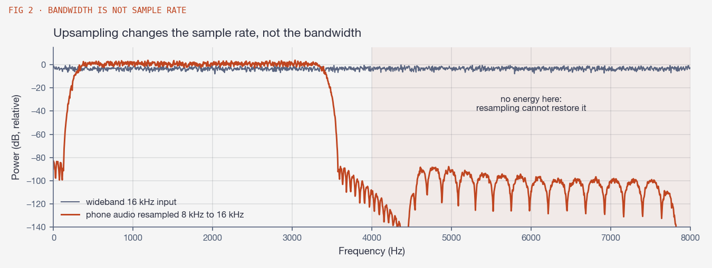

# LiveKit Voice Agent Architecture: From SIP Participant to AgentSession

> The phone leg ends at LiveKit SIP. From there on, a caller is an ordinary participant in a room, and your agent is another one.

**Type:** Learn + Build  
**Language:** Python  
**Prerequisites:** [Telephony and SIP](../../01-telephony-and-sip/docs/en.md), [Digital Audio](../../../01-audio-signal-processing/02-digital-audio/docs/en.md)  
**Time:** ~75 minutes

## Learning Objectives

- Name the LiveKit objects a phone call touches (trunk, dispatch rule, room, SIP participant, track, agent server, job, `AgentSession`) and what each one owns.
- Choose between the three inbound dispatch rule types and predict the room a call lands in.
- Explain how an agent server runs one job per call, and why prewarming matters.
- Compare a cascaded STT → LLM → TTS pipeline with a realtime speech model for a contact center.
- Trace the sample rate and frame size of audio from the phone line to the models and back.
- Build a polyphase windowed-sinc resampler and a fixed-size frame stream, and explain why upsampling cannot add bandwidth.

## The Problem

Lesson 01 ended with RTP packets arriving at LiveKit SIP. Your Python code never sees those packets. It sees a *room*, a *participant* with an *audio track*, and an `AgentSession` that turns that track into turns, tool calls and synthesized replies. When something goes wrong in production — no agent joins, the agent joins the wrong call, the caller hears silence, or STT accuracy drops — the cause is usually at a boundary between these objects. This lesson draws the boundaries.


## The Objects, Outside In

| Object | Created | Owns |
| --- | --- | --- |
| **Inbound trunk** | Once, by you | Which carrier traffic LiveKit accepts (numbers, IPs), codecs, Krisp on the trunk, media encryption |
| **Outbound trunk** | Once, or inline per call | How LiveKit places calls through your carrier |
| **Dispatch rule** | Once, by you | Which room an inbound call joins, and which agent is dispatched there |
| **Room** | Per call, by the rule | The meeting place. Everything in a call happens inside one room |
| **SIP participant** | Per call, by LiveKit SIP | The caller, with `sip.*` attributes and one audio track |
| **Agent server** | Long-running, by you | A process pool that registers with LiveKit and accepts jobs |
| **Job** | Per room, by LiveKit | One run of your entrypoint function, in its own process |
| **`AgentSession`** | Per job, by your code | The voice pipeline: audio in, turns, LLM, tools, audio out |

Two rules from the LiveKit docs shape everything else. Create trunks and dispatch rules **once** and reuse them: per-call dispatch rules "add unnecessary load and can degrade reliability at scale". And LiveKit only **answers** an inbound call after another participant in the room publishes an audio track. An `AgentSession` publishes one when it starts, so a crashed or slow agent leaves the caller ringing.

### Dispatch rules: which room?

LiveKit has three inbound rule types:

| Rule | Room name | Use it for |
| --- | --- | --- |
| `SIPDispatchRuleIndividual(room_prefix=...)` | prefix + caller number + random suffix, **one new room per call** | Voice agents. This is the recommended default |
| `SIPDispatchRuleDirect(room_name=..., pin=...)` | A fixed room for every caller, optionally behind a PIN | Conference bridges, not agents |
| `SIPDispatchRuleCallee(room_prefix=..., randomize=...)` | prefix + the **dialed** number, plus a suffix if randomized | Routing by hotline number, or pre-creating a room per call |

A rule can match all trunks (no `trunk_ids`) or specific ones, and several rules can share a trunk if each has a different PIN. The rule's `room_config` names the agent to dispatch, and its `attributes` and `metadata` are copied onto the SIP participant. `hide_phone_number=True` removes `sip.phoneNumber`. The individual rule puts the caller's number in the room name, and PII redaction does not remove it from there.

`route_call` in `main.py` simulates this matching so you can test routing logic without a phone:

```python
rules = [
    DispatchRule(kind="direct", room_name="vip-line", pin="2468"),
    DispatchRule(kind="individual", room_prefix="call-", agent_name="inbound-agent"),
]
route_call(rules, "ST_hotline", "+84901234567", "+842873001234", "a84b4c76e66710")
# {'room': 'call-+84901234567_5wsjkbca', 'agent_name': 'inbound-agent', 'attributes': {...}}
```

The random suffix format in the simulator is illustrative. Do not parse real room names. Read the `sip.*` attributes instead.

### Agent servers, jobs and prewarm

Your agent code runs as an **agent server**. It registers an entrypoint under an `agent_name` with `@server.rtc_session(agent_name=...)`. When a dispatch rule names that agent, LiveKit sends a job to an available server, which runs the entrypoint in a separate process with a `JobContext` for that room. One call, one room, one job, one `AgentSession`.

Starting a process and loading models takes time, and that time is added to the caller's first silence. The server therefore keeps idle processes ready, and runs `server.setup_fnc` (a *prewarm* function) once per process to load things like a VAD model before any call arrives. `AgentSession` also prewarms its STT, LLM and TTS connections automatically. Lesson 09 measures what this saves.

### Cascaded or realtime?

| | Cascaded STT → LLM → TTS | Realtime speech model |
| --- | --- | --- |
| Latency | Higher: three hops | Lowest |
| Transcript | Full text at every step, easy to audit | Delayed or partial |
| Scripted speech (`say`) | Exact | Usually needs a separate TTS |
| Tools and business logic | Mature | Improving |
| Language choice | Pick the best STT and TTS for Vietnamese separately | Limited to the model's languages and voices |

The LiveKit docs recommend the cascaded pipeline as the default for most production agents. For a contact center the audit trail, exact compliance wording, and per-language model choice usually decide it. The rest of this module assumes a cascaded pipeline.

## Audio Along the Call Path

Each hop has its own sample rate and frame size:

| Hop | Rate | Frame | Samples per frame |
| --- | --- | --- | --- |
| Phone line, G.711 (lesson 01) | 8 kHz | 20 ms | 160 |
| Room track (WebRTC Opus) | 48 kHz | 10 ms (typical) | 480 |
| VAD / STT input | 16 kHz (Silero accepts 8 or 16 kHz) | 10 ms | 160 |
| TTS output | 24 kHz (model dependent) | 10 ms | 240 |

Treat the exact numbers as typical values, not guarantees: log the rate and frame length you actually receive. The framework handles these conversions, but you will meet them as soon as you write a custom STT node, record calls, or debug audio. Every conversion is a resampler, and a resampler is a low-pass filter.

### Resampling is filtering

To change the rate by a rational factor `up/down`, conceptually insert `up − 1` zeros between samples, low-pass filter to remove the spectral images and anything above the new Nyquist frequency, and keep every `down`-th sample. A *polyphase* implementation computes the same result without the zeros: output sample `n` only needs one subset (phase) of the filter taps.

$$y[n] = \sum_k x[k]\, h[n\cdot \text{down} + D - k\cdot \text{up}]$$


Linear interpolation, the shortcut many hand-written pipelines use, has no anti-alias filter. Any energy above the new Nyquist folds back into the speech band as tones and hiss that the STT model has never seen.

### Upsampling does not add bandwidth

Upsampling 8 kHz phone audio to 16 kHz gives the STT model the sample rate it asked for, but the 4–8 kHz half of its input spectrum is empty. A model trained only on wideband audio sees a domain shift. This is why STT models trained on call-center audio, or those offered with a phone-call variant, matter for an AICC, and why the G.722 HD voice offered by some carriers is worth enabling.



## Build It

| Function or class | What it does |
| --- | --- |
| `kaiser_lowpass`, `design_resampler` | Windowed-sinc filter design for any `up/down` pair, with the cutoff at the lower Nyquist frequency |
| `resample` | Polyphase rational resampling, compared with `librosa.resample` in the tests |
| `naive_resample` | Linear interpolation, kept to demonstrate aliasing |
| `FrameStream` | Re-chunks arbitrary audio pieces into exact 10 or 20 ms frames, with a zero-padded flush |
| `DispatchRule`, `route_call` | Simulates individual, direct and callee rules, PINs, trunk filters and the `sip.*` attributes |

The core of the resampler gathers one filter phase per output sample:

```python
u = np.arange(n_out) * down + delay            # position on the virtual upsampled grid
phase, base = u % up, u // up                  # which taps, which input sample
idx = base[:, None] - np.arange(per_phase)     # input samples under the filter
gathered = np.where(valid, x[np.clip(idx, 0, len(x) - 1)], 0.0)
y = np.sum(gathered * phases[phase], axis=1)
```

Run it from this lesson directory:

```bash
python3 code/main.py
python3 -m unittest discover -s code/tests -v
python3 code/generate_figures.py --output-dir assets/generated
```

Expected output includes the frame table above, `Resample 48000 -> 8000 Hz: up 1, down 6, 193 taps`, the 2 kHz alias at about −122 dB with filtering against −6 dB without, and `20 uneven chunks -> 26 frames of 160 samples`. On band-limited test signals the resampler matches `librosa.resample` to within 1e-4.

## Use It in Practice: A Minimal Hotline Agent

[`code/livekit_agent.py`](../code/livekit_agent.py) is a complete inbound agent for a Vietnamese hotline. It needs `livekit-agents~=1.8` and LiveKit Cloud credentials, so it is not run in CI. The essential part:

```python
server = AgentServer()

@server.rtc_session(agent_name="hotline-agent")
async def hotline(ctx: JobContext) -> None:
    participant = await ctx.wait_for_participant()
    caller = participant.attributes.get("sip.phoneNumber")

    session = AgentSession(
        stt="deepgram/nova-3:vi",
        llm="openai/gpt-4.1-mini",
        tts=TTS_MODEL,  # a LiveKit Inference TTS model with a Vietnamese voice
        turn_handling=TurnHandlingOptions(
            turn_detection="vad",  # the turn detector models do not cover Vietnamese
            endpointing={"min_delay": 0.5, "max_delay": 3.0},
        ),
    )
    await session.start(
        room=ctx.room,
        agent=HotlineAgent(caller),
        room_options=room_io.RoomOptions(
            audio_input=room_io.AudioInputOptions(
                noise_cancellation=krisp.voice_isolation_telephony(),
            ),
        ),
    )
    await session.generate_reply(instructions="Chào người gọi và hỏi bạn có thể giúp gì.")
```

Points worth noticing:

- **`agent_name` makes dispatch explicit.** Only rules or API calls that name `hotline-agent` start this entrypoint. This matches the `RoomAgentDispatch(agent_name=...)` in the dispatch rule from lesson 01.
- **Turn handling is one nested option.** Since `livekit-agents` 1.8, `turn_detection`, `endpointing`, `interruption` and `preemptive_generation` live inside `TurnHandlingOptions`. The old flat arguments (`min_endpointing_delay`, `allow_interruptions`, …) are deprecated.
- **Vietnamese needs `turn_detection="vad"` (or `"stt"`).** LiveKit's audio turn detector, the default, supports 14 languages, and Vietnamese is not one of them. The docs recommend VAD or STT endpointing for uncovered languages. Lessons 06 and 07 tune this.
- **Noise cancellation is configured on room input**, with a model tuned for SIP callers. Lesson 04 explains what it does and when not to stack it.
- **Hanging up means deleting the room.** The `end_call` tool waits for playout, then calls `get_job_context().delete_room()`, which disconnects the SIP caller. If the session ends without deleting the room, the caller hears silence until they hang up.
- **Choose models per language.** `deepgram/nova-3:vi` uses the LiveKit Inference `model:language` string form, and Nova-3 lists `vi` among its languages. TTS is read from an environment variable because the available Vietnamese voices change. Pick one from the TTS models page.

Sources: [voice AI quickstart](https://docs.livekit.io/agents/start/voice-ai), [telephony overview](https://docs.livekit.io/telephony), [dispatch rules](https://docs.livekit.io/telephony/accepting-calls/dispatch-rule), [agent dispatch](https://docs.livekit.io/agents/server/agent-dispatch), [pipeline types](https://docs.livekit.io/agents/models/pipelines), [STT models](https://docs.livekit.io/agents/models/stt), [turn handling options](https://docs.livekit.io/reference/agents/turn-handling-options).

## Pitfalls

- **Creating a dispatch rule per call.** Create rules once. Per-call rules add load and hurt reliability.
- **A slow entrypoint before `session.start()`.** The call is answered only after the agent publishes audio. Fetching a CRM record before starting the session keeps the caller ringing. Start the session first, then load context in parallel.
- **Parsing room names.** Room name formats are an implementation detail and may contain the caller's number. Read `sip.phoneNumber` and `sip.callID` from attributes.
- **Hand-written resampling with `np.interp` or slicing.** Both alias. Use a filtered resampler, or leave conversion to the framework.
- **Assuming 16 kHz means wideband.** Check the spectrum, not the header. Phone audio stays narrowband after upsampling.
- **Forgetting the deprecation.** Code copied from older examples passes `min_endpointing_delay=` to `AgentSession`. It still runs with a warning, but new options exist only inside `TurnHandlingOptions`.

## Exercises

1. Resample a 3.9 kHz tone from 8 kHz to 16 kHz with `zeros=4`, `8`, and `16`. Measure the level of its image at 4.1 kHz and the cost in taps per output sample.
2. Implement `44_100 → 16_000` (factors 160/441). How many taps does the filter have, and how many multiplications per output sample does the polyphase form need?
3. Feed `FrameStream` the 160-byte payloads from lesson 01's `packetize`, decoded to float, and confirm it yields 20 ms frames with no gaps.
4. Extend `route_call` so that a rule restricted to a specific trunk wins over a wildcard rule. Write a test for it. Then check the LiveKit docs for how real rule precedence works, and note any difference.
5. Read `code/livekit_agent.py` and list every place where a slow network call would delay the moment the caller hears the agent.

## Key Terms

| Term | Meaning |
| --- | --- |
| Room | LiveKit's container for one real-time session; one per call for an agent. |
| Participant | A member of a room: a SIP caller, an agent, or a browser user. |
| Track | A stream of audio (or video) published by a participant. |
| Dispatch rule | Maps an inbound call to a room and an agent. |
| Agent server | Your long-running process that registers entrypoints and runs jobs. |
| Job | One execution of an entrypoint for one room, in its own process. |
| Prewarm | Loading models and opening connections before a call arrives. |
| `AgentSession` | The per-call voice pipeline: VAD, turns, STT, LLM, tools, TTS. |
| Cascaded pipeline | Separate STT, LLM and TTS models, as opposed to a single realtime speech model. |
| Polyphase resampler | A rational resampler that computes each output from one phase of the filter. |

## Further Reading

- [LiveKit: rooms, participants and tracks](https://docs.livekit.io/intro/basics/rooms-participants-tracks)
- [LiveKit: dispatch rules](https://docs.livekit.io/telephony/accepting-calls/dispatch-rule) and [agent dispatch](https://docs.livekit.io/agents/server/agent-dispatch)
- [LiveKit: pipeline types](https://docs.livekit.io/agents/models/pipelines)
- [Julius O. Smith: Digital Audio Resampling](https://ccrma.stanford.edu/~jos/resample/)
- [librosa.resample](https://librosa.org/doc/latest/generated/librosa.resample.html)
