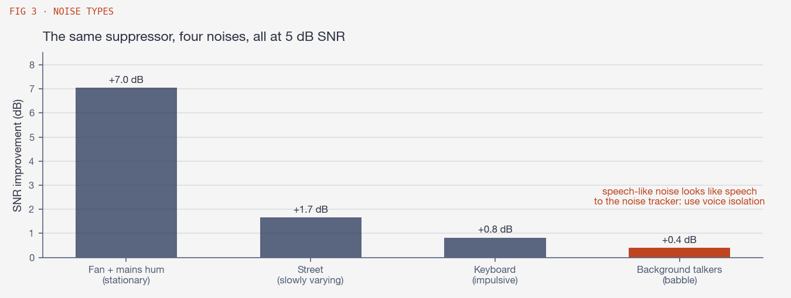

# Noise Suppression: Cleaning the Caller's Audio Without Hurting the Words

> A noise suppressor never knows which energy is speech. It estimates the noise, guesses a gain for every time-frequency bin, and lives with the mistakes.

**Type:** Learn + Build  
**Language:** Python  
**Prerequisites:** [Line Quality](../../03-line-quality-jitter-and-loss/docs/en.md), [The Short-Time Fourier Transform](../../../01-audio-signal-processing/05-short-time-fourier-transform/docs/en.md)  
**Time:** ~80 minutes

## Learning Objectives

- Classify call-center noise as stationary, slowly varying, impulsive or speech-like, and predict which a single-channel suppressor can handle.
- Build a perfect-reconstruction STFT and apply a time-frequency gain to it.
- Track the noise spectrum during speech with minimum statistics, without a VAD.
- Implement power spectral subtraction and a Wiener filter with the decision-directed a priori SNR.
- Explain musical noise, and measure it.
- Separate a suppressor's effect into noise reduction and speech distortion, and recognize over-suppression.
- Configure LiveKit's noise cancellation for SIP callers, and know when not to add another stage.

## The Problem

Callers phone a contact center from cars, markets, motorbikes, open-plan offices and kitchens. Noise lowers STT accuracy, and it does something worse to a voice agent: VAD and turn detection (lessons 06–07) start treating noise as speech. The agent interrupts itself, waits for a user turn that never ends, or answers a television in the background.

Noise suppression helps, but only up to a point. Every gain below 1 removes some speech along with the noise, and STT models are trained on natural speech, not on suppressed speech. The goal is not the cleanest-looking spectrogram. It is the lowest error rate and the fewest false turns.

![Pipeline of a single-channel noise suppressor. Noisy caller audio is cut into frames and transformed by an STFT. Its power feeds a minimum-statistics noise tracker, whose noise spectrum feeds the gain rule: a Wiener rule with a decision-directed SNR estimate and a gain floor, which also uses the previous frame's cleaned spectrum. The gain mask is applied to each bin, and an inverse STFT with overlap-add produces enhanced audio for VAD and STT. A note says that noise suppression assumes the noise is not speech, so a colleague talking behind the caller needs voice isolation.](../assets/concept.svg)

## What Kind of Noise?

| Noise | Example | Statistics | Single-channel suppression |
| --- | --- | --- | --- |
| Stationary | Fan, air conditioner, 50 Hz mains hum | Spectrum constant over seconds | Works well |
| Slowly varying | Street, car interior, passing traffic | Level drifts over seconds | Works, with tracking lag |
| Impulsive | Keyboard, dishes, door slams | Short bursts | Poorly: too fast for the tracker |
| Speech-like | Colleagues, TV, call-center babble | Same spectrum and modulation as speech | Fails: needs voice isolation |

The last row matters most in an AICC. A caller in a busy office, or a human agent's colleague during a warm transfer, produces exactly the kind of noise a classical suppressor cannot see.

## Working in the STFT Domain

All the methods here share one structure. Take the STFT of the noisy signal $X(t,f) = S(t,f) + N(t,f)$, compute a real gain $G(t,f) \in [0,1]$ for each bin, and resynthesize $\hat S = G \cdot X$. With a square-root Hann window used for both analysis and synthesis at 50% overlap, the STFT reconstructs the input exactly (`main.py` checks this to 1e-16), so any change in the output comes from the gain.

### Estimating the noise without a VAD

The gain rules need the noise power $\lambda_N(f)$, and they need it *during* speech. Waiting for pauses requires a VAD, and a VAD in noise is the problem we are trying to solve. **Minimum statistics** (Martin, 2001) avoids that. Smooth each bin's power over time, then take the minimum over the last 1.5 s. Speech rarely occupies one frequency bin continuously for that long, so the minimum follows the noise floor. The minimum of a fluctuating estimate is biased low, so it is scaled up by a bias factor. On the fan noise in `main.py`, the tracked level is within 0.3 dB of the truth.

### Two gain rules

**Power spectral subtraction** subtracts the noise estimate from each bin's power:

$$G_{SS} = \sqrt{\max\!\left(1 - \beta\,\frac{\lambda_N}{|X|^2},\; g_{\min}^2\right)}$$

with an over-subtraction factor $\beta$ and a spectral floor $g_{\min}$.

**The Wiener filter** minimizes mean-square error for a given a priori SNR $\xi = \lambda_S/\lambda_N$: $G_W = \xi/(1+\xi)$. The question is how to estimate $\xi$. The **decision-directed** estimate (Ephraim and Malah, 1984) mixes the previous frame's cleaned power with the current frame's instantaneous estimate:

$$\hat\xi(t) = \alpha\,\frac{|\hat S(t-1)|^2}{\lambda_N} + (1-\alpha)\max(\gamma(t) - 1, 0), \qquad \gamma = \frac{|X|^2}{\lambda_N}$$

With $\alpha \approx 0.98$, the gain changes smoothly from frame to frame.


### Musical noise

In noise-only bins, $|X|^2$ fluctuates randomly around $\lambda_N$. Subtraction zeroes the bins that happen to fall below the estimate and keeps random peaks in the ones above it. The survivors are isolated in time and frequency, and they sound like short tones twinkling on and off: **musical noise**. Listeners find it more annoying than the original noise, and an STT model has never been trained on it.

Two fixes appear in the figure. A **spectral floor** keeps every gain above $g_{\min}$, so the residual sounds like the original noise, only quieter. The **decision-directed** estimate smooths $\xi$ over time, so a single random peak cannot open the gain. `musical_noise` measures the effect as the share of time-frequency bins in speech pauses that stand more than 10 dB above their 5×5 neighbourhood. Raw noise scores 0.5%, subtraction without a floor 18%, and the Wiener filter 7%.

## The Trade-off: Noise Reduction against Speech Distortion

The gain is linear in each bin, so we can apply the *same* gain to the clean speech and the noise separately and measure two things:

- **Noise reduction**: how much quieter the noise got.
- **Speech distortion**: the energy of the change made to the speech, relative to the speech. Lower is better.

Over-estimating the noise by a factor makes the suppressor more aggressive:


Past the best point, the suppressor removes so much speech that the output SNR *falls* even though the noise keeps dropping. In a phone call, the first casualties are quiet consonants and word endings. Those are the same cues that the 8 kHz band already weakened (lesson 01), and the ones STT needs to tell similar Vietnamese syllables apart. Tune suppression against STT error rate on your own call recordings, not against how clean the spectrogram looks.

## When Suppression Fails: Noise That Looks Like Speech



A minimum-statistics tracker assumes noise is steadier than speech. Keyboard clicks are too fast for it, and the street noise's swell is larger and longer than its 1.5 s window can follow. Babble is speech: it has the same spectrum and the same pauses, so the tracker cannot separate it. Give the same Wiener rule the *true* noise spectrum, smoothed over 0.25 s, and the street case jumps to about +13 dB, but babble reaches only about +4 dB, half the fan result. A per-bin gain cannot remove a voice that overlaps the caller's speech in every bin without damaging the caller too (notebook, last cell).

That job needs **voice isolation**: neural models that learn what *one* primary talker sounds like and suppress everything else, including other voices. In a contact center, voice isolation is usually the right default for callers.

## Build It

| Function | What it does |
| --- | --- |
| `synthetic_speech`, `make_noise`, `mix_at_snr` | Deterministic speech-like signal, four call-center noises, and mixing at an exact SNR |
| `stft`, `istft` | Square-root Hann STFT with exact reconstruction at 50% overlap |
| `minimum_statistics` | Noise PSD tracking during speech, no VAD needed |
| `spectral_subtraction_gain`, `wiener_dd_gain` | The two gain rules, with over-estimation and gain floors |
| `enhance` | STFT → noise estimate → gain → inverse STFT |
| `snr_db`, `segmental_snr_db`, `distortion_and_reduction` | Output quality, and its split into noise reduction and speech distortion |
| `speech_absent_frames`, `isolated_peak_fraction`, `musical_noise` | Musical noise measured in speech pauses |

The decision-directed Wiener rule is a short loop:

```python
for i in range(len(power)):
    gamma = power[i] / noise_psd[i]                                   # a posteriori SNR
    xi = alpha * prev_clean / noise_psd[i] + (1 - alpha) * np.maximum(gamma - 1, 0)
    g = np.maximum(xi / (1 + xi), floor)
    gains[i] = g
    prev_clean = g ** 2 * power[i]                                    # feeds the next frame
```

Run it from this lesson directory:

```bash
python3 code/main.py
python3 -m unittest discover -s code/tests -v
python3 code/generate_figures.py --output-dir assets/generated
```

Expected output includes an STFT round-trip error near 2e-16, a noise estimate within 0.3 dB of the truth, output SNRs of 7.5, 9.2 and 12.0 dB for subtraction without a floor, subtraction with a floor and the Wiener filter, isolated peaks of 18.3%, 15.5% and 7.1%, and SNR improvements of +7.0, +1.7, +0.8 and +0.4 dB for fan, street, keyboard and babble.

## Use It in Practice: Noise Cancellation in LiveKit

You will not deploy this Wiener filter. LiveKit Cloud provides neural enhancement models that run on the caller's audio as it reaches the agent. Configure them on the session's room input:

```python
from livekit.agents import room_io
from livekit.plugins import krisp

await session.start(
    room=ctx.room,
    agent=MyAgent(),
    room_options=room_io.RoomOptions(
        audio_input=room_io.AudioInputOptions(
            noise_cancellation=krisp.voice_isolation_telephony(),  # tuned for SIP callers
        ),
    ),
)
```

What the docs say, mapped onto this lesson:

| Lesson concept | LiveKit |
| --- | --- |
| Noise suppression (non-speech noise) | **Background noise suppression**: removes non-speech noise and keeps other voices. Included in LiveKit Cloud, and better when several people should be heard |
| Voice isolation (speech-like noise) | **Voice isolation**: keeps one primary speaker and removes background voices. Extra cost. `krisp.voice_isolation_telephony()` is tuned for SIP; `krisp.voice_isolation()` targets other audio. Krisp exposes a suppression level from 0 to 100 (default 75) |
| Model choice | Krisp (`livekit-plugins-krisp`), ai-coustics (`QUAIL_VF_S`, `QUAIL_VF_L` voice focus, `QUAIL_L` noise suppression), and `noise_cancellation.NC()` in `livekit-plugins-noise-cancellation` |
| One stage only | Do not also enable noise cancellation in a frontend: the models are trained on raw audio. Since 1.8.9 the SDK warns when both the agent and the client apply it. Standard WebRTC noise suppression and echo cancellation can stay on |
| Trunk-level or agent-level | An inbound trunk can enable Krisp with `krisp_enabled` (and `CreateSIPParticipant` for outbound calls). That uses the standard noise model only, so the docs recommend agent-side noise cancellation when an agent handles the call |

The noise-cancelled audio is what VAD, turn detection, STT and LiveKit Cloud's session recordings receive. Your measurements of WER and false turns should therefore be made with noise cancellation on. Older examples use `noise_cancellation.BVCTelephony()`, which still appears in LiveKit example code. Current docs recommend `krisp.voice_isolation_telephony()` for SIP participants.

Sources: [Noise cancellation](https://docs.livekit.io/transport/media/noise-cancellation), [Telephony introduction](https://docs.livekit.io/agents/start/telephony), [Voice AI quickstart](https://docs.livekit.io/agents/start/voice-ai), [agents 1.8.9 release notes](https://github.com/livekit/agents/releases).

## Pitfalls

- **Stacking suppressors.** Carrier-side Krisp, a browser's neural NC, and agent-side voice isolation in series compound the distortion. Use one neural stage.
- **Tuning on spectrograms.** A quieter background is not the goal. Measure STT WER and false VAD triggers on real calls with and without suppression.
- **Over-suppression.** Aggressive settings remove word endings and quiet consonants first. If WER rises when you increase suppression, back off.
- **Using noise suppression for background voices.** It is designed to keep speech. A TV or a colleague needs voice isolation.
- **Ignoring the start of the call.** Trackers like minimum statistics need about a second to learn the noise. Short greetings such as "alô?" or "dạ" are processed with a poor estimate.
- **Forgetting the human leg.** During a warm transfer, the human agent's headset audio also enters the room. Their open-plan office is babble.

## Exercises

1. Mix the clean speech with each noise at 0, 5 and 10 dB SNR. Plot the Wiener filter's SNR improvement against input SNR for each noise type.
2. Replace minimum statistics with the true noise power smoothed over 0.25 s (`noise_psd=` argument of `enhance`). How much of each failure is the noise *estimate*, and how much is the gain rule? Why would an unsmoothed per-frame noise spectrum be an unfair oracle?
3. Sweep `alpha` in `wiener_dd_gain` from 0.5 to 0.995 and plot musical noise and speech distortion. Explain the trade-off.
4. Add a "keyboard click" detector: flag frames whose energy jumps more than 15 dB above the previous frame for less than 30 ms, and hold the gain at the floor there. Does it help the keyboard case?
5. If you have an STT API, transcribe 20 noisy call recordings with and without a suppressor at three aggressiveness levels, and plot WER. Where is the minimum?

## Key Terms

| Term | Meaning |
| --- | --- |
| Noise suppression | Reducing non-speech background noise in a speech signal. |
| Voice isolation | Keeping one primary speaker and removing everything else, including other voices. |
| Gain mask | Per time-frequency bin multiplier applied to the STFT. |
| Minimum statistics | Noise PSD estimation from the minimum of smoothed power over a sliding window. |
| Spectral subtraction | Subtracting an estimated noise power from the noisy power spectrum. |
| Wiener filter | Gain ξ/(1+ξ) that minimizes mean-square error for a given a priori SNR. |
| A priori SNR (ξ) | Ratio of clean speech power to noise power in a bin. |
| Decision-directed estimate | Smoothed ξ estimate that mixes the previous cleaned frame with the current observation. |
| Musical noise | Isolated residual spectral peaks that sound like random tones. |
| Speech distortion | Change to the speech caused by the suppressor, relative to the speech. |

## Further Reading

- Y. Ephraim, D. Malah, "Speech enhancement using a minimum mean-square error short-time spectral amplitude estimator", IEEE TASSP, 1984
- R. Martin, "Noise power spectral density estimation based on optimal smoothing and minimum statistics", IEEE TSAP, 2001
- S. Boll, "Suppression of acoustic noise in speech using spectral subtraction", IEEE TASSP, 1979
- P. C. Loizou, *Speech Enhancement: Theory and Practice*, CRC Press
- [LiveKit: noise cancellation](https://docs.livekit.io/transport/media/noise-cancellation)
