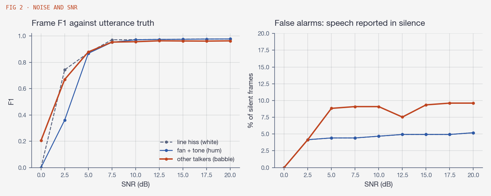

# Voice Activity Detection: Is Anyone Speaking?

> Every decision a voice agent makes about turns starts with one bit per 32 milliseconds: speech or not. Get that bit wrong and nothing downstream can fix it.

**Type:** Learn + Build  
**Language:** Python  
**Prerequisites:** [Time-Domain Features](../../../01-audio-signal-processing/03-time-domain-features/docs/en.md), [Frequency-Domain Features](../../../01-audio-signal-processing/07-frequency-domain-features/docs/en.md), [Noise Suppression](../../04-noise-suppression/docs/en.md)  
**Time:** ~70 minutes

## Learning Objectives

- Explain the three jobs a VAD does in a voice agent: open the STT stream, mark the end of speech for turn detection, and detect barge-in.
- Compute frame features that separate speech from noise, and explain why they must be measured *relative* to the background.
- Implement the Silero-style state machine: activation and deactivation thresholds, minimum speech and silence durations, and prefix padding.
- Evaluate a VAD like a product: frame F1, false alarms per noise type and SNR, onset clipping, and how late START and END events arrive.
- Choose `silero.VAD.load(...)` parameters for phone calls in LiveKit, and know which of them add latency.

## The Problem

In a LiveKit voice agent, the VAD runs on every frame of the caller's audio and drives three things:

1. **Start of speech.** It tells the session the caller has started talking. If the agent is speaking, that is a potential barge-in (lesson 08).
2. **End of speech.** It marks when the caller stopped, which starts the endpointing timer that decides when the agent may reply (lesson 07).
3. **What reaches STT and the turn detector.** Speech chunks, padded at the front, are what get transcribed and judged.

Each error has a visible symptom. A **false alarm** (noise called speech) makes the agent stop mid-sentence for a cough, a TV, or a colleague at the next desk. A **miss** makes a quiet caller wait for an answer that never comes. A **late END** adds directly to response latency. A **clipped onset** cuts the first syllable, which is often the word that matters: "*không*, I said Tuesday".


## From Features to a Probability

A frame of 32 ms (256 samples at 8 kHz, the window Silero uses) carries several cues:

| Feature | Speech | Hiss | Fan / hum | Other talkers |
| --- | --- | --- | --- | --- |
| Log energy | High, fluctuating | Steady | Steady | Fluctuating |
| Spectral flatness | Low (harmonics) | High (~0.5) | Low (coloured) | Low (harmonics) |
| Zero-crossing rate | Mixed | High | Low | Mixed |

Two lessons hide in this table. First, **absolute values are useless**: a fan is just as "non-flat" as a vowel, and a loud office is louder than a quiet caller. Every cue must be measured against a running estimate of the background. This lesson tracks a **noise floor** by following the energy down immediately and letting it creep up slowly, and tracks the background's **flatness** over frames that sit near that floor. Second, **babble is the hard case**: other people's voices have the same harmonic structure and fluctuation as the caller's voice. Only level, direction, or a learned model of the specific talker can separate them.

`speech_probability` adds two background-relative cues in the logit domain, so a strong cue can compensate for a weak one:

$$p = \sigma\!\left(\frac{E - \hat N - 8\,\text{dB}}{3\,\text{dB}} + \operatorname{clip}\!\left(\frac{\overline{\log F}_{\text{noise}} - \log F - 0.5}{0.5}, \pm 3\right)\right)$$

Silero replaces this with a small neural network trained on thousands of hours of speech and noise, which is why it is far better at low SNR. The state machine after it, and the trade-offs, are the same.

## From a Probability to Events

A raw probability flickers: it drops between syllables and spikes on clicks. The state machine converts it into stable events with four knobs. The names and defaults below are exactly those of LiveKit's Silero plugin:

| Parameter | Default | What it does | What it costs |
| --- | --- | --- | --- |
| `activation_threshold` | 0.5 | Probability needed to start counting speech | Lower: more false alarms |
| `deactivation_threshold` | `max(activation − 0.15, 0.01)` | Probability below which silence is counted; the gap is hysteresis | Lower: longer segments in noise |
| `min_speech_duration` | 0.05 s | Speech needed before START_OF_SPEECH | Longer: later START, clipped onsets |
| `min_silence_duration` | 0.55 s | Silence needed before END_OF_SPEECH | Every 100 ms adds 100 ms to every reply |
| `prefix_padding_duration` | 0.5 s | Audio kept before the confirmed onset | Memory, and a little extra audio for STT |


Read the bottom panel carefully. The VAD segment *begins* before the true onset (prefix padding), but the START decision (upward triangle) is made after it. The END decision (downward triangle) comes `min_silence_duration` after the caller actually stopped. Pauses shorter than that inside an utterance are bridged, which is what you want: the caller who says "my number is … 0903 … 123 … 456" in chunks should be one turn, not three.

## Measuring a VAD

Frame accuracy alone hides what callers feel. Measure four things on realistic audio:



- **F1 against utterance-level truth.** An utterance includes its short internal pauses, because that is the unit a voice agent should treat as one turn.
- **False alarms in true silence.** This is the number that predicts phantom barge-ins. Babble causes about twice as many as hiss at the same SNR.
- **Event delay.** START should arrive within about 100 ms of the onset; END arrives `min_silence_duration` after the offset by design.
- **Onset clipping.** How much of each utterance's start is missing from the speech chunk.


The right panel explains why prefix padding exists: by the time `min_speech_duration` has confirmed speech, the first syllable is already in the past. Padding hands that audio to STT anyway, at no cost in latency.

## Build It

`code/main.py` implements the detector and its evaluation with NumPy:

| Function | What it does |
| --- | --- |
| `synthetic_dialog`, `noise`, `mix_at_snr` | A 30-second call with multi-phrase utterances, three noise types, and exact SNR mixing |
| `log_energy_db`, `spectral_flatness`, `zero_crossing_rate` | Per-frame features on 32 ms frames |
| `track_noise_floor`, `track_noise_flatness` | Background estimates that make every cue relative |
| `speech_probability` | Combines the relative cues into one probability per frame |
| `VADParams`, `run_vad` | The Silero-style state machine, with LiveKit's parameter names and defaults |
| `frame_metrics`, `onset_clipping_ms`, `event_delays`, `evaluate` | F1, false alarms, onset clipping, START and END delays |

The heart of the state machine is the hysteresis and the two counters:

```python
if state == "MAYBE_SPEECH":
    if prob >= p.activation_threshold:
        count += 1
        if count >= need_speech:                      # min_speech_duration confirmed
            state = "SPEECH"
            result.events.append(((i + 1) * dur, "START_OF_SPEECH"))
    else:
        state = "SILENCE"
elif state == "SPEECH" and prob < p.deactivation():  # a lower bar to leave than to enter
    state, count, offset = "MAYBE_SILENCE", 0, i
```

Run it from this lesson directory:

```bash
python3 code/main.py
python3 -m unittest discover -s code/tests -v
python3 code/generate_figures.py --output-dir assets/generated
```

Expected output includes `white @ 20 dB SNR: F1 0.98, false alarms 5.2%`, with START after about 66 ms and END after about 570 ms; `babble @ 5 dB SNR: F1 0.88, false alarms 8.8%`; and 5 ms of onset lost without prefix padding against 0 ms with it.

## Use It in Practice: Silero VAD in LiveKit

`AgentSession` provisions a bundled Silero VAD automatically, so a default pipeline needs no VAD code at all. Configure it explicitly when you want to tune it for phone audio. Loading the model is blocking, so do it once per worker process in a prewarm function:

```python
from livekit import agents
from livekit.agents import AgentServer, AgentSession, JobContext, JobProcess
from livekit.plugins import silero

server = AgentServer()

def prewarm(proc: JobProcess):
    proc.userdata["vad"] = silero.VAD.load(
        activation_threshold=0.5,     # raise toward 0.6 for noisy call centers with background talkers
        min_silence_duration=0.55,    # the END delay; see lesson 07 before lowering it
        prefix_padding_duration=0.5,
    )

server.setup_fnc = prewarm

@server.rtc_session(agent_name="inbound-agent")
async def entrypoint(ctx: JobContext):
    session = AgentSession(vad=ctx.proc.userdata["vad"])  # + stt, llm, tts
    ...

if __name__ == "__main__":
    agents.cli.run_app(server)
```

Facts to keep in mind ([LiveKit VAD docs](https://docs.livekit.io/agents/logic/turns/vad)):

- The plugin's defaults are those in the table above, plus `max_buffered_speech=60.0` s and `force_cpu=True`. It runs locally on CPU and produces a decision every 32 ms.
- `sample_rate` must be 8000 or 16000. Phone audio is natively 8 kHz.
- The VAD warns when inference falls more than 200 ms behind real time. On an overloaded worker, every turn gets slower.
- With LiveKit's audio turn detector, `min_silence_duration` must be at least 0.25 s, otherwise the session raises a `ValueError` at start.
- In `turn_detection="vad"` mode, which LiveKit recommends for languages its turn detector does not cover, including Vietnamese, the end-of-turn wait is roughly the larger of the VAD's silence duration and `endpointing.min_delay`. Lesson 07 tunes these together.
- Thresholds can be changed at runtime with `update_options(...)`, for example after detecting a speakerphone or a noisy environment.

## Pitfalls

- **Tuning on clean audio.** A VAD tuned on studio recordings fires on every keyboard click in a call center. Tune on real 8 kHz calls, with babble and speakerphones.
- **Lowering `min_silence_duration` to cut latency.** It does cut latency, and it also splits a caller who pauses while reading a phone number into several turns. Use endpointing (lesson 07) for latency instead.
- **Dropping prefix padding.** Without it, STT never hears the first syllable, which is often "no" or the first digit of a number.
- **Double enhancement.** Aggressive noise suppression before the VAD can remove the quiet onsets the VAD needs. Measure VAD metrics with and without enhancement (lesson 04).
- **Ignoring false alarms in silence.** Frame F1 can look excellent while 10% of silent frames are false alarms. Those are exactly the frames that make an agent stop talking.
- **Loading the model in the entrypoint.** `silero.VAD.load()` blocks; doing it per call adds startup latency to every call.

## Exercises

1. Sweep `activation_threshold` from 0.3 to 0.8 in babble at 10 dB SNR and plot false alarms against onset clipping. Where would you set it for an open-plan call center?
2. Remove the background-relative flatness cue (use raw flatness) and rerun the hum experiment. Explain the result using the feature table.
3. Add a third cue, zero-crossing rate relative to the background, and check whether it helps against hiss at 2.5 dB SNR.
4. Set `deactivation_threshold` equal to `activation_threshold` (no hysteresis). Count segments in the babble condition and explain the change.
5. Run the detector on a real 8 kHz call recording. Label five utterances by hand and compute START delay and onset clipping.

## Key Terms

| Term | Meaning |
| --- | --- |
| VAD | Voice activity detection: deciding, frame by frame, whether someone is speaking. |
| Noise floor | A running estimate of the background level, used to make loudness relative. |
| Spectral flatness | Geometric over arithmetic mean of the power spectrum; near 1 for white noise. |
| Hysteresis | Using a higher threshold to enter a state than to leave it, so the decision does not flicker. |
| Hangover | Staying in the speech state through short silences (`min_silence_duration`). |
| Prefix padding | Audio retained before the confirmed onset and passed downstream with the speech chunk. |
| False alarm | Speech reported where there is none; the cause of phantom barge-ins. |
| Onset clipping | Speech missing from the start of a detected segment. |

## Further Reading

- [Silero VAD (repository and model card)](https://github.com/snakers4/silero-vad)
- J. Sohn, N. S. Kim, W. Sung, "A statistical model-based voice activity detection", *IEEE Signal Processing Letters*, 1999
- R. Martin, "Noise power spectral density estimation based on optimal smoothing and minimum statistics", *IEEE Transactions on Speech and Audio Processing*, 2001
- [LiveKit: voice activity detection](https://docs.livekit.io/agents/logic/turns/vad)
- [LiveKit: turns overview](https://docs.livekit.io/agents/logic/turns)
