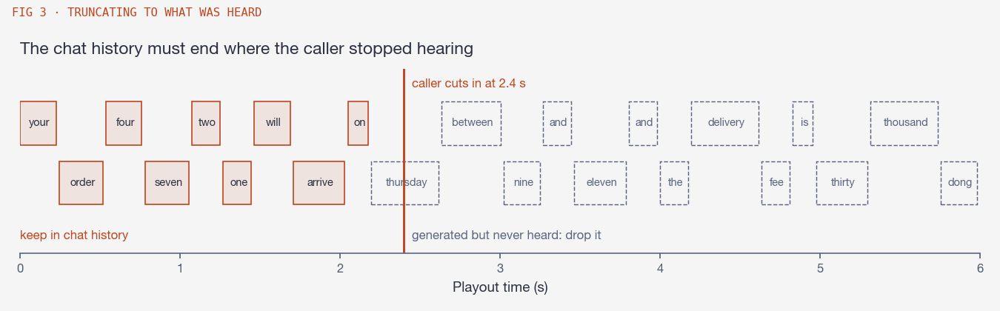

# Barge-in and Interruptions: Letting the Caller Cut In, Only When They Mean It

> A caller who says "khoan đã" should silence the agent within half a second. A caller who says "dạ" should not silence it at all. Both are short bursts of speech while the agent talks.

**Type:** Learn + Build  
**Language:** Python  
**Prerequisites:** [Echo Cancellation](../../05-echo-cancellation/docs/en.md), [Voice Activity Detection](../../06-voice-activity-detection/docs/en.md), [Turn Detection and Endpointing](../../07-turn-detection-and-endpointing/docs/en.md)  
**Time:** ~70 minutes

## Learning Objectives

- Name the four kinds of audio that overlap an agent's speech on a phone call and say which should stop it.
- Explain the two paths that interrupt a LiveKit agent: VAD speech that pauses it, and a final transcript that stops it.
- Simulate a barge-in controller with `min_duration`, `min_words`, `false_interruption_timeout` and `resume_false_interruption`, and measure missed interruptions, false stops, false pauses and stop latency.
- Explain why raising `min_duration` cannot fix backchannels, and what adaptive interruption handling changes.
- Truncate an interrupted reply to what the caller actually heard, so the LLM's history matches the conversation.

## The Problem

Lesson 07 decided when the *caller's* turn ends. This lesson handles the opposite moment: the caller speaks while the *agent* is talking. Human conversation is full of overlap. Callers confirm they are listening ("dạ", "vâng", "ừ", "uh-huh"), correct the agent mid-sentence ("không, đơn hôm qua cơ"), cough, or put the phone down next to a television. On a speakerphone without echo cancellation, the agent may even hear its own voice.

Each of these produces the same first signal: VAD reports speech while TTS audio is playing. The agent has to choose, within a few hundred milliseconds, between three actions:

| Overlap | Example | Right action | Cost of getting it wrong |
| --- | --- | --- | --- |
| Real interruption | "khoan đã, tôi muốn đổi địa chỉ" | Stop now | Caller talks over the agent, repeats themself, gets angry |
| Backchannel | "dạ", "vâng ạ", "uh-huh" | Keep talking | Agent stops mid-sentence and answers "dạ" |
| Cough, laugh, noise | a cough, a door | Keep talking, or resume quickly | Audible gap, or the agent goes silent |
| Own echo | the agent's own words returning | Keep talking | The agent interrupts itself |


## Two Paths to an Interruption

LiveKit Agents (1.8) detects barge-in along two paths, and the simulator in this lesson follows the same structure:

1. **VAD path: pause.** When the session has a VAD, VAD speech is the barge-in signal. Once the overlapping speech lasts `min_duration` (default 0.5 s), and has `min_words` interim words if that is set, the framework pauses the agent's audio.
2. **Transcript path: stop.** A final transcript also triggers an interruption. A barge-in that VAD missed, such as a 0.3 s "không", still interrupts the agent when its final transcript arrives.

A pause is not yet a decision. If the caller falls silent and no transcript arrives within `false_interruption_timeout` (default 2.0 s), the pause was a **false interruption**: the session emits `agent_false_interruption` and, with `resume_false_interruption=True` (the default), the agent continues from where it stopped. If a transcript does arrive, the interruption is real. The agent stops and its history is truncated.

Run the default controller on five overlaps:

```text
interruption 'khoan đã tôi muốn đổi địa chỉ' -> stopped, quiet from 2.50 s (vad)
interruption 'không'                         -> stopped, quiet from 2.65 s (transcript)
backchannel  'dạ'                            -> stopped, quiet from 2.60 s (transcript)
cough        '-'                             -> resumed, quiet from 2.50 s (vad)
echo         'your order four seven'         -> stopped, quiet from 0.90 s (vad)
```


Two of the five decisions are wrong. The agent stops for "dạ", because a backchannel has a transcript and transcripts interrupt. It also stops for its own echo, because echo is speech with words in it.

## Why Thresholds Alone Do Not Work

The tempting fix is to raise `min_duration`. Sweep it over 400 simulated overlaps (40% interruptions, 30% backchannels, 15% coughs, 15% unvoiced noise):


- **False pauses** (coughs) fall as `min_duration` rises, because coughs are short.
- **False stops do not move.** Backchannels reach the agent through the transcript path, which `min_duration` does not gate.
- **Stop latency rises one-for-one.** Every 100 ms added to `min_duration` is 100 ms more of the caller talking over the agent.

`min_words=2` removes most backchannel stops, but it also ignores every one-word interruption ("không", "khoan", "wait"). In the simulation that is 24% of real interruptions missed. Lexical rules sit on a trade-off curve; they cannot get off it.

| Controller | Missed interruptions | False stops | False pauses | Median stop latency |
| --- | ---: | ---: | ---: | ---: |
| VAD, `min_duration=0.5` (defaults) | 0% | 49% | 9% | 0.50 s |
| VAD, `min_words=2` | 24% | 11% | 0% | 0.75 s |
| Adaptive (toy classifier) | 0% | 11% | 0% | 0.50 s |

## Adaptive Interruption Handling

The way off the curve is to classify the overlap instead of thresholding it. LiveKit's **adaptive interruption handling** runs an audio model after VAD that decides whether overlapping speech is a real interruption or a backchannel. In adaptive mode the framework stops treating VAD speech as an interruption shortly after the agent starts speaking, and re-enables it once the detector identifies a genuine interruption. The docs describe it as meant for any spoken language, possibly performing better on English.

The simulator's `adaptive_says_interrupt` is a *toy* stand-in: it ignores non-speech and single listener tokens such as "dạ" or "uh-huh". It deliberately keeps a realistic failure. Two-token backchannels such as "dạ vâng" or "vâng ạ" fool it, which is the 11% of false stops left in the table. Evaluate the real model on your own recordings of Vietnamese backchannels before you trust it.

Neither classifier solves echo. The agent's own voice is speech with words, so it looks like an interruption to both. With 25% echo events added, the adaptive controller false-stops on 38% of non-interruptions. Ignoring overlaps in the first 3 s of each reply drops that to 3%. That is the idea behind LiveKit's `aec_warmup_duration` (default 3.0 s), which blocks interruptions for a few seconds after the agent starts speaking so a client-side echo canceller can calibrate. The price is high: the same 3 s window misses 59% of real interruptions in the simulation, because callers often cut in early in a 6 s reply. A guard window buys echo robustness with responsiveness; lesson 05 removes the echo itself, which is the better trade.

## What the Caller Heard

When the agent stops, its reply has been generated in full but only partly played. If the whole reply stays in the chat history, the LLM believes it told the caller the delivery date and fee, and will not repeat them. The history must end where the caller stopped hearing.



`truncate_to_heard` keeps a word when at least half of it was played. Without word timestamps from TTS, `word_timings` estimates them in proportion to word length. LiveKit performs this step for you: when interrupted, the agent "automatically truncates its conversation history to include only the portion of the speech that the user heard before interruption". The exercise below asks you to see why alignment quality matters.

## Build It

`code/main.py` contains the whole simulator:

| Function | What it does |
| --- | --- |
| `OverlapEvent`, `BargeInConfig` | One overlap (kind, start, duration, words, voiced), and the controller knobs with LiveKit's defaults |
| `simulate_event` | VAD path (pause), transcript path (stop), false-interruption timeout and resume |
| `is_backchannel`, `adaptive_says_interrupt` | A toy lexical stand-in for the adaptive audio model |
| `make_events`, `evaluate`, `sweep_min_duration` | A reproducible overlap mix and the four caller-facing metrics |
| `word_timings`, `truncate_to_heard` | Split a reply into heard and never-heard parts |

The core of the controller is a few lines:

```python
if event.voiced and event.duration >= cfg.min_duration:
    t_pause = event.start + cfg.min_duration              # VAD path pauses the agent
...
timeout = cfg.false_interruption_timeout
silence_from = max(t_pause, event.end)                     # timeout counts silence after the caller stops
if t_final is not None and t_final <= silence_from + timeout:
    return Outcome("stopped", silenced_at=t_pause, trigger="vad")
if cfg.resume_false_interruption:
    return Outcome("resumed", silenced_at=t_pause, resumed_at=silence_from + timeout, trigger="vad")
```

Run it from this lesson directory:

```bash
python3 code/main.py
python3 -m unittest discover -s code/tests -v
python3 code/generate_figures.py --output-dir assets/generated
```

Expected output includes the five decisions above, the three-row comparison table, `with echo leakage, guard 0 s: false stops 38%` and `guard 3 s: false stops 3%`, and the heard text `your order four seven two one will arrive on`.

## Use It in Practice: LiveKit

Interruption behavior is configured in the `interruption` key of `TurnHandlingOptions` (the flat `allow_interruptions`, `min_interruption_duration`… arguments are deprecated in `livekit-agents` 1.8):

```python
from livekit.agents import AgentSession, TurnHandlingOptions

session = AgentSession(
    # ... stt, llm, tts
    turn_handling=TurnHandlingOptions(
        turn_detection="vad",            # Vietnamese is not covered by the turn detector model
        interruption={
            "mode": "adaptive",          # explicit when self-hosted; default on LiveKit Cloud with STT
            "min_duration": 0.5,         # s of speech before VAD counts it
            "min_words": 0,              # >0 needs STT and ignores one-word barge-ins
            "false_interruption_timeout": 2.0,
            "resume_false_interruption": True,
        },
    ),
)
```

| `InterruptionOptions` key | Default | Notes |
| --- | --- | --- |
| `enabled` | `True` | `{"enabled": False}` disables interruptions for the session or agent |
| `mode` | `"adaptive"` on LiveKit Cloud or dev mode with VAD and STT, else `"vad"` | Self-hosted outside dev mode: set `"adaptive"` explicitly; usage beyond a monthly allowance is billed, and it falls back to VAD if the service is unavailable |
| `min_duration` | `0.5` s | Applies in both modes |
| `min_words` | `0` | Requires STT |
| `false_interruption_timeout` | `2.0` s | `None` disables the check |
| `resume_false_interruption` | `True` | Continue speaking after a false interruption |
| `backchannel_boundary` | `(1.0, 1.0)` s | Python only: cooldown at the start and end of each agent turn in adaptive mode |
| `discard_audio_if_uninterruptible` | `True` | Drop caller audio buffered while the agent cannot be interrupted |

Some speech must not be interruptible: a recorded-call disclosure, a legal notice, a price read-back the caller must hear in full. Disable interruptions per utterance, not per session:

```python
await session.say(
    "Cuộc gọi được ghi âm để đảm bảo chất lượng dịch vụ.",
    allow_interruptions=False,
)
```

Watch both kinds of interruption in production; their ratio is your best tuning signal:

```python
@session.on("user_interruption_detected")
def on_interruption(ev):
    log.info("interruption", extra={"probability": ev.probability})

@session.on("agent_false_interruption")
def on_false_interruption(ev):
    log.info("false interruption, resuming")
```

With adaptive mode, `InterruptionMetrics` also reports `num_interruptions` and `num_backchannels` per session. With a realtime model that does its own server-side turn detection, most of these options are ignored and interruption is tuned on the model instead. Sources: [Turns overview](https://docs.livekit.io/agents/logic/turns), [Turn handling options](https://docs.livekit.io/reference/agents/turn-handling-options), [Adaptive interruption handling](https://docs.livekit.io/agents/logic/turns/adaptive-interruption-handling).

## Pitfalls

- **Tuning `min_duration` to stop backchannel cut-offs.** Backchannels arrive as final transcripts; `min_duration` only gates the VAD path. Measure false stops separately from false pauses.
- **Fixing echo with interruption settings.** A guard window or high thresholds hide self-interruption and make real barge-in slower. Remove the echo first (lesson 05), then tune.
- **Disabling `resume_false_interruption`.** Every cough then leaves the agent silent, and the caller hears dead air until they speak.
- **Keeping the full reply in history.** The LLM will skip information the caller never heard. Verify truncation in `session.history` after an interrupted turn.
- **Making the whole session uninterruptible because of one disclosure.** Use `allow_interruptions=False` on that utterance only.
- **Ignoring the language.** Backchannel inventories differ: Vietnamese callers use "dạ", "vâng", "ừ", "ờ", often doubled ("dạ vâng"). Test the classifier on real recordings from your callers.

## Exercises

1. Set `false_interruption_timeout=None` and re-run `evaluate`. Which metric changes, and what does the caller hear after a cough?
2. Add the doubled backchannels to `is_backchannel` and measure how many real interruptions you now miss. Which Vietnamese two-word phrases are true interruptions ("không phải", "khoan đã")?
3. Replace the `guard_s` window with a rule that ignores an overlap only when its words match the agent's own recent words. How many echo false stops remain, and what happens when the caller repeats the agent's words to confirm them?
4. Change `min_fraction` in `truncate_to_heard` to 0.0 and 1.0. Which setting risks the LLM repeating itself, and which risks it skipping information?
5. Record ten Vietnamese backchannels and ten short interruptions on an 8 kHz line. Measure their durations and choose a `min_duration` from the data rather than from the default.

## Key Terms

| Term | Meaning |
| --- | --- |
| Barge-in | The caller speaking while the agent is speaking, intending to take the turn. |
| Backchannel | A short listener token ("dạ", "vâng", "uh-huh") that signals attention, not a turn. |
| False interruption | A pause triggered by audio that produces no transcript; the agent resumes after a timeout. |
| False stop | The agent abandoning its reply because of overlap that was not an interruption. |
| Stop latency | How long the caller speaks over the agent before its audio goes quiet. |
| Adaptive interruption handling | LiveKit's audio model that separates real interruptions from backchannels. |
| Guard window | A period at the start of each reply during which interruptions are ignored. |
| Truncation | Cutting the agent's reply in chat history to the words the caller heard. |

## Further Reading

- [LiveKit: Turns overview and interruptions](https://docs.livekit.io/agents/logic/turns)
- [LiveKit: Adaptive interruption handling](https://docs.livekit.io/agents/logic/turns/adaptive-interruption-handling)
- [LiveKit: Turn handling options reference](https://docs.livekit.io/reference/agents/turn-handling-options)
- [LiveKit: Turn-taking tuning](https://docs.livekit.io/agents/logic/turns/tuning)
- Heldner, M. and Edlund, J. (2010). [Pauses, gaps and overlaps in conversations](https://doi.org/10.1016/j.wocn.2010.08.002). *Journal of Phonetics*, 38(4).
