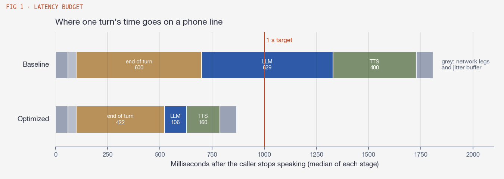
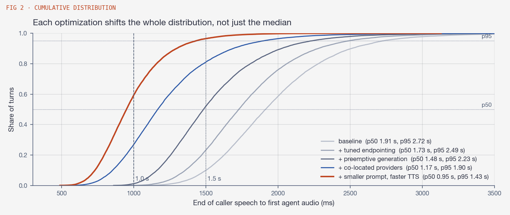

# The Latency Budget: Under One Second, Measured From the Caller's Last Word

> Callers do not experience your LLM's time to first token. They experience the silence after they stop talking, and every stage of the pipeline adds to it.

**Type:** Learn + Build  
**Language:** Python  
**Prerequisites:** [Line Quality: Jitter and Packet Loss](../../03-line-quality-jitter-and-loss/docs/en.md), [Turn Detection and Endpointing](../../07-turn-detection-and-endpointing/docs/en.md), [Barge-in and Interruptions](../../08-barge-in-and-interruptions/docs/en.md)  
**Time:** ~70 minutes

## Learning Objectives

- Decompose one conversational turn on a phone line into its stages, and say which run in sequence and which overlap.
- Simulate the end-to-end latency distribution with per-stage lognormal models, and report p50 and p95 instead of averages.
- Quantify what tuned endpointing, preemptive generation, provider co-location and faster models each buy.
- Show why streaming both the LLM and TTS matters, and how sentence chunking sets the time to first audio.
- Separate perceived latency (first sound) from answer latency (first useful words), and report both.
- Find the matching numbers in LiveKit's per-turn metrics.

## The Problem

Voice conversations feel natural when the end-to-end response latency stays under about one second. That is the bar in LiveKit's own guidance, and the bar a contact-center business will hold you to. It is easy to miss by a lot. A pipeline in which every component is "fast" (a 450 ms LLM, a 220 ms TTS, a 600 ms end-of-turn wait) still answers in close to two seconds, because the stages add up, and because each one has a long tail.

The right measurement starts at the **end of the caller's speech at the phone** and ends at the **first agent audio the caller hears**. Anything narrower, such as LLM time to first token, hides most of the budget.


## The Stages of One Turn

| Stage | What happens | Typical median | Who controls it |
| --- | --- | ---: | --- |
| Uplink | Phone → carrier → SIP trunk → LiveKit SIP | 60 ms | Carrier, LiveKit region |
| Jitter buffer | Smooths packet arrival (lesson 03) | 40 ms | Media stack |
| End-of-turn wait | VAD silence plus endpointing delay (lesson 07) | 400–600 ms | **You**: `endpointing`, VAD settings |
| STT final | Final transcript; overlaps the silence wait | 100–300 ms | STT provider |
| LLM first token | Network round trip + time to first token | 300–650 ms | **You**: model, prompt size, region |
| TTS first audio | Network round trip + time to first byte | 150–400 ms | **You**: voice, provider, region |
| Downlink | LiveKit → carrier → phone | 80 ms | Carrier, LiveKit region |

Two structural facts matter more than any single number:

1. **The end-of-turn wait and STT finalization overlap.** The turn commits when both have finished, so the critical path is `max(wait, stt)`, not their sum. A faster STT does not help if the silence wait dominates.
2. **Every provider call pays a network round trip.** An agent in Singapore calling an LLM in the US pays 150–250 ms per call, twice per turn (LLM and TTS), before any model runs.

## Simulate the Distribution, Not the Average

Each stage is modelled as a lognormal distribution set by its median and its 95th percentile. Latency is right-skewed: most requests are fast and a few are very slow. For a stage with median $m$ and 95th percentile $q$:

$$\mu = \ln m, \qquad \sigma = \frac{\ln q - \ln m}{1.645}$$

`simulate_turns` draws 20,000 turns and composes the stages along the critical path:

```python
arrive = up + jit
committed = arrive + np.maximum(eot, stt)              # wait and STT overlap
first_token = committed + rtt + ttft
if cfg.preemptive:                                     # LLM started on the interim transcript
    early = np.maximum(committed, arrive + cfg.interim_lag_ms + rtt + ttft)
    first_token = np.where(changed, first_token, early)
total = first_token + rtt + ttfb + down
```



In the baseline, the round trips to a provider in another region are 180 ms of the LLM's 629 ms and 180 ms of the TTS's 400 ms. Those 360 ms buy nothing.

## The Optimization Ladder

Apply the optimizations one at a time, each on top of the previous one:

| Configuration | p50 | p95 | Turns under 1 s |
| --- | ---: | ---: | ---: |
| Baseline | 1.91 s | 2.72 s | 0% |
| + tuned endpointing (end-of-turn median 600 → 420 ms) | 1.73 s | 2.49 s | 0% |
| + preemptive generation (20% of transcripts change) | 1.48 s | 2.23 s | 1% |
| + co-located providers (RTT 180 → 10 ms) | 1.17 s | 1.90 s | 27% |
| + smaller prompt, faster TTS | 0.95 s | 1.43 s | 59% |



Read the table from the right. Even the final configuration answers 41% of turns in more than a second; a realistic target is **p50 ≤ 1 s and p95 ≤ 1.5 s**, reported separately. And no single optimization is enough. The biggest single step here is co-location, which costs nothing but a deployment decision.

## Streaming and Chunking

The table assumed that the LLM streams tokens into a TTS that streams audio. Remove either and the budget explodes:


With LLM streaming, TTS can start on the **first chunk** of the reply instead of the whole text. `split_for_tts` cuts at sentence ends, and at commas once a chunk has at least four words, so "Dạ," alone is not sent as a chunk. The first chunk's length is now part of your latency: a reply that starts with a 30-word sentence speaks later than one that starts "Dạ, em kiểm tra ngay." Prompt the LLM to lead with a short sentence.

## Preemptive Generation

With **preemptive generation**, the LLM starts on the interim transcript while the end-of-turn wait is still running. Two rules govern it:

- The reply **cannot be spoken before the turn commits**. Preemption hides LLM time inside the wait; it does not shorten the wait.
- If the committed transcript differs from the one the LLM started on, the speculative call is **thrown away** and redone. That is wasted compute, and in the simulation it equals the share of changed transcripts.

The right panel above shows the trade. Preemption helps at every change rate, but the saving shrinks from about 300 ms to 60 ms as transcripts become less stable. On noisy 8 kHz calls, where interim transcripts change more often, measure the change rate before you count on the saving.

## Perceived Versus Answer Latency

A tool call that queries a CRM can take 2–3 s. A filler such as "Dạ, anh chờ em một chút" or a keyboard sound at 700 ms makes the *perceived* latency 700 ms, while the *answer* still arrives at 2.6 s. Both numbers are real, and they answer different questions. `perceived_latency_ms` computes the first; never report it in place of the second.

## Build It

| Function | What it does |
| --- | --- |
| `Stage`, `Stage.lognormal`, `Stage.sample` | A stage from its median and p95, as a lognormal distribution |
| `PipelineConfig`, `simulate_turns` | Compose the stages along the critical path, with overlap and optional preemption |
| `summarize`, `optimization_ladder` | p50, p95, p99 and share under 1 s; the five cumulative configurations |
| `split_for_tts`, `first_audio_ms` | Sentence and clause chunking; time to first audio with and without streaming |
| `perceived_latency_ms` | First sound with an optional filler |

Run it from this lesson directory:

```bash
python3 code/main.py
python3 -m unittest discover -s code/tests -v
python3 code/generate_figures.py --output-dir assets/generated
```

Expected output: the five-row ladder above, `Largest median contribution in the baseline: llm ttft (629 ms)`, the three TTS chunks of the sample reply, first-audio times of 2707, 1207, 1491 and 857 ms, and `first sound with a filler at 700 ms: 700 ms`.

## Use It in Practice: LiveKit

**Measure per turn.** In `livekit-agents` 1.8, per-turn latency lives on each chat message's `metrics` (the session-level `metrics_collected` event is deprecated). Assistant messages carry `e2e_latency`, `llm_node_ttft`, `tts_node_ttfb` and `playback_latency`; user messages carry `transcription_delay`, `end_of_turn_delay` and `on_user_turn_completed_delay`, all in seconds:

```python
from livekit.agents import ConversationItemAddedEvent
from livekit.agents.llm import ChatMessage

@session.on("conversation_item_added")
def on_item(ev: ConversationItemAddedEvent):
    if isinstance(ev.item, ChatMessage) and ev.item.role == "assistant":
        m = ev.item.metrics
        if m.get("e2e_latency") is not None:
            log.info("turn latency", extra={"e2e": m["e2e_latency"],
                                            "ttft": m.get("llm_node_ttft"),
                                            "ttfb": m.get("tts_node_ttfb")})
```

These are measured inside the agent. Add the carrier legs (uplink, downlink, jitter buffer) from this lesson's model, or measure them with test calls, to get what the caller hears.

**Tune the turn.** Preemptive generation is on by default and runs the LLM only. `preemptive_tts=True` also starts TTS early, saving more and wasting more compute. Endpointing lives in the same options; because the turn detector model does not cover Vietnamese, a Vietnamese hotline uses `turn_detection="vad"` and tunes the VAD silence and `min_delay` together (lesson 07):

```python
from livekit.agents import AgentSession, TurnHandlingOptions

session = AgentSession(
    # ... stt, llm, tts
    turn_handling=TurnHandlingOptions(
        turn_detection="vad",
        endpointing={"mode": "dynamic", "min_delay": 0.4, "max_delay": 2.0},
        preemptive_generation={"enabled": True, "preemptive_tts": False},
    ),
)
```

**Keep processes and connections warm.** Load models once per process with a setup function, so the first call after a restart is not slow. In production the server keeps `num_idle_processes` warm (by default the CPU count; zero in dev mode), and `AgentSession` pre-opens provider connections itself:

```python
from livekit.agents import JobProcess
from livekit.plugins import silero

def prewarm(proc: JobProcess):
    proc.userdata["vad"] = silero.VAD.load()

server.setup_fnc = prewarm
```

**Co-locate.** An agent deployment's region is fixed when you create it, and callers connect to the nearest deployment. LiveKit's global SIP endpoint routes an inbound call to the region closest to your SIP provider; you can pin a region with `{subdomain}.{region}.sip.livekit.cloud`. Put the agent, the SIP region and your STT, LLM and TTS providers in the same region whenever the providers allow it.

**Fill silences honestly.** For a slow tool, say something short first, or play a thinking sound while the agent's state is `thinking`:

```python
from livekit.agents import AudioConfig, BackgroundAudioPlayer, BuiltinAudioClip

background_audio = BackgroundAudioPlayer(
    thinking_sound=[AudioConfig(BuiltinAudioClip.KEYBOARD_TYPING, volume=0.8)],
)
await background_audio.start(room=ctx.room, agent_session=session)

await session.say("Dạ, anh chờ em kiểm tra một chút.", allow_interruptions=False)
```

Sources: [Data and metrics](https://docs.livekit.io/testing/observability/data), [Turn handling options](https://docs.livekit.io/reference/agents/turn-handling-options), [Agent server options](https://docs.livekit.io/agents/server/options), [Agent deployment regions](https://docs.livekit.io/deploy/admin/regions/agent-deployment), [SIP region pinning](https://docs.livekit.io/telephony/features/region-pinning), [Background audio](https://docs.livekit.io/agents/multimodality/audio/background-audio).

## Pitfalls

- **Reporting averages.** A 900 ms mean can hide a p95 of 2.5 s. Report p50 and p95, per call flow.
- **Measuring from the wrong start.** LLM TTFT or "agent latency" ignores the end-of-turn wait and both carrier legs, which are often half the budget.
- **Counting fillers as answers.** A hold phrase at 700 ms is good design, but the answer still arrived at 2.6 s. Track both.
- **Cutting endpointing to win latency.** Below a point, every 100 ms saved cuts off callers who pause mid-sentence, typically while reading a phone number or address. Tune it with the cut-off rate from lesson 07 next to latency.
- **Cross-region providers.** Two round trips of 180 ms are more than a TTS model's whole time to first byte. Check where each provider's endpoint actually runs.
- **Long first sentences.** With streaming, the first chunk decides first audio. Ask the LLM to start with a short acknowledgement.
- **Cold starts.** The first call after a deploy or scale-up pays model loading and connection setup. Prewarm, and keep idle processes.

## Exercises

1. Set `stt_final` to median 700 ms, p95 1500 ms. Which optimization on the ladder stops helping, and why?
2. Find the smallest end-of-turn median that, with all other optimizations, gives p95 under 1.5 s. Then use lesson 07 to estimate how many callers that delay would cut off.
3. Add a 2 s tool call to 30% of turns. Compute p50 and p95 of answer latency with and without a filler at 700 ms, and of perceived latency.
4. Extend `simulate_turns` with `preemptive_tts=True`: TTS starts as soon as the speculative first token exists. How much does it save, and how much TTS audio is wasted at a 20% change rate?
5. Make test calls to your own agent from a mobile phone and record the caller-side latency with a stopwatch app or a dual-channel recording. How large is the gap between that and `e2e_latency`?

## Key Terms

| Term | Meaning |
| --- | --- |
| End-to-end latency | Time from the end of the caller's speech to the first agent audio they hear. |
| Critical path | The chain of stages whose durations add up to the end-to-end latency. |
| TTFT | Time to first token of an LLM response. |
| TTFB | Time to first byte of synthesized audio from TTS. |
| Endpointing delay | Extra wait after speech stops before the turn is committed. |
| Preemptive generation | Starting the LLM on an interim transcript before the turn is committed. |
| Co-location | Running the agent and its model providers in the same region to cut round trips. |
| Perceived latency | Time to the first sound, including fillers and thinking sounds. |
| p95 | The latency that 95% of turns beat; the tail users remember. |

## Further Reading

- [LiveKit: Data and metrics](https://docs.livekit.io/testing/observability/data)
- [LiveKit: Pipelines and models](https://docs.livekit.io/agents/models/pipelines)
- [LiveKit: Turn-taking tuning](https://docs.livekit.io/agents/logic/turns/tuning)
- [LiveKit: Agent speech and background audio](https://docs.livekit.io/agents/multimodality/audio)
- Stivers, T. et al. (2009). [Universals and cultural variation in turn-taking in conversation](https://doi.org/10.1073/pnas.0903616106). *PNAS*, 106(26).
