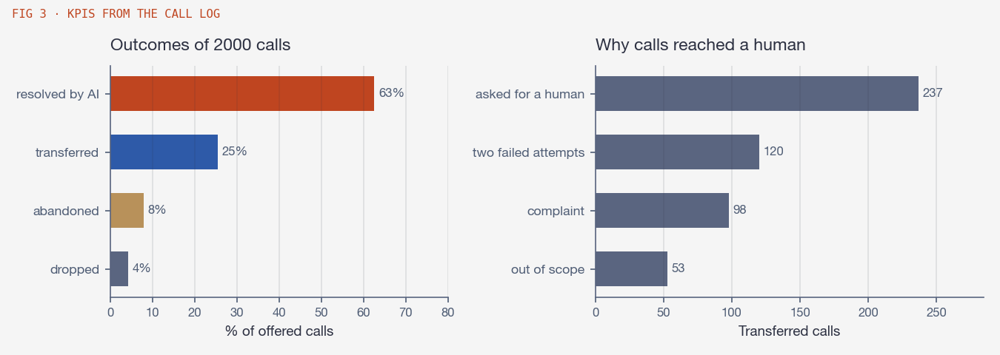
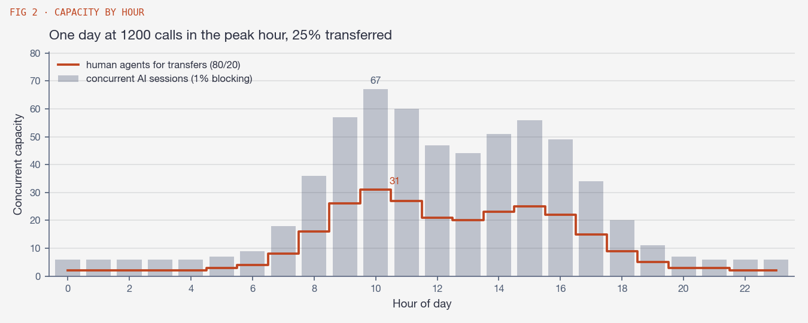

# Production AICC: Hand-offs, Keypads, and Running It at Scale

> A voice agent that answers well is a demo. A contact center needs it to hand a caller to a person without making them repeat themselves, take a PIN without speaking it, keep personal data out of logs, and have enough capacity at 10 a.m. on a Monday.

**Type:** Learn + Build  
**Language:** Python  
**Prerequisites:** [Telephony and SIP](../../01-telephony-and-sip/docs/en.md), [LiveKit Voice Agent Architecture](../../02-livekit-voice-agent-architecture/docs/en.md), [The Latency Budget](../../09-latency-budget/docs/en.md)  
**Time:** ~80 minutes

## Learning Objectives

- Choose between cold and warm transfer, and model a warm transfer as a state machine with timeouts and fallbacks.
- Collect keypad digits the way an IVR prompt does, and explain when DTMF is better than speech.
- Place outbound calls that handle rejection, no answer and voicemail correctly.
- Hang up cleanly, record calls, and keep phone and ID numbers out of transcripts and logs.
- Compute the KPIs an AICC is judged on: containment, transfer, abandonment, average handle time and tail latency.
- Size the system with Erlang B (concurrent AI sessions, SIP channels) and Erlang C (the human team behind the AI).

## The Problem

Lessons 01–09 made one call work well. A contact center runs thousands of them, and the hard problems move from the audio to the operation around it:

- **Some calls must reach a person.** A complaint, a safety issue, a request the AI cannot handle, or a caller who simply asks. The caller should not have to repeat what they already said.
- **Some input should not be spoken.** A PIN or a card number read aloud is overheard, misrecognized, and ends up in the transcript.
- **Outbound calls reach machines.** Voicemail answers with `200 OK`, exactly like a person.
- **Every call produces personal data.** The caller's number is in the room name; their ID number is in the transcript.
- **Demand is uneven.** Peak hour can be twenty times the night volume, and the human team behind the AI is the expensive, slow-to-scale part.


## Hand-offs: Cold and Warm

| | Cold transfer | Warm transfer |
| --- | --- | --- |
| Mechanism | SIP `REFER` through your trunk; the caller leaves the LiveKit room | The AI dials the human into a consultation room, briefs them, then the human joins the caller |
| Context for the human | None (unless your CRM carries it) | A spoken or written summary of the call |
| If the human does not answer | Fails with a reason code; LiveKit sees nothing after a successful REFER | The AI is still on the call and can resume or offer a callback |
| Use it for | Routing to a queue or another department | Escalations, complaints, anything where repeating the story would anger the caller |

A warm transfer has more ways to fail, so model it explicitly. `run_transfer` replays timestamped events through a transition table:

```text
ai_conversation --transfer_requested--> caller_on_hold --dial_started--> dialing_human
dialing_human   --human_answered-->     briefing        --human_accepted--> connected --ai_left--> completed
dialing_human   --ringing_timeout-->    callback_offered --callback_booked--> completed
briefing        --human_declined-->     ai_conversation
any waiting state --caller_hung_up-->   abandoned
```

```text
Warm transfer, accepted : ai_conversation -> caller_on_hold -> dialing_human -> briefing -> connected -> completed (hold 30 s)
Warm transfer, no answer: ai_conversation -> caller_on_hold -> dialing_human -> callback_offered (hold 31 s)
Warm transfer, declined : ai_conversation -> caller_on_hold -> dialing_human -> briefing -> ai_conversation (hold 20 s)
```

Hold time is the number to watch: the caller hears music while you dial and brief. Keep the brief short, and set the ringing timeout from your human team's real answer times, not from a default.

## Keypads Beat Speech for Secrets

DTMF (lesson 01) is the right input when the content is secret or must be exact: a PIN, an OTP, a card number, an account number. It is not transcribed, not overheard by the people around the caller, and cannot be misrecognized. `collect_digits` reproduces the behavior of an IVR prompt: stop after `num_digits`, on `#`, or when the caller pauses longer than the per-digit timeout (4 s, LiveKit's `GetDtmfTask` default).

```text
Keypad entry: ('090123', 'terminated')     # caller pressed # after six digits
```

Speech is still fine for most numbers. LiveKit's `GetDtmfTask` accepts either keypad or spoken digits, and can read them back for confirmation.

## Personal Data in Transcripts and Logs

Transcripts are the most useful data an AICC produces, and the most dangerous. `mask_pii` replaces any run of seven or more digits (allowing spaces, dots and dashes between them) with asterisks, keeping the last three:

```text
Số điện thoại của tôi là *******567, CCCD *********789.
```

A regex is a floor, not a solution. Callers also speak numbers as words ("không chín không một…"), and names and addresses are personal data too. Combine masking with keypad input for secrets, access control on recordings, and retention limits. Remember from lesson 01 that an individual dispatch rule puts the caller's number in the room name, where PII redaction does not reach.

## KPIs

`compute_kpis` turns a call log into the numbers a contact-center manager reads every morning. Every rate uses **all offered calls** as its denominator, so the rates add up to 100%:

| KPI | Definition | Simulated day |
| --- | --- | ---: |
| Containment rate | Calls resolved by the AI without a human | 63% |
| Transfer rate | Calls handed to a human | 25% |
| Abandonment rate | Callers who hung up before resolution | 8% |
| Average handle time (AHT) | Mean duration of resolved and transferred calls | 159 s |
| p95 turn latency | 95th percentile of per-turn latency (lesson 09) | 1430 ms |



Read the transfer reasons, not only the transfer rate. "Asked for a human" may be a trust or greeting problem; "two failed attempts" points at recognition or flow design; "out of scope" is a product decision. Containment is only good if the caller's problem was actually solved: pair it with repeat-call rate or a post-call survey.

## Capacity: Erlang B and Erlang C

Calls in progress at the same time is **traffic** in Erlangs, by Little's law:

$$A = \lambda \cdot \text{AHT}, \qquad \text{e.g. } 1200\ \text{calls/h} \times 160\ \text{s} / 3600 = 53\ \text{Erlangs}$$

**Erlang B** gives the probability that a call finds every server busy and is blocked. It sizes things without a queue: SIP channels on your trunk, and concurrent agent sessions.

$$B(A, 0) = 1, \qquad B(A, m) = \frac{A\,B(A, m-1)}{m + A\,B(A, m-1)}$$

**Erlang C** gives the probability that a call has to *wait* when there is a queue, which is how a human team works. From it come the service level (share answered within $t$ seconds) and the average speed of answer (ASA):

$$C(A, m) = \frac{m\,B(A, m)}{m - A\,(1 - B(A, m))}, \qquad \text{SL} = 1 - C\,e^{-(m - A)\,t/\text{AHT}}, \qquad \text{ASA} = \frac{C \cdot \text{AHT}}{m - A}$$


The curves are steep: near capacity, one more or one fewer person changes the wait from seconds to minutes. That is why staffing by averages fails. Now combine both formulas over a day:



```text
Peak hour: 1200 calls -> 53 Erlangs of AI traffic, 67 concurrent sessions for 1% blocking, 4 worker hosts at 25 sessions each
305 transfers/hour need 31 human agents for 80% answered in 20 s (ASA 11 s)
```

The AI absorbs the volume, but the 25% it transfers still needs 31 people at peak. Each point of containment you gain is worth more in staffing than in AI capacity. Note that `workers_needed` keeps hosts below a load threshold of 0.7, LiveKit's default, at which a worker stops accepting new jobs. Measure sessions per host on your own hardware and pipeline; it depends on whether VAD and turn detection run locally.

## Build It

| Function | What it does |
| --- | --- |
| `TRANSITIONS`, `next_state`, `run_transfer`, `TransferTrace.hold_seconds` | Warm-transfer state machine with ringing timeout, decline, voicemail and hang-up paths |
| `collect_digits` | IVR-style keypad collection with a stop key and per-digit timeout |
| `mask_pii` | Mask long digit runs in transcripts and logs |
| `generate_call_log`, `compute_kpis` | A synthetic day of calls and the KPIs computed from it |
| `offered_load`, `erlang_b`, `erlang_c` | Traffic, blocking probability and waiting probability |
| `service_level`, `average_speed_of_answer`, `agents_for_service_level` | Human staffing for an 80/20 target |
| `channels_for_blocking`, `workers_needed` | Concurrent sessions, SIP channels and worker hosts |

Run it from this lesson directory:

```bash
python3 code/main.py
python3 -m unittest discover -s code/tests -v
python3 code/generate_figures.py --output-dir assets/generated
```

Expected output is the three transfer traces, the keypad and masking lines, and the KPI and capacity lines quoted above.

## Use It in Practice: LiveKit

**Cold transfer.** `TransferSIPParticipant` sends a SIP `REFER` through your trunk. The call must already be answered, your provider must allow transfers, and `ringing_timeout` defaults to 30 s. Failures carry a reason such as `STR_REJECTED`, `STR_RINGING_TIMEOUT` or `STR_CALL_ENDED`:

```python
await job_ctx.api.sip.transfer_sip_participant(
    api.TransferSIPParticipantRequest(
        room_name=job_ctx.room.name,
        participant_identity=sip_participant.identity,
        transfer_to="tel:+842873001000",
    )
)
```

**Warm transfer.** In Python, `WarmTransferTask` is in the beta workflows. It handles the consultation room, the SIP dial, hold music, the briefing with the chat history, and the tools the human-side agent uses (`connect_to_caller`, `decline_transfer`, `voicemail_detected`). If the human does not answer within the ringing timeout, the task ends with a `ToolError` and the caller's conversation resumes; that is where you offer a callback.

```python
from livekit.agents.beta.workflows import WarmTransferTask

@function_tool
async def transfer_to_human(self) -> None:
    """Called when the caller confirms they want a human agent."""
    await self.session.say("Dạ, anh chờ một chút, em chuyển máy cho nhân viên.", allow_interruptions=False)
    result = await WarmTransferTask(
        sip_call_to="+842873001000",
        sip_trunk_id="ST_xxxx",
        chat_ctx=self.chat_ctx,
        ringing_timeout=30.0,
    )
    self.session.shutdown()
```

**Keypad input.** `GetDtmfTask` (Python, beta) collects `num_digits` by keypad or speech, with `dtmf_input_timeout` (default 4.0 s per digit), `dtmf_stop_event` (default `#`) and optional read-back confirmation:

```python
from livekit.agents.beta.workflows.dtmf_inputs import GetDtmfTask

result = await GetDtmfTask(num_digits=6, chat_ctx=self.chat_ctx.copy(exclude_instructions=True),
                           ask_for_confirmation=False)
pin = result.user_input
```

**Outbound calls.** Create the SIP participant with `wait_until_answered=True`; rejection (`486`/`603`), no answer (`408`/`480`) and trunk failures raise `api.SipCallError`, and you must call `ctx.shutdown()` yourself for no-answer and trunk failures. Voicemail is *not* an error: it answers with `200 OK`. Wrap the dial in answering machine detection, which classifies the start of the call as `human`, `machine-ivr`, `machine-vm`, `machine-unavailable` or `uncertain`:

```python
from livekit.agents import AMD

async with AMD(session, participant_identity=identity) as detector:
    await ctx.api.sip.create_sip_participant(api.CreateSIPParticipantRequest(
        room_name=ctx.room.name, sip_trunk_id="ST_xxxx", sip_call_to=phone_number,
        participant_identity=identity, wait_until_answered=True))
    await ctx.wait_for_participant(identity=identity)
    result = await detector.execute()
    if result.category == "machine-vm":
        handle = session.generate_reply(instructions="Leave a short message asking them to call back.")
        await handle.wait_for_playout()
        ctx.shutdown("voicemail")
```

**Hanging up.** If the session ends but the room stays, the caller hears silence until they hang up. Give the LLM the prebuilt `EndCallTool` (which by default deletes the room), or delete the room yourself with `get_job_context().delete_room()` after `wait_for_playout()`.

**Recording and reports.** On LiveKit Cloud, session audio is collected for Agent insights, with noise cancellation applied and PII redacted if enabled. For your own storage use Egress, or `RecorderIO` in the agent. Generate a per-session report in an `on_session_end` callback with `ctx.make_session_report()`, and feed your KPI pipeline from it.

Sources: [Cold transfer](https://docs.livekit.io/telephony/features/transfers/cold), [Warm transfer](https://docs.livekit.io/agents/prebuilt/tasks/warm-transfer), [GetDtmfTask](https://docs.livekit.io/agents/prebuilt/tasks/get-dtmf), [Outbound calls](https://docs.livekit.io/telephony/making-calls/outbound-calls), [Answering machine detection](https://docs.livekit.io/telephony/features/answering-machine-detection), [EndCallTool](https://docs.livekit.io/agents/prebuilt/tools/end-call-tool), [Recording](https://docs.livekit.io/testing/observability/recording), [Agent server options](https://docs.livekit.io/agents/server/options).

## Pitfalls

- **Transferring without a fallback.** Humans are busy, on break, or decline. Every transfer path needs a timeout and a resume-or-callback branch.
- **Treating voicemail as success.** An outbound "answered" call may be a greeting. Run AMD before the agent speaks.
- **Leaving the room open.** Ending the session is not hanging up. Delete the room, or the caller hears dead air.
- **Speaking secrets.** A spoken PIN ends up in the transcript and in the ears of everyone near the caller. Use the keypad.
- **Measuring containment alone.** An AI that never transfers can show high containment and furious callers. Track transfer reasons, repeat calls and satisfaction next to it.
- **Staffing by averages.** Erlang C is steep near capacity. Plan from peak-hour traffic and service-level targets, then add shrinkage for breaks and training.
- **Sizing workers from CPU alone.** A worker stops accepting jobs above its load threshold. Load-test with real calls; local VAD and turn detection change sessions per host a lot.

## Exercises

1. Add a `supervisor_busy` event in `briefing` that returns the call to `dialing_human` for a second supervisor. What is the worst-case hold time with two 30 s ringing timeouts?
2. Extend `mask_pii` to spoken Vietnamese digits ("không chín không một hai ba…"). Test it on ten transcripts; what does it miss?
3. Raise containment from 63% to 75% in `generate_call_log` by moving transfers to resolved. How many human agents does the peak hour need now?
4. Compute the SIP channels your trunk needs at peak for 0.1% blocking, and compare with the 1% figure. Why do carriers sell channels in blocks?
5. Write a nightly report from a real LiveKit session report: per-call outcome, transfer reason, p95 `e2e_latency`, and masked transcript.

## Key Terms

| Term | Meaning |
| --- | --- |
| Cold transfer | Handing the call to another number with SIP `REFER`; the AI leaves without briefing anyone. |
| Warm transfer | The AI briefs a human in a consultation room before connecting them to the caller. |
| AMD | Answering machine detection: classifies an outbound call's answer as person, voicemail or IVR. |
| Containment rate | Share of calls resolved by the AI without a human. |
| AHT | Average handle time of a call. |
| Erlang | Unit of traffic: one call in progress on average. |
| Erlang B | Blocking probability when there is no queue; sizes channels and sessions. |
| Erlang C | Waiting probability with a queue; sizes a human team for a service level. |
| Service level | Share of calls answered within a target time, such as 80% in 20 s. |
| ASA | Average speed of answer: mean wait in queue. |

## Further Reading

- [LiveKit: Cold transfer](https://docs.livekit.io/telephony/features/transfers/cold) and [warm transfer](https://docs.livekit.io/telephony/features/transfers/warm)
- [LiveKit: Answering machine detection](https://docs.livekit.io/telephony/features/answering-machine-detection)
- [LiveKit: Handling DTMF](https://docs.livekit.io/telephony/features/dtmf)
- [LiveKit: Recording and observability](https://docs.livekit.io/testing/observability/recording)
- Gans, N., Koole, G. and Mandelbaum, A. (2003). [Telephone call centers: tutorial, review, and research prospects](https://doi.org/10.1287/msom.5.2.79.16071). *Manufacturing & Service Operations Management*, 5(2).
