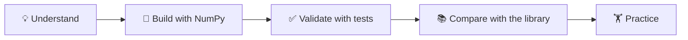

# 🛠️ Hands-on Tutorials

> Build speech fundamentals from scratch, so library calls stop being black boxes.

[← Back to home](../README.md) · [🗺️ Roadmap](../roadmap/README.md) · [📡 SOTA Tracker](../sota/README.md)

Every lesson follows the same loop:



## 📚 Modules

| Module | Status | Lessons | Roadmap phase |
| --- | :---: | :---: | --- |
| 🔊 [**01 · Audio Signal Processing**](#-01--audio-signal-processing) | 🟢 Active | 8 / 12 | [Foundations](../roadmap/01-foundations.md#-audio-signal-processing-for-ml) |
| 🎙️ **02 · Speech Recognition** | ⚪ Planned | — | [Core Speech Technologies](../roadmap/03-core-speech-technologies.md) |
| 🗣️ **03 · Speech Synthesis** | ⚪ Planned | — | [Core Speech Technologies](../roadmap/03-core-speech-technologies.md) |
| ☎️ [**04 · AI Contact Center with LiveKit**](04-ai-contact-center/README.md) | 🟢 Active | 10 / 10 | [Core Speech Technologies](../roadmap/03-core-speech-technologies.md), [SOTA: dialogue](../sota/topics/dialogue.md) |

## 🔊 01 · Audio Signal Processing


| | Lesson | Time | What you will build |
| :---: | --- | :---: | --- |
| ✅ | [01 · Sound and Waveforms](01-audio-signal-processing/01-sound-and-waveforms/docs/en.md) | ~45 min | Generate and mix tones, inspect spectra, and round-trip PCM16 WAV audio. |
| ✅ | [02 · Digital Audio](01-audio-signal-processing/02-digital-audio/docs/en.md) | ~50 min | Reproduce sampling, aliasing, resampling pitfalls, and PCM quantization. |
| ✅ | [03 · Time-Domain Features](01-audio-signal-processing/03-time-domain-features/docs/en.md) | ~50 min | Frame a signal and compute amplitude envelope, RMS energy, and zero-crossing rate. |
| ✅ | [04 · The Discrete Fourier Transform](01-audio-signal-processing/04-discrete-fourier-transform/docs/en.md) | ~60 min | Implement the DFT from its definition, read a spectrum, and explain spectral leakage. |
| ✅ | [05 · The Short-Time Fourier Transform](01-audio-signal-processing/05-short-time-fourier-transform/docs/en.md) | ~60 min | Window frames, build the STFT and its inverse, and explore the time-frequency trade-off. |
| ✅ | [06 · Mel Spectrograms and MFCCs](01-audio-signal-processing/06-mel-spectrograms-and-mfccs/docs/en.md) | ~70 min | Build a mel filterbank, log-mel spectrograms, and MFCCs, and show they track the vowel, not the pitch. |
| ✅ | [07 · Frequency-Domain Features](01-audio-signal-processing/07-frequency-domain-features/docs/en.md) | ~60 min | Compute band energy ratio, spectral centroid, bandwidth, rolloff, and flatness, and label vowels, fricatives, and silence. |
| ✅ | [08 · Pitch Estimation](01-audio-signal-processing/08-pitch-estimation/docs/en.md) | ~70 min | Build autocorrelation and YIN pitch trackers, make voicing decisions, and diagnose octave errors. |

## ☎️ 04 · AI Contact Center with LiveKit


Phone calls, not browser demos: SIP and G.711, jitter and loss, noise, echo, VAD, end-of-turn detection, barge-in, latency, and production hand-offs, each built from scratch and then mapped to [LiveKit Agents](https://docs.livekit.io/agents). See the [module overview](04-ai-contact-center/README.md) for the course map.

| | Lesson | Time | What you will build |
| :---: | --- | :---: | --- |
| ✅ | [01 · Telephony and SIP](04-ai-contact-center/01-telephony-and-sip/docs/en.md) | ~70 min | Parse SIP/SDP, packetize RTP, implement bit-exact G.711 µ-law, and detect DTMF with Goertzel. |
| ✅ | [02 · LiveKit Voice Agent Architecture](04-ai-contact-center/02-livekit-voice-agent-architecture/docs/en.md) | ~70 min | Map trunks, dispatch rules and `AgentSession` onto a call; resample and frame 8/16/48 kHz audio. |
| ✅ | [03 · Line Quality: Jitter and Packet Loss](04-ai-contact-center/03-line-quality-jitter-and-loss/docs/en.md) | ~75 min | Build jitter buffers and loss concealment, and estimate MOS with the E-model. |
| ✅ | [04 · Noise Suppression](04-ai-contact-center/04-noise-suppression/docs/en.md) | ~75 min | Implement spectral subtraction and a Wiener filter with noise-floor tracking. |
| ✅ | [05 · Echo Cancellation](04-ai-contact-center/05-echo-cancellation/docs/en.md) | ~75 min | Cancel echo with NLMS, measure ERLE, and add double-talk detection. |
| ✅ | [06 · Voice Activity Detection](04-ai-contact-center/06-voice-activity-detection/docs/en.md) | ~60 min | Build a hysteresis VAD that mirrors Silero's parameters and evaluate it across SNRs. |
| ✅ | [07 · Turn Detection and Endpointing](04-ai-contact-center/07-turn-detection-and-endpointing/docs/en.md) | ~70 min | Compare fixed, dynamic and semantic endpointing on cut-offs versus latency. |
| ✅ | [08 · Barge-in and Interruptions](04-ai-contact-center/08-barge-in-and-interruptions/docs/en.md) | ~70 min | Tell interruptions from backchannels and echo; truncate the transcript to what was heard. |
| ✅ | [09 · Latency Budget](04-ai-contact-center/09-latency-budget/docs/en.md) | ~70 min | Simulate p50/p95 turn latency and quantify each optimization. |
| ✅ | [10 · Production AICC](04-ai-contact-center/10-production-aicc/docs/en.md) | ~80 min | Model warm transfers, size human teams with Erlang C, and compute contact-center KPIs. |

## 📦 Inside Each Lesson

```text
NN-lesson-name/
├── docs/en.md            # Explanation, pitfalls, exercises, key terms
├── assets/               # Concept diagram and deterministic generated figures
├── code/
│   ├── main.py           # Runnable NumPy implementation
│   ├── generate_figures.py
│   └── tests/            # Unit tests for the concept
└── notebook/lesson.ipynb # Interactive companion, executed in CI
```

## 🚀 Run the Lessons

From the repository root, after following [Getting Started](../README.md#-getting-started):

```bash
make audit      # verify lesson structure
make test       # run unit tests
make figures    # regenerate plots
make notebooks  # execute every notebook from a clean state
```

Or run one lesson directly:

```bash
python tutorials/01-audio-signal-processing/01-sound-and-waveforms/code/main.py
```

## ✍️ Write a Lesson

Follow [LESSON_TEMPLATE.md](LESSON_TEMPLATE.md), keep examples deterministic, and give every diagram descriptive alt text. New lesson folders are picked up by `make` automatically.
